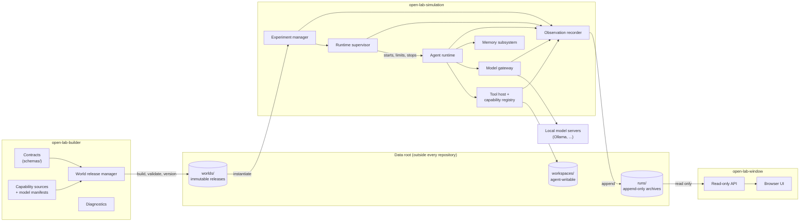
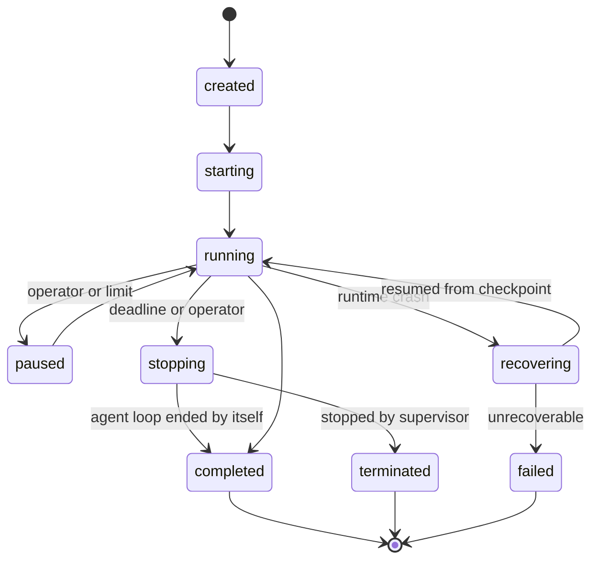
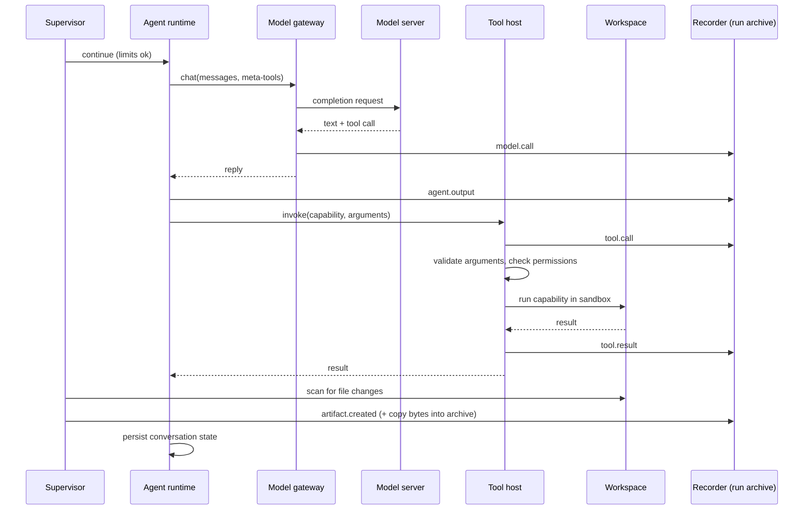
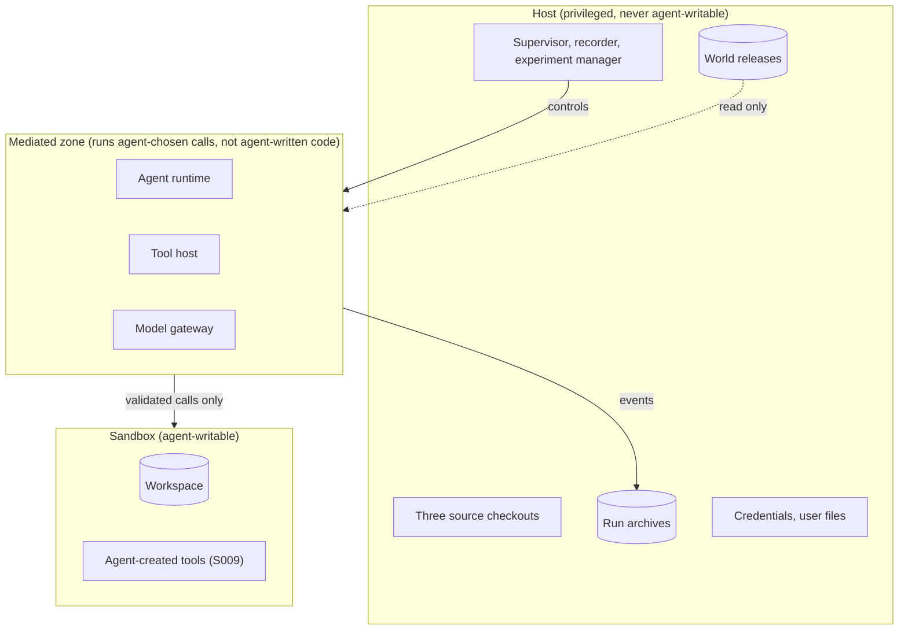

# Architecture

Active direction: [Habitat v2](../habitat/HABITAT_V2.md),
[ADR-0027](../decisions/ADR-0027-habitat-v2.md). S020a implements digest-bound scientific container images and package
discovery in Habitat 1.1.0. S020b adds licensed offline references, procedural
FFmpeg media and read-only WAV/WebM previews in Habitat 1.2.0. Optional local
text models are delivered in Habitat 1.3.0 (S021a); AI media remain planned. Three-repository ownership and existing isolation remain.
All further inhabitant simulations/experiments are suspended; offline component
verification replaces full-run demonstrations during development. S012-002
demonstrated sustained prompted activity; its historical report is preserved.

Status: established in S001. Implemented so far: the contracts, the builder
tooling, the world release manager (S002), the generated registry, documentation
and five simple capabilities (S005a), and in
`open-lab-simulation` the experiment manager, a minimal supervisor, the
recorder, the tool host and the agent loop (S003a), driven either by a
scripted stand-in or by one local model through Ollama's chat-completions
endpoint (S003b), now through four discovery meta-tools (S005b), with durable
memory/checkpoints (S006a), graceful deadlines (S006b) and opt-in bounded
recovery (S006d) and process resources/sampling (S006e), plus local gateway/catalog selection
(S007a). Other sections describe later designs. Each section says
which milestone delivers it.

Related: [CONTRACTS.md](CONTRACTS.md) · [OBSERVATION.md](OBSERVATION.md) ·
[SAFETY_AND_ISOLATION.md](SAFETY_AND_ISOLATION.md) ·
[decision records](../decisions/README.md)

S007e adds `models.ask` in minimal 0.7.0. Its reserved service invocation travels
over the runtime pipe to the supervisor-owned local gateway, never to a
capability subprocess. One asynchronous Ollama lease serves the pinned
specialist while hosted orchestration continues with the same conversation.
Limits, reservations, recording, expiry and segment cleanup remain outside
the agent. [ADR-0018](../decisions/ADR-0018-supervisor-specialist-consultation.md)
and the specialist protocol in CONTRACTS.md specify this boundary. Archived
0.6.0 remains runnable. Local orchestrator swapping is not implemented.

S021a extends this service to Habitat 1.3.0 container worlds: neutral models.list
and explicit models.ask selection from a frozen, permitted local catalog. The
supervisor repeats permission/schema/correlation checks and reserves calls before
HTTP. Single-owner residency, conservative context bounds, RAM/VRAM admission,
reported allocation checks and cancellable HTTP remain outside sandbox code.
The model server itself is outside container job ceilings; the lease is
cooperative, not hard VRAM isolation. No model receives tools or a runtime loop.
[ADR-0028](../decisions/ADR-0028-optional-local-assistants.md) defines this additive
protocol; S021b still owes isolated local visual workers.

S008c engineering adds `stats.describe` and `stats.regress` in minimal 0.8.0.
They are ordinary standard-library Python capabilities on the process tier,
accept bounded numeric data only, and require no filesystem, network, GPU or
subprocess permission. Their manifests define population variance, inclusive
quartiles and OLS-with-intercept edge cases. No agent-supplied code is executed.
The scripted acceptance path and four hosted capability-check archives verify.
Both tools were invoked and their results used under guidance; unguided C
regression use/result use occurred in 2/3 runs, description use in 0/3. These
are bounded observations, not a new autonomy GO. No runtime or schema changes.

S013 adds an experimental-readiness plan without changing implemented architecture:
[Autonomy and experimental readiness](AUTONOMY_AND_EXPERIMENTAL_READINESS.md),
[prospective baseline and validity gates](../experiments/README.md),
[ADR-0013](../decisions/ADR-0013-autonomy-as-an-experimental-objective.md).
The four development streams are conceptual, not new components/repositories.
Tool competence and uptime remain engineering outcomes, not evidence of autonomy.

S020a adds world-release 1.1.0's optional `environment.container_image` config
ID. The verified world selects the operator-provisioned image; Simulation checks
its local identity before allocation and never pulls. Existing worlds select
the original S006c image. Habitat 1.1.0 contains NumPy/SciPy/SymPy/mpmath/pandas/
Matplotlib/Pillow, with python.packages discovery and runner-owned headless
plot/cache/thread defaults. Execution remains network-free and container-only,
with explicit unchanged experiment resource authority. The evidence consists of
direct sandbox/tool-host/recorder component fixtures, never an inhabitant loop.
See [S020a evidence](../habitat/demos/S020a.md). The image requires this S020a
Simulation implementation; using an older runtime that ignores new semantics
is unsupported. No local or hosted inference was performed.

S020b packages immutable `library/` text/CSV assets with validated source hashes,
licences and citations. Ordinary library.search/read capabilities provide bounded
retrieval with no writable index or network. Python programs use installed
FFmpeg/ffprobe inside a new pinned image; no host media process or broker is
introduced. Window independently recognises bounded PCM WAV/WebM headers and
serves GET/HEAD byte ranges to native browser controls. It never converts, writes
or contacts Simulation. Direct media/recorder/checkpoint/lineage tests and a real
browser preview verify this chain without an inhabitant loop. See
[S020b evidence](../habitat/demos/S020b.md).

## 1. Three repositories, three roles

S016a adds procedural skill storage in Habitat 0.2.1: `skills.save/list/get`
are ordinary Builder capabilities, discovered by the existing meta-tools.
They store bounded, structured JSON notes under the agent-owned workspace
`.skills/` directory. Keyword listing and retrieval expose those notes without
executing them. The existing workspace checkpoint includes them; no new
runtime state or schema is needed. Agent provenance labels authored data,
not validated behaviour. See [the demonstration](../habitat/demos/S016a.md).

S016b adds opt-in `tools.create` in Habitat 0.3.0. The runtime validates bounded
declarative definitions and runs every supplied example through the existing
`python.run` container capability before registration. Generated agent manifests
join the same discovery interface; their pinned entry bytes, definitions and
digests survive the existing protected runtime checkpoint. Workspace source edits
cannot replace registrations. The runtime and supervisor never execute agent
source. Both target and Python runner retain normal permission and allow/deny
checks. No new network, GPU or host privileges are available. See
[ADR-0023](../decisions/ADR-0023-pinned-agent-tools.md) and the protocol in CONTRACTS.md.

S017 adds `world.observe/act/advance` in Habitat 0.4.0. Fixed, deterministic
coupled-field laws run only in the supervisor; the world release contains
manifests, not those laws or private state. The service binds each pipe request
to a permitted recorded call, journals/syncs a candidate transition, then commits
and acknowledges it. The supervisor inserts private state into the protected
runtime checkpoint component and strips it from worker resume data. Archive
verification independently replays the journal and checks checkpoint state.
Recovery can explicitly roll back post-checkpoint effects, retaining earlier
observations. See [the design](../habitat/PHENOMENA_V1.md) and
[ADR-0024](../decisions/ADR-0024-supervisor-phenomena.md).

S018 adds supervisor-time services in Habitat 0.5.0: `time.remaining` reads the
original active budget, and `time.sleep` requests a bounded wake under the new
`self-scheduled-v1` policy. Private wake state shares the protected runtime
checkpoint component; pending waits admit no model input and inject no message.
The operator can also start a new run with `ols run --from-run`: only protected
final workspace/memory data transfer from a verified completed source. A pinned
portable lineage manifest and parent child-reference sidecar link the runs;
existing parent logs/summary remain unchanged. Permissions, conversation, budgets,
private fields, wake schedules and trusted tool registrations start fresh. See
[ADR-0025](../decisions/ADR-0025-time-and-run-lineage.md).

S019 assembles these capabilities in Habitat **1.0.0**, retaining the same
22-capability interface and container boundary. The supervisor demonstration
combines file repair/reuse, memory, skills, validated tools, phenomena, waking,
checkpoint resume and data-only lineage in one release. The existing Window
reads the resulting events and artifacts without a new interface. See
[assembly evidence](../habitat/demos/S019.md). The
[S012 initial prompt](../habitat/S012_INITIAL_PROMPT.md) is owner-approved (ADR-0026); its single observation is
reported in [S012-001](../experiments/2026-11-16-s012-001.md);
engineering acceptance does not establish independent objective choice.

| | Builder | Simulation | Window |
| --- | --- | --- | --- |
| Verb | engineers | inhabits | observes |
| Owns | Contracts, capability sources, model manifests, world releases, architecture, roadmap | Experiment manager, agent runtime, tool host, model gateway, memory, supervisor, event recorder | Read-only API and browser UI |
| Writes | World releases | Run archives, workspaces | Nothing |
| Reads | The machine (diagnostics) | World releases | Run archives |
| Must never | Take part in a run | Be writable by the agent | Send anything into a run |

The repositories share **no code**. They share:

1. **Contracts** — JSON Schemas in this repository's `schemas/`, copied into
   every world release so that a release is self-describing.
2. **A data root** — a directory outside all three checkouts, located by the
   `OPEN_LAB_DATA` environment variable (default: `open-lab-data` in the home
   directory).

```
$OPEN_LAB_DATA/
  worlds/<world_id>/<version>/         world releases   (Builder writes; read-only afterwards)
  runs/<experiment_id>/<run_id>/       run archives     (Simulation infrastructure writes; never the agent)
  workspaces/<run_id>/                 agent workspaces (the only place an agent can write; disposable)
```



## 2. Subsystems

### World release manager — Builder (S002, implemented)

`olb world build` and `olb world verify`. The exact layout, digest algorithm
and invocation protocol are specified in
[CONTRACTS.md](CONTRACTS.md#world-release). Turns capability sources and model manifests into an immutable directory:

```
<world_id>/<version>/
  world-release.json        manifest (contract: world-release)
  contracts/v1/*.schema.json   the exact contract versions this world speaks
  capabilities/<id>/capability.json + implementation files
  models/<provider>.json
```

Build steps: validate every manifest, run every capability self-test, compute
per-file SHA-256 digests and an overall `content_digest`, set `status` to
`validated`. A release is never edited; a change is a new version. Failure
modes: a self-test fails (no release is produced), or a digest mismatch at
launch (the Simulation refuses to start).

### Capability registry — Builder defines, Simulation serves (S002, S005)

A capability is one directory with a `capability.json` manifest
([contract](CONTRACTS.md#capability)). The registry is the set of manifests in
a world release plus, later, tools the agent creates inside its own sandbox.

Implemented in S005a: build-time `registry/index.json`, full generated
`registry/docs/<id>.txt`, and pure-Python weighted keyword search in the Builder
(format and ranking in CONTRACTS.md). Minimal world 0.4.0 contains five
capabilities, including workspace text writing/listing and UTC time. The
Simulation serves the four meta-tools below (S005b); these are the only tools
presented to the model. Its generic system preamble names no world capability.
Search uses the bundled index, describe reads the generated documentation and
includes the input schema and a manifest-derived example call, demonstrate
executes a shipped example, and invoke validates and runs the actual tool.
Allow/deny lists and permissions apply to discovery as well as execution.

The agent's initial prompt does **not** list the tools. The runtime exposes
four fixed meta-tools, and everything else is discovered through them:

| Meta-tool | Purpose |
| --- | --- |
| `capabilities.search(query, category?)` | Ranked summaries from names, summaries, categories and keywords |
| `capabilities.describe(id)` | Full documentation, schemas, limitations, failure modes |
| `capabilities.demonstrate(id, demo_id?)` | Run a shipped demonstration and show input and real output |
| `capabilities.invoke(id, arguments)` | Validated call through the tool host |

This keeps the prompt constant as the world grows and makes discovery itself
observable behaviour. See [ADR-0003](../decisions/ADR-0003-capability-manifest.md).

### Model gateway — Simulation (S003b/S007a/S014/S007e)

Implemented so far (S003b): a single chat model client with tool calling,
tool-call repair, one retry, a context-length guard, and the model's identity
recorded in the archive. Only the four discovery meta-tools are offered (S005b).
S007e adds one supervisor-mediated local specialist beside a hosted orchestrator.
Local-orchestrator swapping and general multi-model memory scheduling remain future work.

Implemented S007a separates approved local orchestrator selection from world packaging
so matched comparisons can keep the world/registry fixed. Bundled manifests remain
the default; effective catalog/model/settings are frozen in each archive.
Hosted providers (ADR-0016, S014) are implemented and reached only through
a supervisor-owned broker that alone holds credentials and egress, reserves request
budgets before every attempt and never falls back to another model; provider
egress never implies tool-network permission. See CONTRACTS.md for
the implemented catalog protocol; effective server settings can remain unknown.

One internal interface for every model, whatever serves it. Request and
response use the OpenAI chat-completions shape, which Ollama, llama.cpp's
server and LM Studio all expose. Provider adapters translate anything else.
The supervisor gateway owns S007e's single specialist lease. It validates the
pinned model identity, refuses other resident models, loads on use and unloads
on expiry or segment exit. It translates the bounded chat request to native
Ollama chat to enforce finite keep-alive (ADR-0018). Orchestration calls retain
`model.call`; specialist calls/lease transitions use supervisor-owned observation
extensions described in CONTRACTS.md. Specialist failure consumes its reserved
call and returns an error, without retries or unloading unrelated models.

### Agent runtime — Simulation (S003)

A small, explicit loop — no agent framework ([ADR-0004](../decisions/ADR-0004-orchestration.md)):

```
state = load_or_create(conversation, memory)
loop:
    reply = gateway.chat(orchestrator_model, state.messages, tools=meta_tools)
    record agent.output
    for each tool call in reply: result = tool_host.invoke(...)   # records tool.call / tool.result
    append results to state; persist state
    if supervisor says stop: break
```

The runtime holds no authority. It cannot extend its deadline, change its
permissions or write to the run archive except through the recorder.

S007c adds selectable archived runtime policies, defaulting to the legacy
immediate continuation. The quiet alternative stops inference at its bounded
tool-free reply threshold, with no automatic wake until the active deadline.
Checkpoint state preserves counters and the idle latch; the existing supervisor
retains deadline/pause authority during idle. Exact outgoing requests and guard
mutations are recorded before each HTTP attempt, outside the agent workspace.
Memory retrieval remains explicit. See [Runtime policies](RUNTIME_POLICIES.md)
and [ADR-0016](../decisions/ADR-0016-versioned-runtime-treatments.md). Both policies
are treatments; neither is asserted neutral. S007d-001 is now complete with NO_GO; see the
[registered baseline report](../experiments/2026-11-14-autonomy-baseline.md).

S007d adds frozen campaign manifests, serialized append-only cell ledgers,
initial empty-workspace observations and source-bound derived analysis/rating.
A one-shot supervisor-owned D-arm fault intercepts an otherwise-permitted actual
execution after validation and before side effects. Injection, delivery and
exposure in a later model input are distinct observations. The first 24-cell
local baseline is reported with NO_GO; major expansion remains closed. No raw
archive is rewritten by analysis. The Window remains read-only and unchanged.

### Memory subsystem — Simulation (S006a)

Implemented in S006a, with the detailed protocol in
[ADR-0009](../decisions/ADR-0009-checkpoint-barriers-and-agent-memory.md).
Per-run and durable, in three parts: the **conversation state** needed to
resume the loop; an **agent memory store** (SQLite, exposed to the agent as
capabilities such as `memory.write` / `memory.search`); and the **workspace**
file tree. All three are snapshotted together as a checkpoint
([contract](CONTRACTS.md#checkpoint-metadata)) stored in the run archive, out of
the agent's reach.

Live agent memory is `.memory.sqlite` in the workspace, exposed through
`memory.write`, `memory.search` and `memory.list`. `NOTES.md` is the working-notes
convention. This refines ADR-0007's originally planned supervisor-area memory:
the live database is entirely agent-owned data; protected checkpoint copies
remain in the archive. No authority is read from memory.

The runtime blocks at complete-step barriers while the supervisor takes an
initial snapshot, interval snapshots when due, and pre-shutdown snapshots for
normal completion/cooperative operator pause. `ols resume <archive>` restores a
verified checkpoint and appends a recovery segment to the same event log.
Corrupt snapshots are rejected in favour of earlier valid ones. Existing
observations survive rollback; step/time budgets are not reset. Hard deadline
termination retains the previous safe snapshot. S006b implements
`checkpoint_then_stop` with a fixed additional grace allowance (default zero),
a complete-step snapshot and supervisor termination before acknowledging the
barrier. See [ADR-0010](../decisions/ADR-0010-bounded-deadline-checkpoints.md).
S006d adds opt-in bounded worker restarts and interrupted-run startup scanning,
with verified writer ownership, original budgets and model-health probes. See
[ADR-0011](../decisions/ADR-0011-bounded-supervisor-recovery.md). Resource
enforcement and sampling are implemented in S006e (ADR-0012).

### Runtime supervisor — Simulation (S003a/S006b/S006d/S006e)

Implemented: the CLI supervisor is a separate OS process and the parent of
the runtime; it owns the recorder, deadlines and process-tree termination.
Graceful deadlines are implemented in S006b. S006d implements bounded recovery,
stale-lock verification and model-health probes. `ols recover` is the explicit
startup scan for opted-in interrupted runs; it installs no OS startup task.
S006e implements aggregate Windows job memory/process-count/CPU ceilings,
supervisor workspace quota checks and periodic resource samples. The child
joins the configured job while suspended, before its launcher can spawn.
CPU controls govern cycles; samples measure active time. Disk quota checks can
overshoot during a write; they deny subsequent writing calls and terminate
observed in-flight overshoots. VRAM limits and unsupported platform limits are
refused. Available VRAM is an optional host-level observation. See
[ADR-0012](../decisions/ADR-0012-process-resources-and-sampling.md).
The supervisor does not read the agent's output to decide
anything: a limit is a limit regardless of what the agent says.



### Observation subsystem — Simulation writes, Window reads (S003a, S004)

Privileged components append [observation events](OBSERVATION.md) to
`events.jsonl` in the run archive. The agent has no handle on this file. A
SQLite index beside it is a rebuildable cache for queries (designed; nothing
writes it yet). Details and the integrity rules are in
[OBSERVATION.md](OBSERVATION.md).

The Window (S004) serves a read-only browser view of the archives: run list,
frozen configuration, paginated timeline, tool call and result pairs,
artifact previews and a live tail. It reads the files directly and keeps only
line offsets in memory; it does not need the SQLite index.

### Experiment manager — Simulation (S003a)

Takes an [experiment configuration](CONTRACTS.md#experiment-configuration), resolves
and verifies the world release, creates a new `run_id`, a fresh empty
workspace and a run archive containing frozen copies of the configuration and
the world manifest, then hands over to the supervisor. Two runs never share a
workspace or an archive.

## 3. One agent step



## 4. Trust boundaries



The agent is a model emitting text. Its only effects on the world are tool
calls that the tool host chooses to execute. The strength of the sandbox
around those executions is the isolation tier
([ADR-0006](../decisions/ADR-0006-isolation.md)).

## 5. Failure modes

| Failure | Detected by | Response |
| --- | --- | --- |
| Model server crash or hang | Gateway timeout | Retry with backoff; `error` event; after N failures supervisor pauses the run |
| GPU out of memory | Gateway load error | Unload other models, retry once, fail the call |
| Runtime process crash | Supervisor (child exit) | `recovery` event; restart from last checkpoint |
| Host reboot or power loss | Supervisor on next start | Run marked `recovering`; resume from last checkpoint; downtime excluded from elapsed time |
| Capability hangs | Tool host timeout | Kill the sandboxed process; `tool.result` with `timeout` |
| Agent fills the disk | Supervisor quota check | `supervisor.action: limit_enforced`; writes denied |
| Event log write fails | Recorder | Run is stopped: an unobserved run has no experimental value |
| World digest mismatch | Experiment manager | Launch refused |
| Deadline reached | Supervisor clock | Checkpoint (if configured), then kill; never negotiable |

## 6. Technology choices

Summarised here; reasoning and alternatives are in the
[decision records](../decisions/README.md).

| Concern | Choice |
| --- | --- |
| Language | Python 3.12, `uv`, minimal dependencies |
| Contracts | JSON Schema draft 2020-12, semantic versioning |
| Capability interface | Transport-neutral manifest; MCP is one projection |
| Orchestration | Small custom loop over chat-completions tool calling |
| Model serving | Ollama first, behind a provider-neutral gateway |
| Isolation | Two tiers: supervised process now, container before agent-written code |
| Durable state | Append-only JSONL as the record; SQLite for indexes and memory |
| Inter-component communication | Files under the data root; read-only local HTTP for the Window |
| Window front end | Standard-library HTTP server, JSON API, static HTML and JavaScript with no build step (ADR-0008) |

## Offline study evidence (S010a)

Builder defines two additive research schemas and the study protocol. Simulation
exports declared cells and verified stopped archives into a portable directory,
and verifies it without the original data root. This never launches a model,
imports Builder code or changes original records. See ADR-0019 and
[STUDY_PROTOCOL.md](../experiments/STUDY_PROTOCOL.md). Requested constants and
inventory findings are recorded facts, not causal comparability or autonomy
scores. S010b adds source-bound analysis below; Window comparison remains S010c.

## Source-bound study analysis (S010b)

Simulation derives deterministic JSON/Markdown reports from verified exports,
without writing to them or making model requests. Builder owns two additional
research formats (study-annotations and study-analysis) and the descriptive
rubric. Typed investigator descriptions/assessments and exact agent quotes have
validated log/sequence/artifact citations; they never enter observation records.
Reports retain every declared cell and group by role/condition, expose treatment
differences and unknown settings, and map all seven research gates to checks or
explicit external requirements. A report does not certify a launch GO or causal
matching. See ADR-0020 and [the protocol](../experiments/STUDY_ANALYSIS.md).
S010c may consume these files in the read-only Window; no Window code changed.
