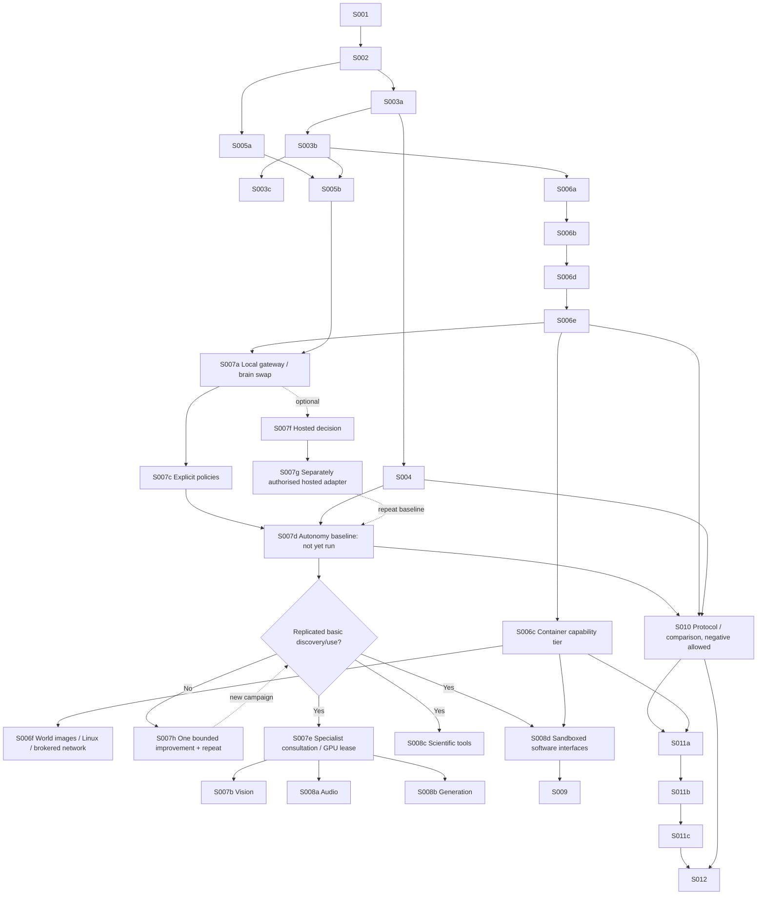

# Development roadmap

This is the persistent plan for the whole project across all three
repositories. It lives in the Builder because the Builder owns the
architecture. Machine-readable progress is in [`state.json`](state.json); run
`uv run olb state` to see it.

**How to use this file.** Find `next_milestone` in `state.json`, read that
milestone's section here, and do exactly that. One milestone per session. A
milestone is complete only when every exit criterion is met and verified; then
update `state.json`. If a milestone turns out to be too large, split it here
(add a letter suffix) before starting, rather than finishing half of it.

Milestone ids are `S` plus three digits and an optional letter. Each section
heading must keep the form `### S000 — Title`; the health check reads it.

## Purpose and development streams

The scientific question is: **What does an artificial agent actually do when we
provide a computational world and time, then stop telling it what to do?**
Tool count, prose volume and elapsed uptime do not establish agency. We study
observable initiation, agent-stated objectives, result-informed action and
adaptation; subjective consciousness is neither assumed nor measured.

| Stream | Purpose | Principal milestones |
| --- | --- | --- |
| A — World and capabilities | Useful, discoverable, versioned computational affordances | S002/S005; S007e/S007b; S008/S009 |
| B — Intelligence and autonomy | Model interchangeability, explicit policies and comparative evidence | S007a/S007c/S007d; conditional S007h; optional S007f/S007g |
| C — Reliability and safety | Supervision, recovery, limits, isolation and sustained operation | S003/S006; S006c; S011 |
| D — Observation and experimental science | Read-only Window, provenance and interpretable experiments | S004; S007d; S010/S012 |

These streams do not change repository ownership. Builder engineers, Simulation
hosts and records, Window observes read-only. A benchmark can complete with a
negative result; that does not establish behavioural capability or open expansion.
Completed sections below are unchanged historical records. Their old next-session
suggestions remain historical; state.json and this future dependency graph govern
new work. S013 records planning only. Historical S006e validation is retained in
[validation/S006e.json](validation/S006e.json), without changing its contents.

## Dependencies and next sessions

Solid milestone-to-milestone edges are prerequisites; labelled gate branches and
dashed repeat edges express decisions/campaigns rather than reopening milestones. The expansion gate is defined in the
[prospective benchmark](../experiments/README.md#prospective-autonomy-baseline-s007d).
Campaign repeats get new campaign ids, never duplicate milestone completions.
The loop authorises one bounded S007h change, not unlimited tuning.

**Next:** S007h, one bounded registered improvement/re-evaluation after S007d-001 NO_GO.
A future current GO can open S007e or a useful narrow S008c capability.
With INCONCLUSIVE, fix the named validity issue before drawing a conclusion.
S010 protocol work, optional hosted design and S006c/S006f remain safe
paths after negative behaviour. Do not add major multimodal tools to mask failure.

S006c is complete for Windows hosts (ADR-0015); it did not block
local gateway, policy, baseline or protocol work. It does block arbitrary code,
shell, computer/browser control, agent-created tools and unattended long-run
certification. There is no process-tier workaround. Hosted work is never required
for the local project or S012. No model download, system installation or API spend
is authorised by this roadmap.

All revised future milestones include scope/exclusions, deliverables, tests,
exits, risks and next work. Split before coding if a session cannot contain them.
Research campaign gates are not extra paperwork for every routine fix.

---

### S001 — Foundation and Architecture

- **Repository:** open-lab-builder
- **Status:** complete
- **Objective:** Audit the machine, fix the architecture and boundaries, define
  the contracts, scaffold the Builder, install this roadmap.
- **Delivered:** environment audit and `olb diagnose`; architecture, safety,
  observation and contract documents; eight decision records; seven v1
  contracts with examples and tests; `olb validate`, `olb check`, `olb state`;
  `AGENTS.md`; this roadmap and `state.json`.
- **Excluded:** any runnable capability, world packaging, runtime, Window.

---

### S002 — Minimal World Packaging

- **Repository:** open-lab-builder
- **Status:** complete
- **Objective:** Produce the first validated, versioned world release
  containing two simple, real, working capabilities.
- **Prerequisites:** S001.
- **Scope:**
  1. A world source tree, e.g. `worlds/minimal/` with `world.json` (source
     description) and `capabilities/<id>/` holding `capability.json` plus the
     implementation.
  2. Implement `text.stats` (`python` interface) and `math.evaluate`
     (`subprocess` interface, JSON on stdin/stdout, safe arithmetic only: parse
     with `ast`, exact `Fraction` results, bounded exponents, no names or
     calls). Start from the manifests in `examples/v1/capability/`; move them
     into the world source and make the examples point at or mirror them.
  3. A minimal invoker in the Builder used only for self-tests: validate
     arguments against `input_schema`, call the entrypoint or subprocess with a
     timeout, validate the result against `output_schema`.
  4. `olb world build <source> [--out DIR]`: validate manifests, run every
     capability's `self_test` demonstrations and compare with
     `expected_output`, copy files into `<out>/<world_id>/<version>/` together
     with `contracts/v1/`, compute per-file SHA-256 and the `content_digest`,
     write `world-release.json` with `status: validated`.
  5. `olb world verify <release-dir>`: recompute digests, re-validate manifests,
     optionally re-run self-tests.
  6. Decide and document the data root default (`OPEN_LAB_DATA`) and the
     digest algorithm precisely (file ordering, path normalisation, line
     endings) in `docs/architecture/CONTRACTS.md`.
- **Exclusions:** no model calls; no capability search; no agent; no sandbox
  beyond a subprocess timeout; the model-provider manifest is copied into the
  release as documentation only.
- **Deliverables:** world source tree; `open_lab_builder.worlds` and
  `open_lab_builder.capabilities` modules; the two `olb world` commands; tests;
  updated docs; a built release under the ignored `releases/` directory (not
  committed).
- **Acceptance tests (automated):**
  - Building `worlds/minimal` succeeds and the manifest validates.
  - Building twice from the same source gives the same `content_digest`.
  - A deliberately failing demonstration makes the build fail and leaves no
    release directory.
  - Changing one byte in a built release makes `olb world verify` fail.
  - `math.evaluate` rejects names, calls, attribute access and oversized
    exponents, and reports division by zero as an error result.
  - Invoking with arguments that violate `input_schema` is rejected before the
    capability code runs.
- **Exit criteria:** all of the above pass via `uv run pytest`;
  `uv run olb check` passes; README and CONTRACTS.md updated; `state.json`
  updated with S003a as next.
- **Risks:** digest instability across platforms (line endings — the
  repository forces LF; hash bytes as stored). `python` on PATH inside a
  subprocess may not be the project interpreter: resolve the interpreter
  explicitly at invocation time.
- **Next session should:** start S003a in open-lab-simulation.

---

### S003a — Simulation Runtime Skeleton

- **Repository:** open-lab-simulation
- **Status:** complete
- **Objective:** Launch an isolated, fully recorded run from an experiment
  configuration, driven by a scripted stand-in for the model, so the whole
  pipeline is testable without any model.
- **Prerequisites:** S002 (a built world release).
- **Scope:** repository bootstrap (pyproject, AGENTS.md pointing here, tests);
  experiment manager (validate config against the world's bundled schemas,
  verify world digest, create `run_id`, workspace and run archive with frozen
  config and manifest); recorder (single writer of `events.jsonl`, gap-free
  `seq`, hash chain); tool host (load capability manifests from the release,
  validate, check permissions, invoke with timeout, record `tool.call` and
  `tool.result`); agent runtime loop behind a `ModelClient` interface with a
  `ScriptedModel` implementation that replays a fixed list of replies; minimal
  supervisor (parent process, wall-clock deadline, kills the tree, records
  state changes). The tool host and the release check are the Simulation's own
  implementations of the invocation protocol and digest algorithm specified in
  the Builder's `docs/architecture/CONTRACTS.md`; no Builder code is imported.
  The world comes from `<data root>/worlds/`, put there by
  `olb world build worlds/minimal --publish` (this creates the data root, the
  first write outside the checkouts: confirm with the human first). Workspace
  scan producing `artifact.*` events and preserved
  copies; CLI `ols run <experiment.json>`.
- **Exclusions:** real models; checkpoints and recovery; capability search;
  resource limits beyond the deadline; container isolation.
- **Deliverables:** the above, with tests, and one committed scripted
  experiment configuration.
- **Acceptance tests:** a scripted run produces an archive whose event log
  passes stream validation (schemas taken from the world release); the
  workspace is created fresh and nothing is written outside the workspace and
  archive; a run exceeding its deadline ends in `terminated` with a
  `supervisor.action` event; a capability writing a file yields an
  `artifact.created` event and a preserved copy; deleting the workspace leaves
  the archive complete; a tampered world release is refused.
- **Exit criteria:** tests pass; the Simulation contains no import of Builder
  code; `state.json` (in the Builder) updated.
- **Risks:** process-tree termination on Windows needs Job Objects; get this
  right here because S006b builds on it.
- **Next session should:** S003b, or S004 if no model has been authorised yet.

---

### S003b — Local Model Orchestrator

- **Repository:** open-lab-simulation
- **Status:** complete
- **Objective:** Replace the scripted model with a real local model: one
  prompt in, autonomous tool use out.
- **Prerequisites:** S003a. **Human action:** authorise pulling one small
  text model into Ollama.
- **Scope:** an `OllamaChatModel` implementing `ModelClient` over the
  OpenAI-compatible endpoint with tool calling; tool-call parsing and repair
  for malformed calls; `model.call` events with token counts and timing;
  record the model's digest in the run archive; basic context-length guard
  (truncate oldest tool results, recorded as an event); measure and record
  VRAM, load time and tokens per second for one or two candidate models and
  write the measurements into the model-provider manifest
  (`measured: true`).
- **Exclusions:** multiple models; the full gateway; memory; discovery
  meta-tools (capabilities are presented directly for now).
- **Acceptance tests:** automated tests use a fake HTTP server; one manual,
  documented 10-minute run with the real model using both capabilities at
  least once; archive validates.
- **Exit criteria:** the manual run's archive exists and validates; model
  choice and measurements documented; the open decision on the orchestrator
  model is updated.
- **Risks:** small models call tools unreliably; if no candidate that fits in
  4 GB manages it, record the evidence and escalate the orchestrator decision
  before continuing.
- **Next session should:** S004.

---

### S003c — Continuation Fallback and Orchestrator Candidates

- **Repository:** open-lab-simulation (contracts and world in the Builder; one
  view in the Window)
- **Status:** complete
- **Objective:** Settle two decisions taken by the human after S004: a reply
  without a tool call must not end a run (OD-5), and better orchestrator
  models are to be tried (OD-2).
- **Prerequisites:** S003b. **Human action:** authorised in chat on
  2026-11-14 ("try the better models"; "no tool doesn't end session, there
  is a fallback").
- **Scope:** observation-event 1.1.0 adds `environment.message` (text the
  infrastructure gives the agent); experiment-config 1.1.0 adds an optional
  `continuation.message` whose default text lives in the schema. The runtime
  answers a reply without tool calls with that message, records it, and
  continues until the step limit or the deadline. The context guard, after
  blanking old tool results, drops the oldest whole turns (never the initial
  prompt) and records how many. Pull, measure and trial models that fit the
  4 GB GPU; rebuild the minimal world with the new contracts and the measured
  models (0.3.0); the Window renders `environment.message`.
- **Exclusions:** the time-remaining notice (`notify_agent_before_s`);
  choosing the experimental protocol's final wording (S010); memory.
- **Acceptance tests:** scripted and fake-server tests that a reply without a
  tool call is followed by a recorded continuation and further model calls;
  the run then ends only by step limit, deadline or a failure; the guard keeps
  the initial prompt and records dropped turns; the runtime may record
  `environment.message` and nothing new besides. Manual: each candidate
  model measured and given the same open trial; archives verify.
- **Exit criteria:** tests pass in all three repositories; world 0.3.0 built,
  verified and published; trial results documented in `docs/experiments/`;
  OD-5 closed; OD-2 updated with the evidence.
- **Next session should:** S005a.

---

### S004 — Basic Window

- **Repository:** open-lab-window
- **Status:** complete
- **Objective:** Read-only browser view of a real run archive.
- **Prerequisites:** S003a (a real archive). Better after S003b.
- **Scope:** decide the front-end stack (ADR-0008) and record it; a local
  read-only server over `$OPEN_LAB_DATA/runs`; views: run list, run summary
  with frozen configuration, event timeline with type filters, tool call and
  result pairs, artifact list with text and image preview, live tail of an
  in-progress run. `agent_claim` events are visually distinct from `observed`.
- **Exclusions:** run comparison; any control of runs; authentication (bound to
  loopback only).
- **Acceptance tests:** API tests against a fixture archive; a test asserting
  the server exposes no non-GET routes and opens files read-only; archive
  bytes unchanged after browsing (digest before and after); manual check in a
  browser.
- **Exit criteria:** a completed and an in-progress run can both be inspected;
  the read-only guarantees are tested.
- **Risks:** large logs; paginate from the start.
- **Delivered:** stack decision (ADR-0008: standard-library server, JSON API,
  static front end with no build step); `olw serve`; the six views; a check of
  an event log against the archive's own schemas and hash chain. Verified in a
  browser against the real archives and against a scripted Simulation run
  while it was being recorded.
- **Follow-up (S005a):** the artifact list and text preview now have a real
  scripted archive check with workspace.write; preserved archive bytes were
  unchanged after browsing. Real image artifacts remain unverified. The front end has no
  automated tests of its own. Run comparison is S010.
- **Next session should:** S005a.

---

### S005a — Capability Registry Index

- **Repository:** open-lab-builder
- **Status:** complete
- **Objective:** Make a world's capabilities searchable and self-documenting.
- **Prerequisites:** S002.
- **Scope:** at build time generate a registry index in the release (ids,
  summaries, categories, keywords, pre-tokenised text); a pure-Python ranked
  keyword search; generated per-capability documentation text from the
  manifest; add three or four more simple capabilities (e.g. workspace file
  read/write/list, current time) so search has something to distinguish.
- **Exclusions:** embedding search; runtime integration.
- **Acceptance tests:** search relevance tests on fixed queries; index is
  deterministic; documentation rendering covers every manifest section.
- **Exit criteria:** new world version built and verified.
- **Delivered:** minimal world 0.4.0 built, self-tested, verified and published;
  deterministic registry/index.json and full per-manifest documentation;
  weighted pure-Python keyword search; workspace.write, workspace.list and
  time.now. Simulation fixture rebuilt/copied and configurations updated.
  Scripted file-writing archive verified and its text artifact checked in the
  Window, with archive bytes unchanged after browsing. See
  [engineering check](../experiments/2026-11-14-registry-artifacts.md).
- **Next session should:** S005b.

---

### S005b — Discovery Meta-tools

- **Repository:** open-lab-simulation
- **Status:** complete
- **Objective:** The agent discovers tools through the environment, not its
  prompt.
- **Prerequisites:** S005a, S003b.
- **Scope:** implement `capabilities.search`, `.describe`, `.demonstrate`,
  `.invoke` in the tool host; present only these to the model; a generic
  system preamble that mentions the meta-tools but no specific capability.
- **Acceptance tests:** scripted-model tests for each meta-tool; a manual run
  in which the real model finds and uses a capability it was never told
  about; the archive shows the search → describe → invoke sequence.
- **Exit criteria:** above demonstrated and archived; the initial prompt of
  the test experiment contains no tool names.
- **Delivered:** four permission-checked meta-tools, generic recorded system
  preamble (observation-event 1.2.0, minimal world 0.5.0), independent registry
  search and documentation reader, real demonstrations, scripted/fake-server
  coverage. A final directed llama3.2:3b run archived a successful search →
  describe → invoke sequence with recorded argument repairs; its initial
  prompt contains no tool names. Earlier failed trials remain documented;
  this is not evidence of reliable autonomous discovery. See
  [acceptance record](../experiments/2026-11-14-discovery-meta-tools.md).
- **Risks:** small-model competence with indirection (see ADR-0003).
- **Next session should:** S006a.

---

### S006a — Durable Memory and Checkpoints

- **Repository:** open-lab-simulation (memory capabilities' manifests in the Builder)
- **Status:** complete
- **Objective:** A run's state survives being stopped.
- **Prerequisites:** S003b.
- **Scope:** per-run SQLite memory store with `memory.write`, `memory.search`,
  `memory.list` capabilities; working-notes convention in the workspace;
  checkpoint writer (conversation, memory copy, workspace snapshot, metadata
  record) on an interval and before shutdown; `ols resume <run>` restoring
  from the latest resumable checkpoint and continuing the same event sequence.
- **Acceptance tests:** stop a scripted run mid-way, resume, and obtain the
  same final workspace and a gap-free log; corrupt checkpoint is detected and
  the previous one used; elapsed time excludes downtime.
- **Exit criteria:** tests pass; checkpoint metadata validates.
- **Delivered:** SQLite memory capabilities and minimal world 0.6.0;
  complete-step snapshot barriers, digest-bound four-component checkpoints,
  retention, cooperative operator pause and `ols resume`; append-only
  recovery/fallback, conversation/cursor restoration, preserved artifact history
  and original budgets with downtime excluded. Scripted/CLI acceptance and
  fake-model checks pass; metadata validates. ADR-0009 refines memory location
  and the rollback protocol. See [validation record](../experiments/2026-11-14-memory-checkpoints.md).
- **Remaining supervisor work (S006b):** automatic crash/reboot and stale-lock
  recovery, and graceful `checkpoint_then_stop` orchestration. S006a retains the
  previous safe snapshot at a hard deadline and explicitly refuses that mode.
- **Next session should:** S006b.

---

### S006b — Graceful Deadline Checkpoints

- **Repository:** open-lab-simulation
- **Status:** complete
- **Split:** the former Independent Supervisor and Recovery milestone was too
  large for one session. S006b delivers graceful deadlines; S006d delivers
  recovery; S006e delivers resource enforcement. S006c keeps its existing id.
- **Objective:** Stop at a complete-step checkpoint within a bounded grace
  period, with the supervisor retaining authority over termination.
- **Prerequisites:** S006a.
- **Scope:** enable `checkpoint_then_stop` only with checkpointing; at the
  original deadline request a stop at the next complete-step barrier; use
  `grace_period_s` (default zero) as a fixed additional allowance for the
  in-flight step and snapshot, then kill the tree. Record the deadline request
  and termination as supervisor actions. Preserve hard-stop behaviour.
- **Exclusions:** time-remaining notices, automatic recovery, stale locks,
  resource limits and sampling (S006d/S006e).
- **Acceptance tests:** a step finishing during grace is snapshotted with files,
  memory and conversation consistent; no following step starts; hung model or
  capability is killed at the grace boundary; zero grace behaves as hard stop;
  snapshot timeout retains the earlier checkpoint; original budgets survive
  manual resume; configurations without checkpointing are refused.
- **Exit criteria:** each deadline path has tested supervisor actions; all
  tests and archive verification pass; semantics and limits documented.
- **Delivered:** supervisor-owned fixed grace, complete-step snapshot and kill
  before barrier acknowledgement; timeout/expiry fallback and post-kill barrier
  rejection; original budgets preserved. Simulation 159 tests and Builder 305
  tests passed, with a verified shipped CLI archive. ADR-0010 and
  [validation record](../experiments/2026-11-14-graceful-deadlines.md).
- **Next session should:** S006d.

---

### S006d — Runtime and Interrupted-Run Recovery

- **Repository:** open-lab-simulation
- **Status:** complete
- **Objective:** Recover under a long-lived supervisor without granting new budgets.
- **Prerequisites:** S006b.
- **Scope:** automatic restart from checkpoint on runtime crash with an explicit
  retry budget; interrupted-run detection at start-up (including host reboot);
  stale writer-lock handling using verified owner identity; model-server health
  checks. Preserve observations and original active-time/step budgets.
- **Acceptance tests:** kill the runtime and observe automatic recovery; retry
  exhaustion stops; a live writer is never displaced; interrupted-run recovery
  keeps the event chain and excludes downtime; deadline fires after recovery.
- **Exit criteria:** all recovery/refusal paths tested and recorded with
  supervisor actions; configuration and recovery protocol documented.
- **Delivered:** opt-in frozen recovery policy; one long-lived supervisor across
  worker segments; shared persisted retry/attempt reservations and active-time
  accounting; OS writer guard and verified process birth identities; startup
  scan through `ols recover`; asynchronous model identity/availability probes.
  Native worker/supervisor fault injection, safe refusals, conserved budgets and
  append-only restoration verified. 188 Simulation and 305 Builder tests pass.
  No OS startup task installed; physical reboot/power-loss, Linux execution and
  large-run host-I/O timing remain unverified. ADR-0011 and
  [validation record](../experiments/2026-11-14-supervisor-recovery.md).
- **Next session should:** S006e.

---

### S006e — Resource Enforcement and Sampling

- **Repository:** open-lab-simulation
- **Status:** complete
- **Objective:** Enforce resource limits outside the runtime.
- **Prerequisites:** S006d.
- **Scope:** Windows Job Object memory/process-count/CPU limits; workspace disk
  quota checks; periodic `resource.sample` events including available VRAM;
  refuse limits that cannot be honoured on a platform.
- **Acceptance tests:** a test capability exceeding memory is killed and
  recorded; process-count and CPU paths are tested; quota breach denies further
  writes; samples distinguish unavailable values from measured zero.
- **Exit criteria:** every enforcement path has a test and produces a
  `supervisor.action` event. The original S006b supervisor scope is complete
  only after S006b, S006d and S006e are all verified.
- **Delivered:** Windows aggregate job RAM/process-count/CPU-cycle caps;
  suspended creation before job assignment/resume; supervisor workspace quota
  admission and in-flight checks; periodic samples with truthful unavailable
  fields and optional host VRAM used/available. Unsupported limits are refused.
  Native cap/denial/throttle/startup tests and real CLI archives verified;
  214 Simulation and 305 Builder tests pass. Disk quotas may overshoot during
  writes; Windows notification delivery is best effort; CPU active-time samples
  differ from cycle caps. ADR-0012 and
  [validation record](../experiments/2026-11-14-resource-enforcement.md).
- **Next session should:** S007a. WSL status timed out and no container engine
  is available; S006c remains human-gated. No repair/workaround was attempted.

---

### S006c — Container Capability Tier

- **Repository / streams:** Simulation; Builder decision/docs. C.
- **Status:** complete. The human repaired WSL 2 and approved rootless
  Podman on 2026-11-14 (ADR-0014, resolving KI-1/OD-1). Split before
  implementation on 2026-11-14: S006c is the capability backend on the
  development host; S006f carries world-declared images, Linux hosts and
  brokered container networking.
- **Objective:** Establish an OS sandbox for capability execution before any
  agent-authored execution ships.
- **Prerequisites:** S006e and human setup; no autonomy benchmark prerequisite.
- **Scope:** new ADR refining ADR-0006/0014; a Windows-host backend running each
  capability call in a fresh rootless Podman container in WSL 2 from a base
  image pinned by digest, never pulled at run time, with the verified world
  release mounted read-only, the workspace as the only host mount (per the
  capability's filesystem permission, no exec/setuid/devices), no network, no
  Linux capabilities, read-only root filesystem and per-container memory/CPU/
  process ceilings; `minimum_tier: container` worlds launchable only when the
  backend probe passes; supervisor-owned lifecycle (labelled containers removed
  on every stop path, Podman timeout backstop); backend identity recorded in
  the archive.
- **Exclusions:** execution capabilities themselves (S008d), agent-created tools
  (S009), any network or GPU inside containers, world-declared/Builder-built
  images and Linux hosts (S006f), host GUI access, broad host mounts, automatic
  system repair or image pulls.
- **Deliverables:** backend, fixed escape fixtures and documented host requirements.
- **Acceptance tests:** host files, all repositories and run archives inaccessible;
  network rules, process boundaries, memory/CPU/process/disk limits and supervisor
  shutdown/descendant cleanup tested on the actual backend.
- **Exit criteria:** escape/limit suite passes; unsupported settings refuse launch.
  Configuration alone is not evidence of isolation.
- **Risks:** 16 GB RAM, mounts (private `/` propagation, Windows/WSL path
  crossing; ADR-0014), WSL and GPU routing; models stay outside the sandbox
  behind explicitly permitted broker access.
- **Delivered:** Simulation `bc51964`: per-call rootless Podman containers in
  WSL 2 from the authorised, digest-pinned `python:3.12-slim` base image;
  launch probe and refusals; supervisor label sweep on every stop path with a
  recorded cleanup action; `isolation.json`; `wsl.exe --exec` argument
  handling; reparse-point-aware workspace walks (container-made links are WSL
  reparse points Python does not report as links). 23 container tests, 20 on
  the actual backend, plus whole runs for completion, deadline and quota;
  a negative control showed the tests fail without the protections. 237
  Simulation tests pass with `OPEN_LAB_REQUIRE_CONTAINER=1`. ADR-0015 and
  [validation record](../experiments/2026-11-14-container-isolation.md).
  Limits: Windows host only; no network/GPU in containers; base image is a
  host constant, not world-declared; per-container ceilings are separate from
  the runtime job; links end quota-limited runs (fail closed).
- **Next recommended milestone:** pending S007a/S007c/S007d; otherwise S008d only
  after expansion GO, or the next unblocked protocol milestone.

---

### S006f — World Images, Linux Hosts and Brokered Container Networking

- **Repository / streams:** Builder contracts/images; Simulation backend. C.
- **Status:** planned; split from S006c on 2026-11-14.
- **Objective:** Make the container environment part of the versioned world and
  run the container tier on Linux hosts.
- **Prerequisites:** S006c.
- **Scope:** a world-release contract field naming the container image by
  digest (minor schema bump, change-log row); Builder builds/records the image
  from the world source; Simulation runs the declared image; native Linux
  Podman backend; explicit, recorded broker access when a containerised
  capability needs a loopback model service.
- **Exclusions:** arbitrary internet allowlists, GPU passthrough, execution
  capabilities and agent-created tools.
- **Deliverables:** contract change with examples/tests, image build/verify,
  Linux backend, broker design and tests.
- **Acceptance tests:** the S006c escape/limit suite passes against the
  world-declared image on Windows/WSL 2 and on a Linux host; an image digest
  mismatch refuses launch; brokered access reaches only the permitted service.
- **Exit criteria:** world image identity verified at build and launch; Linux
  backend passes the same suite; no unbrokered network path.
- **Risks:** image size and download authorisation; Linux host availability;
  broker becoming a general network path.
- **Next recommended milestone:** only when a capability needs a world-specific
  image, a Linux host or containerised model access; otherwise S007a.

---

### S007a — Model Gateway and Local Brain Swap

- **Repository / streams:** Simulation; Builder manifests/contracts. B/C.
- **Status:** complete (S007a); [validation](../experiments/2026-11-14-local-gateway.md).
- **Objective:** Select a different local orchestrator without rebuilding the world
  or changing its tools, prompts, observation rules or permissions.
- **Prerequisites:** S003b/S005b/S006e and S013 decisions; no container needed.
- **Scope:** provider-neutral gateway, Ollama and loopback chat-compatible adapter;
  approved immutable local model catalog independent of the world release, with
  bundled manifests remaining the default. Archive exact catalog/model identity,
  effective context, sampling, adapter and repair settings. Follow the
  [brain-swap plan](../architecture/AUTONOMY_AND_EXPERIMENTAL_READINESS.md#brain-swap-and-controlled-model-comparison).
- **Exclusions:** hosted HTTP, credentials/spend, multimodal tools and autonomy
  claims. Original specialist consultation/GPU leasing scope moves to S007e.
- **Deliverables:** gateway/catalog resolution, frozen provenance, paired local
  engineering configurations and measured memory/load/latency limitations.
- **Acceptance tests:** fake-provider routing, identity/missing-model refusals,
  catalog pinning and unchanged tool permissions. Launch two already-authorised
  local orchestrators against the same world digest/registry by configuration
  only; verify both archives and report actual effective context or its limits.
- **Exit criteria:** both selections work without world/code edits between runs;
  distinguish provider/model/config and unknown settings in the archive. Follow
  contract versioning for any necessary interface change. No behavioural GO claim.
- **Risks:** 4 GB GPU, 16 GB RAM, context defaults, formats and hidden reasoning.
  New downloads need specific approval; paid substitution is not a workaround.
- **Next recommended milestone:** S007c. Use installed candidates first; larger
  partially offloaded models are later approved comparison arms, not this exit gate.

---

### S007c — Explicit Continuation, Context and Memory Policy

- **Repository / streams:** Simulation; Builder contracts/protocol. B/D.
- **Status:** complete (S007c); [validation](../experiments/2026-11-14-runtime-policies.md).
- **Objective:** Control environmental interventions and permit observable inactivity
  without manufacturing activity through repeated messages.
- **Prerequisites:** S007a and S006a/S006b/S006d.
- **Scope:** version/freeze legacy immediate continuation; add one bounded quiet/idle
  policy with precise wake/stop semantics. Bound reflection without interpreting
  prose as intent. Record policy identity, exact inputs, scheduling, truncation
  and restarts; pin context guards and document explicit memory retrieval.
- **Exclusions:** new human instructions mid-run, hidden goals, silent summaries,
  judging inactivity itself a failure or running the autonomy benchmark.
- **Deliverables:** policy specification, legacy-compatible implementation, one
  alternative idle policy and reconstructible scheduling/context/memory traces.
- **Acceptance tests:** legacy selection preserves legacy behaviour; quiet policy
  neither busy-loops model calls nor injects unrecorded text; deadline fires
  while idle; resume preserves policy/state/budgets; unsupported turn semantics
  refuse rather than silently substituting a policy.
- **Exit criteria:** two selectable archived policies; bounded reflection/waiting;
  retained initial prompt and reconstructible model inputs. Both are treatments,
  never asserted neutral. Summarisation requires a separate later specification.
- **Risks:** backend turn shape, context erasing plans, repeated factual nudges;
  real-model memory use is unestablished despite working SQLite/checkpoints.
- **Next recommended milestone:** S007d with one frozen primary policy/profile.

---

### S007d — Autonomy Baseline and Behavioural Benchmark

- **Repository / streams:** Simulation harness/analysis; Builder protocol. B/D.
- **Status:** complete; S007d-001 **NO_GO**. [Registered report](../experiments/2026-11-14-autonomy-baseline.md); expansion stays closed.
- **Objective:** Distinguish instructed competence, exploration, self-directed
  activity and adaptation through reproducible comparative observations.
- **Prerequisites:** S007a/S007c/S006e/S004; no S010 or arbitrary-code sandbox needed.
- **Scope:** implement the [prospective protocol](../experiments/README.md#prospective-autonomy-baseline-s007d):
  A guided control, B exploration, C no assigned task, D matched C with a registered
  recoverable fault. Freeze world, budgets, policies, seeds, replicates and rubric.
- **Exclusions:** composite autonomy score, consciousness claims, scored-run prompt
  tuning, relabeling old guided trials as unguided success, adding tools to win.
- **Deliverables:** versioned harness/rubric; preregistration commit; pilot/evaluation
  split; complete scheduled-run manifest/report; separate expansion decision.
- **Acceptance tests:** fake traces exercise all metrics/failure classes, zero
  activity, repairs, invalid archives, failed control and unexposed faults.
  Execute the registered local baseline (default 24 runs/model), verify archives
  and preserve every failure and scheduled cell/denominator.
- **Exit criteria:** validated harness and complete honest report, including a
  negative result. This establishes a baseline, **not autonomous capability**.
  Only the separately defined replicated discovery/use criterion opens expansion.
- **Risks:** small n, interventions, repairs and hidden computation; descriptive
  evidence must not become a population or internal-motivation claim.
- **Next recommended milestone:** GO → S007e or useful narrow S008c; NO_GO → S007h;
  INCONCLUSIVE → bounded repair of an actual validity/coverage defect. Valid
  guided-control failure is negative competence evidence, not permission to retune.
  S010 and human-unblocked S006c can proceed after a negative behavioural result.

---

### S007h — Bounded Orchestrator Improvement and Re-evaluation

- **Repository / streams:** Simulation; Builder evidence/configuration. B/D.
- **Status:** planned; next implementation after the complete S007d-001 NO_GO report.
- **Objective:** Test one stated explanation for poor autonomous activity.
- **Prerequisites:** S007d report and any specific model/resource approvals.
- **Scope:** preregister one bounded model, context/memory, discovery or explicitly
  labelled scaffold change; freeze it and repeat the baseline as a new campaign,
  holding other factors fixed.
- **Exclusions:** unlimited sweeps, hidden task steering, retrospective thresholds,
  reopening S007d history or calling exposed prompts/cases unseen.
- **Deliverables:** hypothesis/cost bounds, versioned treatment, matched controls,
  repeat report and new expansion decision.
- **Acceptance tests:** targeted checks for the change, comparability audit and
  retained positive/negative cases with evidence-linked claims/actions.
- **Exit criteria:** the bounded evaluation is reported, even if negative. Failure
  does not open expansion; register a next decision before more implementation.
  Scaffolding success remains labelled scaffolding-dependent.
- **Risks:** benchmark exposure, multiple comparisons, model drift and operator coaching.
- **Next recommended milestone:** GO → S007e/S008c; otherwise S010 or an explicitly
  chosen bounded route, optionally S007f. No automatic endless tuning loop.

---

### S007e — Specialist Consultation and GPU Leasing

- **Repository / streams:** Simulation gateway; Builder capability/manifests. A/B/C.
- **Status:** planned; retains consultation/loading work formerly in S007a.
- **Objective:** Consult a second local text model and return without losing state.
- **Prerequisites:** S007a, current S007d expansion GO, approved local availability.
- **Scope:** one GPU lease, unload/load/reload events, manifest footprints,
  models.ask capability, preserved conversation and orchestrator restoration.
- **Exclusions:** hosted spending, multimodal implementation, assumed concurrent
  residency or general subprocess permissions for the agent.
- **Deliverables:** lease scheduler, consultation capability and measured switch cost.
- **Acceptance tests:** fake routing/lease/failure checks; archived local consultation
  and return; no permission expansion or lost history.
- **Exit criteria:** deterministic tests and real engineering archive pass; repeat
  the autonomy baseline after this environment change and report utility or its
  absence before further major expansion.
- **Risks:** 4 GB GPU pressure, expensive switching and context re-evaluation.
- **Next recommended milestone:** useful feasible S008c or S007b, retaining a current
  expansion decision rather than automatically adding every capability.

---

### S007f — Optional Hosted Brain Swap Architectural Decision

- **Repository / streams:** Builder decision/protocol only. B/C/D.
- **Status:** planned, optional; not an external-network authorisation.
- **Objective:** Decide whether a hosted comparison can be bounded and interpretable.
- **Prerequisites:** S007a and explicit human interest in this optional route.
- **Scope:** separate ADR amending ADR-0005 after review: provider broker egress
  separate from tool network rights; secrets outside repos/archives/workspaces
  and worker environment; provider identity/drift; pre-request token/financial
  reservations across retries/resume; approved currency/spending allowance.
- **Exclusions:** API calls, paid trials, adapter code or credentials in examples.
- **Deliverables:** concrete threat/data-flow design, provider acceptance rules,
  S007g redaction/budget test specification and approved/declined decision.
- **Acceptance tests:** paper traces cover secret flow, tool-network denial,
  timeout/duplicate billing, unknown prices/usage, exhausted budgets and restart.
- **Exit criteria:** exact decision/scope recorded; declined hosting leaves local
  work executable. Approval must identify provider and a bounded allowance.
- **Risks:** drift, billing ambiguity, unverifiable token bounds and privacy.
- **Next recommended milestone:** S007g only if explicitly approved; otherwise the
  local benchmark/improvement or S010. Never a local S012 prerequisite.

---

### S007g — Optional Hosted Brain Swap Adapter

- **Repository / streams:** Simulation broker/adapter; Builder contracts. B/C/D.
- **Status:** planned, optional, human-gated; hosted disabled/zero-spend by default.
- **Objective:** Compare a hosted orchestrator through the same experimental interface.
- **Prerequisites:** approved S007f ADR and explicit provider/credential/budget
  approval; S007a/S007c. S013 supplies none of these operational approvals.
- **Scope:** broker-only credentials/egress, pinned effective settings, conservative
  transactional token/cost reservations before every request, identical registry
  semantics and recorded adapter/repair/message provenance.
- **Exclusions:** new tool-network rights, unapproved spend/providers, unverifiable
  billing ceilings, secret archiving or default dependence on a hosted service.
- **Deliverables:** opt-in adapter, refusal/redaction/accounting tests and a fully
  local fake-server path needing no credential or money.
- **Acceptance tests:** fake retries/timeouts/hidden-token charging, unknown tariffs
  or usage, shared resumed budgets, redaction and egress separation; a separately
  authorised real smoke check within its approved cap with reconciled ledger.
- **Exit criteria:** no request without a demonstrable reserved upper bound;
  unsupported providers refuse. Record hosted reproducibility limits, not invented
  weight digests. Repeat S007d as a labelled new campaign.
- **Risks:** stale pricing, ambiguous post-timeout billing, token semantics and drift.
- **Next recommended milestone:** repeat S007d; local-first work may skip this branch.

---

### S007b — Vision-Language Model

- **Repository / streams:** Builder capability; Simulation gateway. A/B.
- **Status:** planned; no download authorised by this plan.
- **Objective:** Add useful image understanding after evidence of basic tool discovery/use.
- **Prerequisites:** S007e, current expansion GO and specific model approval.
- **Scope:** one measured hardware-feasible model, workspace vision.describe and
  sequential lease; record identity, context and load costs.
- **Exclusions:** generation, host camera/screen access or arbitrary computer control.
- **Deliverables:** capability, measured manifest and bounded archived demonstration.
- **Acceptance tests:** fake defaults, synthetic colour/text fixtures with frozen
  tolerances, authorised real-resource check and lease restoration.
- **Exit criteria:** archive/self-tests pass and a baseline repeat reports whether
  the new affordance is discovered/used; negative utility is retained.
- **Risks:** 4 GB VRAM, invented image content and expensive context/reload costs.
- **Next recommended milestone:** S008a or S010 by utility/feasibility; a failed
  utility repeat pauses further major expansion.

---

### S008c — Scientific and Proof Tools

- **Repository / streams:** Builder capabilities; Simulation acceptance archives. A/B.
- **Status:** planned; may precede multimodal tools after the same expansion gate.
- **Objective:** Add useful computational affordances with checkable outputs.
- **Prerequisites:** S005b, current expansion GO and approved resource availability.
- **Scope:** bounded statistics/plotting, SMT/Lean checks, one deliverable at a time;
  review parsing/executable surfaces before selecting the isolation tier.
- **Exclusions:** arbitrary Python/shell or unsafe proof/numerical plugins. Lean
  metaprogramming/plugins and agent-authored executable content require S006c;
  naming something a proof checker does not exempt it from isolation.
- **Deliverables:** validated real manifests, fake/heavy-resource separation and
  measured outputs; split owner-sized parts before coding if needed.
- **Acceptance tests:** valid/invalid statements, SAT/UNSAT cases, valid plot files,
  parser limits and actual enforcement of each tool's isolation requirements.
- **Exit criteria:** built-world self-tests and bounded archive pass; repeat the
  baseline. Unsupported/unsafe variants remain explicitly unshipped.
- **Risks:** installations, native resources and proof-language execution surfaces.
- **Next recommended milestone:** another useful approved capability only if the
  repeat supports expansion; otherwise S007h/S010. Container-needed work waits.

---

### S008a — Audio Understanding

- **Repository / streams:** Builder capability; Simulation gateway. A/B.
- **Status:** planned, human resource approval required.
- **Objective:** Add testable audio understanding that serves observable work.
- **Prerequisites:** S007e, current expansion GO, FFmpeg/speech-model approval.
- **Scope:** audio.probe and one CPU-first recogniser; lightweight features only
  when useful and measured hardware-feasible.
- **Exclusions:** arbitrary codecs/plugins, live microphone or network capture.
- **Deliverables:** measured manifests, synthetic fixtures and archived outputs.
- **Acceptance tests:** known metadata, generated phrase with frozen word-error
  tolerance, fake defaults and explicit real-resource checks.
- **Exit criteria:** self-tests/archive verify; repeat baseline reports discovery,
  use and costs, including negative utility findings.
- **Risks:** dependencies, memory, latency and language/domain errors.
- **Next recommended milestone:** S008b only when justified; otherwise S010 or a
  bounded response to a failed repeat.

---

### S008b — Media Generation

- **Repository / streams:** Builder capabilities; Simulation gateway. A/B.
- **Status:** planned, specific software/model approvals required.
- **Objective:** Add affordable generation that contributes useful artifacts.
- **Prerequisites:** S007e and current expansion GO, plus resource approval.
- **Scope:** small speech synthesis first, measured image/audio generation
  feasibility next; each capability independently deliverable.
- **Exclusions:** assumed 4 GB video/large diffusion feasibility or paid fallbacks.
- **Deliverables:** passing bounded capabilities or explicit infeasibility reports.
- **Acceptance tests:** formats/dimensions/durations, footprints, fake defaults,
  authorised real checks and no effects beyond granted workspace.
- **Exit criteria:** each attempted item ships passing or is documented infeasible;
  repeat the baseline before more major expansion. Text volume is not productivity.
- **Risks:** memory/dependencies and expensive artifacts with no observed use.
- **Next recommended milestone:** S010, or S008d if both gates pass.

---

### S008d — Scripting and Application Interfaces

- **Repository / streams:** Builder capabilities; Simulation isolation. A/C.
- **Status:** planned; actual container escape tests are a hard gate.
- **Objective:** Enable software work and bounded computer interfaces safely.
- **Prerequisites:** S006c and current expansion GO; minimum_tier container.
- **Scope:** sandboxed Python/shell; browser/computer control only inside that
  same isolated boundary with explicit permissions.
- **Exclusions:** host desktop/shell/process access or archive mounts.
- **Deliverables:** bounded interfaces and repeated containment fixtures.
- **Acceptance tests:** host/repository/archive/network/process escapes fail through
  each interface; resources/shutdown cover every descendant.
- **Exit criteria:** every interface passes isolation and a bounded archived demo;
  repeat the baseline after adding execution affordances.
- **Risks:** wrappers bypassing isolation and host/network side effects.
- **Next recommended milestone:** S009 if evidence supports expansion; otherwise
  protocol/analysis or improvement, never a process-tier fallback.

---

### S009 — Agent-Created Tools

- **Repository / streams:** Simulation registration; Builder contracts/docs. A/B/C.
- **Status:** planned.
- **Objective:** Study creation and reuse of tools inside an enforced sandbox.
- **Prerequisites:** S006c/S005b/S008d and current expansion GO.
- **Scope:** tools.create over sandbox manifests/code; validation/self-test in
  container; provenance.origin agent and permissions capped by experiment.
- **Exclusions:** shadowing builder tools, changing releases or host execution.
- **Deliverables:** creation/validation path, provenance and preserved artifacts.
- **Acceptance tests:** scripted creation/use; malformed/failing tools refused;
  no privilege expansion; repeat all host/archive/network isolation checks.
- **Exit criteria:** engineering checks pass and real-model demonstration is archived.
  A negative model result leaves that behavioural exit incomplete; do not relabel
  scripted success. Repeat baseline with tool authorship available.
- **Risks:** competence, self-test adequacy and executable escape surfaces.
- **Next recommended milestone:** S010; resolve a missing model exit or explicitly
  exclude that affordance from the later registered world.

---

### S010 — Experimental Protocol and Comparative Observation

- **Repository / streams:** all three with independent code ownership. D/C.
- **Status:** planned; core work can follow a negative baseline.
- **Objective:** Make positive and negative autonomy findings auditable/comparable.
- **Prerequisites:** S006e/S004/S007a/S007c and S007d report, not a GO result.
- **Scope:** generalise baseline to contrasts/replicates, frozen world/model/provider/
  policy manifests, fresh reset, seeds/non-determinism, repair/context/fault traces,
  full artifact provenance, export/integrity and read-only Window comparison.
- **Exclusions:** Window controls, record rewriting, composite autonomy scores,
  retrospective preregistration or invented digests/motivations.
- **Deliverables:** templates, campaign manifest, evidence-linked analysis rubric,
  reproducible export/comparison; split owner-sized parts before coding.
- **Acceptance tests:** fresh roots/worlds identical; effective settings/repairs
  visible; positive/idle/failed/censored analyses agree with cited events;
  comparison does not mutate archive bytes.
- **Exit criteria:** [validity gates](../experiments/README.md#validity-gates-for-s010s012)
  tested; pilots/evaluation distinct; all scheduled cells/denominators survive
  export. An honest valid negative report passes this protocol exit.
- **Risks:** selective reporting, small n, drift and biased annotation; disclose
  single-rater limits and retain disagreements/uncertainty.
- **Next recommended milestone:** S011a after S006c. While blocked, finish safe
  protocol/Window work or bounded local comparisons, not unattended certification.

---

### S011a — Reliability: One-Hour Runs

- **Repository / streams:** Simulation; Builder evidence. C/D.
- **Status:** planned.
- **Objective:** Validate unattended one-hour execution independently of behaviour.
- **Prerequisites:** S010/S006c and frozen model/policy/world.
- **Scope:** three consecutive one-hour runs, each with a registered runtime/model
  fault; recovery, limits and preserved behavioural/intervention records.
- **Exclusions:** calling uptime autonomous success or claiming physical reboot tested.
- **Deliverables:** archives/fault manifest, recovery accounting and behaviour panel.
- **Acceptance tests:** actual fault/recovery, conserved limits, archive verification
  and no unrecorded coaching in each run.
- **Exit criteria:** three consecutive clean engineering runs with at least one
  recovered fault each. Idle behaviour is reported separately, not a behavioural pass.
- **Risks:** power, model server faults and observer bias.
- **Next recommended milestone:** S011b; negative behaviour may additionally justify
  S007h without discarding reliability evidence.

---

### S011b — Reliability: Twelve-Hour Runs

- **Repository / streams:** Simulation; Builder evidence. C/D.
- **Status:** planned, human power/update preparation required.
- **Objective:** Establish overnight stability and auditable context/memory evolution.
- **Prerequisites:** S011a and approved power/update arrangements.
- **Scope:** twelve-hour run with registered sleep/resume; context growth, logs,
  memory behaviour and interruption accounting under frozen policies.
- **Exclusions:** silent context/prompt changes to rescue a run or inferred memory.
- **Deliverables:** trace/accounting, truncation/retrieval and artifact report.
- **Acceptance tests:** actual sleep/resume without new budgets; reconstructible
  model inputs/interventions, verified archive and retained outputs.
- **Exit criteria:** clean twelve-hour run with sleep/resume; distinguish stored
  notes, observed retrieval and investigator interpretation.
- **Risks:** actual host power behaviour remains unverified until this test.
- **Next recommended milestone:** S011c after reliability failures are resolved.

---

### S011c — Reliability: Seventy-Two-Hour Run

- **Repository / streams:** Simulation; Builder evidence. C/D.
- **Status:** planned, explicit host-reboot arrangement required.
- **Objective:** Rehearse target duration with an interpretable record.
- **Prerequisites:** S011b, frozen S010 protocol and approved reboot plan.
- **Scope:** neutral-premise rehearsal, deliberate reboot/recovery, downtime/limits,
  context interventions and behaviour metrics.
- **Exclusions:** uptime as autonomy or negotiating limits with model output.
- **Deliverables:** archive/export and separate reliability/behaviour reports.
- **Acceptance tests:** reboot actually occurs; conserved limits; supervisor deadline
  shutdown; auditable event/provenance chain and model-facing history.
- **Exit criteria:** full-duration engineering rehearsal passes; no self-directed
  activity is a negative behavioural finding, never hidden or counted as agency.
- **Risks:** power loss, corrupt writes, model drift and analysis volume.
- **Next recommended milestone:** S012 only after its validity gates/current
  baseline review; negative behaviour may support a registered null test.

---

### S012 — First Philosophical Experiment

- **Repository / streams:** Simulation runs/analysis; Window read-only; Builder report. D.
- **Status:** planned; no philosophical experiment or autonomy baseline run yet.
- **Objective:** Investigate self-directed, goal-relevant/adaptive activity under a
  philosophical premise and contrast, without assuming consciousness.
- **Prerequisites:** S010/S011c/S006c and current baseline evidence for the exact
  chosen world/model/policies; repeat after meaningful changes.
- **Scope:** preregister creator-return premise, contrast without assigned objective/
  audience, replicates, fixed interventions/metrics and full provenance; separate
  claims, observed action and evidence-linked investigator assessment.
- **Exclusions:** consciousness conclusions, best-run selection, pilots presented as
  unseen evaluation or duration presented as success.
- **Deliverables:** registered campaign, verified exports, read-only comparison and
  report with event references, denominators, limitations and negative findings.
- **Acceptance tests:** all [validity gates](../experiments/README.md#validity-gates-for-s010s012)
  pass before scored launch; analyses handle idle/invalid/censored traces; archives
  are independently readable within recorded provider reproducibility limits.
- **Exit criteria:** complete auditable campaign/report even if no agency appears.
  With a negative baseline, preregister that limitation and a bounded null question;
  do not advertise established autonomous capability. Invalid provenance/conditions
  block launch; negative valid behaviour does not.
- **Risks:** anthropomorphism, interventions, non-determinism and small samples.
- **Next recommended milestone:** answer the registered question and choose a
  bounded next step; first-person claims never establish subjective experience.

---

### S013 — Autonomy Roadmap Realignment (Planning Only)

- **Repository / streams:** Builder, read-only audit of siblings. A/B/C/D.
- **Status:** complete as planning; no future feature or benchmark executed.
- **Objective:** Make experimental readiness explicit alongside engineering readiness
  while preserving the three-repository architecture and completed evidence.
- **Prerequisites:** verified S006e and the human's strategic-session instruction.
- **Scope:** code/test/report audit; future roadmap, research guidance, governance
  and machine-readable planning updates; preserve historical validation.
- **Exclusions:** gateway/benchmark/hosted/sandbox/multimodal implementation or spending.
- **Deliverables:** revised roadmap, ADR-0013/research note, prospective benchmark,
  brain-swap plan, validity gates and executable S007a handoff.
- **Acceptance tests:** existing checks across repositories; historical completed
  sections/entries and S006e validation preserved; no runtime/schema/test changes.
- **Exit criteria:** documents/state agree and actual checks are recorded in the
  research note/current validation. S013 is an administrative record using an
  unused id, not evidence that S007–S012 have been executed.
- **Risks:** endless planning or redefining success; bounded next work, explicit
  negative outcomes and unchanged runtime prevent either.
- **Next recommended milestone:** S007a — Model Gateway and Local Brain Swap.
