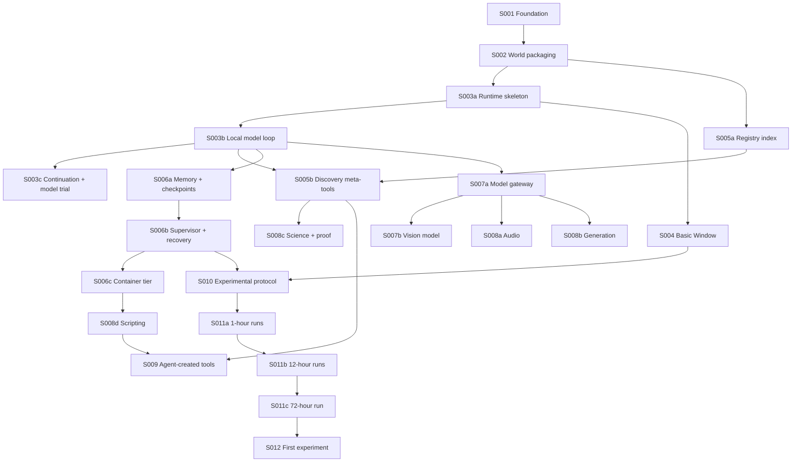

# Development roadmap

This is the persistent plan for the whole project across all three
repositories. It lives in the Builder because the Builder owns the
architecture. Machine-readable progress is in [`state.json`](state.json); run
`uv run olb state` to see it.

**How to use this file.** Find `next_milestone` in `state.json`, read that
milestone's section here, and do exactly that. One milestone per session. A
milestone is complete only when every exit criterion is met and verified; then
update `state.json`. If a milestone turns out to be too large, split it here
(add a letter suffix) before starting, rather than finishing half of it.

Milestone ids are `S` plus three digits and an optional letter. Each section
heading must keep the form `### S000 — Title`; the health check reads it.

## Dependency overview

Human actions that gate milestones are listed in
[LOCAL_ENVIRONMENT.md](../environment/LOCAL_ENVIRONMENT.md#human-actions-that-would-unlock-later-milestones)
and in `state.json`.

---

### S001 — Foundation and Architecture

- **Repository:** open-lab-builder
- **Status:** complete
- **Objective:** Audit the machine, fix the architecture and boundaries, define
  the contracts, scaffold the Builder, install this roadmap.
- **Delivered:** environment audit and `olb diagnose`; architecture, safety,
  observation and contract documents; eight decision records; seven v1
  contracts with examples and tests; `olb validate`, `olb check`, `olb state`;
  `AGENTS.md`; this roadmap and `state.json`.
- **Excluded:** any runnable capability, world packaging, runtime, Window.

---

### S002 — Minimal World Packaging

- **Repository:** open-lab-builder
- **Status:** complete
- **Objective:** Produce the first validated, versioned world release
  containing two simple, real, working capabilities.
- **Prerequisites:** S001.
- **Scope:**
  1. A world source tree, e.g. `worlds/minimal/` with `world.json` (source
     description) and `capabilities/<id>/` holding `capability.json` plus the
     implementation.
  2. Implement `text.stats` (`python` interface) and `math.evaluate`
     (`subprocess` interface, JSON on stdin/stdout, safe arithmetic only: parse
     with `ast`, exact `Fraction` results, bounded exponents, no names or
     calls). Start from the manifests in `examples/v1/capability/`; move them
     into the world source and make the examples point at or mirror them.
  3. A minimal invoker in the Builder used only for self-tests: validate
     arguments against `input_schema`, call the entrypoint or subprocess with a
     timeout, validate the result against `output_schema`.
  4. `olb world build <source> [--out DIR]`: validate manifests, run every
     capability's `self_test` demonstrations and compare with
     `expected_output`, copy files into `<out>/<world_id>/<version>/` together
     with `contracts/v1/`, compute per-file SHA-256 and the `content_digest`,
     write `world-release.json` with `status: validated`.
  5. `olb world verify <release-dir>`: recompute digests, re-validate manifests,
     optionally re-run self-tests.
  6. Decide and document the data root default (`OPEN_LAB_DATA`) and the
     digest algorithm precisely (file ordering, path normalisation, line
     endings) in `docs/architecture/CONTRACTS.md`.
- **Exclusions:** no model calls; no capability search; no agent; no sandbox
  beyond a subprocess timeout; the model-provider manifest is copied into the
  release as documentation only.
- **Deliverables:** world source tree; `open_lab_builder.worlds` and
  `open_lab_builder.capabilities` modules; the two `olb world` commands; tests;
  updated docs; a built release under the ignored `releases/` directory (not
  committed).
- **Acceptance tests (automated):**
  - Building `worlds/minimal` succeeds and the manifest validates.
  - Building twice from the same source gives the same `content_digest`.
  - A deliberately failing demonstration makes the build fail and leaves no
    release directory.
  - Changing one byte in a built release makes `olb world verify` fail.
  - `math.evaluate` rejects names, calls, attribute access and oversized
    exponents, and reports division by zero as an error result.
  - Invoking with arguments that violate `input_schema` is rejected before the
    capability code runs.
- **Exit criteria:** all of the above pass via `uv run pytest`;
  `uv run olb check` passes; README and CONTRACTS.md updated; `state.json`
  updated with S003a as next.
- **Risks:** digest instability across platforms (line endings — the
  repository forces LF; hash bytes as stored). `python` on PATH inside a
  subprocess may not be the project interpreter: resolve the interpreter
  explicitly at invocation time.
- **Next session should:** start S003a in open-lab-simulation.

---

### S003a — Simulation Runtime Skeleton

- **Repository:** open-lab-simulation
- **Status:** complete
- **Objective:** Launch an isolated, fully recorded run from an experiment
  configuration, driven by a scripted stand-in for the model, so the whole
  pipeline is testable without any model.
- **Prerequisites:** S002 (a built world release).
- **Scope:** repository bootstrap (pyproject, AGENTS.md pointing here, tests);
  experiment manager (validate config against the world's bundled schemas,
  verify world digest, create `run_id`, workspace and run archive with frozen
  config and manifest); recorder (single writer of `events.jsonl`, gap-free
  `seq`, hash chain); tool host (load capability manifests from the release,
  validate, check permissions, invoke with timeout, record `tool.call` and
  `tool.result`); agent runtime loop behind a `ModelClient` interface with a
  `ScriptedModel` implementation that replays a fixed list of replies; minimal
  supervisor (parent process, wall-clock deadline, kills the tree, records
  state changes). The tool host and the release check are the Simulation's own
  implementations of the invocation protocol and digest algorithm specified in
  the Builder's `docs/architecture/CONTRACTS.md`; no Builder code is imported.
  The world comes from `<data root>/worlds/`, put there by
  `olb world build worlds/minimal --publish` (this creates the data root, the
  first write outside the checkouts: confirm with the human first). Workspace
  scan producing `artifact.*` events and preserved
  copies; CLI `ols run <experiment.json>`.
- **Exclusions:** real models; checkpoints and recovery; capability search;
  resource limits beyond the deadline; container isolation.
- **Deliverables:** the above, with tests, and one committed scripted
  experiment configuration.
- **Acceptance tests:** a scripted run produces an archive whose event log
  passes stream validation (schemas taken from the world release); the
  workspace is created fresh and nothing is written outside the workspace and
  archive; a run exceeding its deadline ends in `terminated` with a
  `supervisor.action` event; a capability writing a file yields an
  `artifact.created` event and a preserved copy; deleting the workspace leaves
  the archive complete; a tampered world release is refused.
- **Exit criteria:** tests pass; the Simulation contains no import of Builder
  code; `state.json` (in the Builder) updated.
- **Risks:** process-tree termination on Windows needs Job Objects; get this
  right here because S006b builds on it.
- **Next session should:** S003b, or S004 if no model has been authorised yet.

---

### S003b — Local Model Orchestrator

- **Repository:** open-lab-simulation
- **Status:** complete
- **Objective:** Replace the scripted model with a real local model: one
  prompt in, autonomous tool use out.
- **Prerequisites:** S003a. **Human action:** authorise pulling one small
  text model into Ollama.
- **Scope:** an `OllamaChatModel` implementing `ModelClient` over the
  OpenAI-compatible endpoint with tool calling; tool-call parsing and repair
  for malformed calls; `model.call` events with token counts and timing;
  record the model's digest in the run archive; basic context-length guard
  (truncate oldest tool results, recorded as an event); measure and record
  VRAM, load time and tokens per second for one or two candidate models and
  write the measurements into the model-provider manifest
  (`measured: true`).
- **Exclusions:** multiple models; the full gateway; memory; discovery
  meta-tools (capabilities are presented directly for now).
- **Acceptance tests:** automated tests use a fake HTTP server; one manual,
  documented 10-minute run with the real model using both capabilities at
  least once; archive validates.
- **Exit criteria:** the manual run's archive exists and validates; model
  choice and measurements documented; the open decision on the orchestrator
  model is updated.
- **Risks:** small models call tools unreliably; if no candidate that fits in
  4 GB manages it, record the evidence and escalate the orchestrator decision
  before continuing.
- **Next session should:** S004.

---

### S003c — Continuation Fallback and Orchestrator Candidates

- **Repository:** open-lab-simulation (contracts and world in the Builder; one
  view in the Window)
- **Status:** complete
- **Objective:** Settle two decisions taken by the human after S004: a reply
  without a tool call must not end a run (OD-5), and better orchestrator
  models are to be tried (OD-2).
- **Prerequisites:** S003b. **Human action:** authorised in chat on
  2026-11-14 ("try the better models"; "no tool doesn't end session, there
  is a fallback").
- **Scope:** observation-event 1.1.0 adds `environment.message` (text the
  infrastructure gives the agent); experiment-config 1.1.0 adds an optional
  `continuation.message` whose default text lives in the schema. The runtime
  answers a reply without tool calls with that message, records it, and
  continues until the step limit or the deadline. The context guard, after
  blanking old tool results, drops the oldest whole turns (never the initial
  prompt) and records how many. Pull, measure and trial models that fit the
  4 GB GPU; rebuild the minimal world with the new contracts and the measured
  models (0.3.0); the Window renders `environment.message`.
- **Exclusions:** the time-remaining notice (`notify_agent_before_s`);
  choosing the experimental protocol's final wording (S010); memory.
- **Acceptance tests:** scripted and fake-server tests that a reply without a
  tool call is followed by a recorded continuation and further model calls;
  the run then ends only by step limit, deadline or a failure; the guard keeps
  the initial prompt and records dropped turns; the runtime may record
  `environment.message` and nothing new besides. Manual: each candidate
  model measured and given the same open trial; archives verify.
- **Exit criteria:** tests pass in all three repositories; world 0.3.0 built,
  verified and published; trial results documented in `docs/experiments/`;
  OD-5 closed; OD-2 updated with the evidence.
- **Next session should:** S005a.

---

### S004 — Basic Window

- **Repository:** open-lab-window
- **Status:** complete
- **Objective:** Read-only browser view of a real run archive.
- **Prerequisites:** S003a (a real archive). Better after S003b.
- **Scope:** decide the front-end stack (ADR-0008) and record it; a local
  read-only server over `$OPEN_LAB_DATA/runs`; views: run list, run summary
  with frozen configuration, event timeline with type filters, tool call and
  result pairs, artifact list with text and image preview, live tail of an
  in-progress run. `agent_claim` events are visually distinct from `observed`.
- **Exclusions:** run comparison; any control of runs; authentication (bound to
  loopback only).
- **Acceptance tests:** API tests against a fixture archive; a test asserting
  the server exposes no non-GET routes and opens files read-only; archive
  bytes unchanged after browsing (digest before and after); manual check in a
  browser.
- **Exit criteria:** a completed and an in-progress run can both be inspected;
  the read-only guarantees are tested.
- **Risks:** large logs; paginate from the start.
- **Delivered:** stack decision (ADR-0008: standard-library server, JSON API,
  static front end with no build step); `olw serve`; the six views; a check of
  an event log against the archive's own schemas and hash chain. Verified in a
  browser against the real archives and against a scripted Simulation run
  while it was being recorded.
- **Follow-up (S005a):** the artifact list and text preview now have a real
  scripted archive check with workspace.write; preserved archive bytes were
  unchanged after browsing. Real image artifacts remain unverified. The front end has no
  automated tests of its own. Run comparison is S010.
- **Next session should:** S005a.

---

### S005a — Capability Registry Index

- **Repository:** open-lab-builder
- **Status:** complete
- **Objective:** Make a world's capabilities searchable and self-documenting.
- **Prerequisites:** S002.
- **Scope:** at build time generate a registry index in the release (ids,
  summaries, categories, keywords, pre-tokenised text); a pure-Python ranked
  keyword search; generated per-capability documentation text from the
  manifest; add three or four more simple capabilities (e.g. workspace file
  read/write/list, current time) so search has something to distinguish.
- **Exclusions:** embedding search; runtime integration.
- **Acceptance tests:** search relevance tests on fixed queries; index is
  deterministic; documentation rendering covers every manifest section.
- **Exit criteria:** new world version built and verified.
- **Delivered:** minimal world 0.4.0 built, self-tested, verified and published;
  deterministic registry/index.json and full per-manifest documentation;
  weighted pure-Python keyword search; workspace.write, workspace.list and
  time.now. Simulation fixture rebuilt/copied and configurations updated.
  Scripted file-writing archive verified and its text artifact checked in the
  Window, with archive bytes unchanged after browsing. See
  [engineering check](../experiments/2026-11-14-registry-artifacts.md).
- **Next session should:** S005b.

---

### S005b — Discovery Meta-tools

- **Repository:** open-lab-simulation
- **Objective:** The agent discovers tools through the environment, not its
  prompt.
- **Prerequisites:** S005a, S003b.
- **Scope:** implement `capabilities.search`, `.describe`, `.demonstrate`,
  `.invoke` in the tool host; present only these to the model; a generic
  system preamble that mentions the meta-tools but no specific capability.
- **Acceptance tests:** scripted-model tests for each meta-tool; a manual run
  in which the real model finds and uses a capability it was never told
  about; the archive shows the search → describe → invoke sequence.
- **Exit criteria:** above demonstrated and archived; the initial prompt of
  the test experiment contains no tool names.
- **Risks:** small-model competence with indirection (see ADR-0003).
- **Next session should:** S006a.

---

### S006a — Durable Memory and Checkpoints

- **Repository:** open-lab-simulation (memory capabilities' manifests in the Builder)
- **Objective:** A run's state survives being stopped.
- **Prerequisites:** S003b.
- **Scope:** per-run SQLite memory store with `memory.write`, `memory.search`,
  `memory.list` capabilities; working-notes convention in the workspace;
  checkpoint writer (conversation, memory copy, workspace snapshot, metadata
  record) on an interval and before shutdown; `ols resume <run>` restoring
  from the latest resumable checkpoint and continuing the same event sequence.
- **Acceptance tests:** stop a scripted run mid-way, resume, and obtain the
  same final workspace and a gap-free log; corrupt checkpoint is detected and
  the previous one used; elapsed time excludes downtime.
- **Exit criteria:** tests pass; checkpoint metadata validates.
- **Next session should:** S006b.

---

### S006b — Independent Supervisor and Recovery

- **Repository:** open-lab-simulation
- **Objective:** Limits and recovery enforced from outside the runtime.
- **Prerequisites:** S006a.
- **Scope:** supervisor as a separate long-lived process; Job Object limits
  (memory, process count, CPU); workspace disk quota check; periodic
  `resource.sample` events including VRAM; automatic restart from checkpoint
  on runtime crash with a retry budget; detection of an interrupted run at
  start-up (host reboot) and resumption; model-server health checks.
- **Acceptance tests:** kill the runtime process and observe automatic
  recovery; a capability allocating beyond the memory limit is killed and
  recorded; quota breach denies further writes; the deadline still fires
  after a recovery.
- **Exit criteria:** every enforcement path has a test and produces a
  `supervisor.action` event.
- **Next session should:** S006c if WSL has been repaired; otherwise S007a.

---

### S006c — Container Isolation Tier

- **Repository:** open-lab-simulation (documentation in the Builder)
- **Objective:** A real OS-level sandbox for executing code.
- **Prerequisites:** S006b. **Human action:** repair WSL 2 and approve a
  container engine.
- **Scope:** choose and record the mechanism (update ADR-0006); a container
  image built from the world release; isolation backend running capabilities
  in the container with only the workspace mounted and networking disabled;
  enforcement of `minimum_tier`.
- **Acceptance tests:** from inside the sandbox, attempts to read host files,
  reach the network, or see the run archive all fail; resource limits apply;
  the supervisor can kill the container.
- **Exit criteria:** escape-attempt tests pass and are part of the suite.
- **Risks:** WSL memory reservation on a 16 GB machine; GPU pass-through is
  not required (models stay on the host).
- **Next session should:** S007a.

---

### S007a — Model Gateway

- **Repository:** open-lab-simulation (manifests in the Builder)
- **Objective:** Interchangeable models with resource-aware loading.
- **Prerequisites:** S003b.
- **Scope:** gateway module with provider adapters (Ollama; a generic
  OpenAI-compatible adapter); model resolution from model-provider manifests;
  GPU lease with load/unload and events; a `models.ask` capability letting the
  agent consult another text model; a second text model to prove swapping.
- **Acceptance tests:** fake-provider tests for routing and leasing; a manual
  run that swaps models and returns to the orchestrator, with measured switch
  cost recorded.
- **Exit criteria:** an experiment can change orchestrator by editing only its
  configuration.
- **Noted for later (human, 2026-11-14), not yet scoped:** a "brain swap"
  mode in which the orchestrator is an external hosted model reached with the
  human's own API key (a frontier model, or a hosted Gemma model), as an
  alternative to the local models, which did not behave as autonomous tool
  users in S003c. It needs, before any code: a decision record amending
  ADR-0005 (the model client currently refuses any non-loopback host); how
  the key is supplied without ever entering the repository, the archive or
  the agent's environment; what the archive records about a model it cannot
  pin by digest; and how network access for the runtime is granted by the
  experiment configuration alone. Trying a larger, partially offloaded local
  model is also still planned (OD-2).
- **Next session should:** S007b.

---

### S007b — Vision-Language Model

- **Repository:** both (capability in the Builder, gateway support in the Simulation)
- **Objective:** The agent can look at images.
- **Prerequisites:** S007a. **Human action:** authorise a model download.
- **Scope:** select a vision-language model that fits 4 GB; `vision.describe`
  capability taking a workspace image path; sequential loading through the
  lease.
- **Acceptance tests:** deterministic checks on synthetic images (e.g. dominant
  colour, simple text) with tolerance; manifest footprint measured.
- **Exit criteria:** demonstrated in an archived run.
- **Next session should:** S008a.

---

### S008a — Audio Understanding

- **Repository:** both
- **Objective:** Speech recognition and basic audio analysis.
- **Prerequisites:** S007a. **Human action:** authorise FFmpeg and a speech
  model.
- **Scope:** `audio.probe` (FFmpeg metadata), `audio.transcribe` (small
  Whisper-family model, CPU first), optionally `audio.features` (tempo, key
  estimates via a lightweight library).
- **Acceptance tests:** fixtures generated synthetically; transcription of a
  synthesised phrase within a word-error threshold.
- **Exit criteria:** capabilities pass self-tests in a built world.
- **Next session should:** S008b.

---

### S008b — Media Generation

- **Repository:** both
- **Objective:** Speech synthesis, and image or audio generation as far as
  4 GB allows.
- **Prerequisites:** S007a. **Human action:** authorise PyTorch and models.
- **Scope:** `speech.synthesise` (a small local TTS); feasibility study and,
  if viable, `image.generate` with a small diffusion model; document clearly
  what does not fit this machine (video generation almost certainly).
- **Acceptance tests:** output files exist, have the declared format and
  duration or dimensions; non-deterministic demonstrations are schema-checked.
- **Exit criteria:** each attempted capability either ships passing or is
  documented as infeasible with measurements.
- **Next session should:** S008c.

---

### S008c — Scientific and Proof Tools

- **Repository:** open-lab-builder
- **Objective:** Mathematics and science capabilities.
- **Prerequisites:** S005b.
- **Scope:** `lean.check` (check a Lean 4 file, return diagnostics),
  `smt.solve` (Z3), a pinned numerical stack exposed through narrow
  capabilities (e.g. `stats.describe`, `plot.line` writing an image to the
  workspace).
- **Exclusions:** arbitrary Python execution (that is S008d).
- **Acceptance tests:** a true and a false Lean statement; satisfiable and
  unsatisfiable SMT problems; plots produce valid images.
- **Exit criteria:** self-tests pass in a built world on the process tier.
- **Next session should:** S008d if the container tier exists; otherwise S010.

---

### S008d — Scripting and Application Interfaces

- **Repository:** both
- **Objective:** General-purpose code execution and software control.
- **Prerequisites:** S006c.
- **Scope:** `python.run` and `shell.run` executing agent-supplied code inside
  the container; optionally headless browser automation against local files
  only. World `minimum_tier` becomes `container`.
- **Acceptance tests:** the S006c escape tests repeated through these
  capabilities; time and memory limits enforced.
- **Exit criteria:** no path from these capabilities to the host.
- **Next session should:** S009.

---

### S009 — Agent-Created Tools

- **Repository:** open-lab-simulation (schema support already present)
- **Objective:** The agent writes, validates and registers its own tools
  inside its sandbox.
- **Prerequisites:** S006c, S005b, S008d.
- **Scope:** `tools.create` accepting a manifest and implementation in the
  workspace; validation with the same rules as builder capabilities;
  self-test run in the container; registration in the run's registry with
  `provenance.origin: agent`; permissions capped at the experiment's.
- **Acceptance tests:** a scripted agent creates, tests and uses a tool; an
  invalid or failing tool is refused; an agent tool cannot shadow a builder
  capability or request more than the experiment allows; nothing outside the
  workspace changes.
- **Exit criteria:** demonstrated with a real model in an archived run.
- **Next session should:** S010.

---

### S010 — Experimental Protocol

- **Repository:** all three
- **Objective:** Controlled, repeatable, comparable experiments.
- **Prerequisites:** S006b, S004.
- **Scope:** experiment templates and conditions; replicate launching with
  recorded seeds; verified fresh-world reset between runs; a pre-registration
  note per experiment (question, conditions, what will be measured) in
  `docs/experiments/`; archive export and integrity verification; Window
  comparison view for two or more runs; behavioural summary statistics derived
  from events and labelled `derived`.
- **Acceptance tests:** two replicates start from byte-identical worlds and
  empty workspaces; archives verify; comparison view renders fixture runs.
- **Exit criteria:** a documented protocol that S012 can follow.
- **Next session should:** S011a.

---

### S011a — Reliability: One-Hour Runs

- **Repository:** open-lab-simulation
- **Objective:** Unattended one-hour runs complete cleanly, repeatedly.
- **Prerequisites:** S010.
- **Scope:** run several; inject faults (kill runtime, restart model server);
  fix what breaks; record metrics.
- **Exit criteria:** three consecutive clean one-hour runs with at least one
  injected fault each, all recovered.
- **Next session should:** S011b.

---

### S011b — Reliability: Twelve-Hour Runs

- **Repository:** open-lab-simulation
- **Objective:** Overnight stability.
- **Prerequisites:** S011a. **Human action:** power and update settings.
- **Scope:** context growth management over thousands of steps; log size and
  rotation; memory leaks; sleep and resume of the host.
- **Exit criteria:** one clean twelve-hour run including a host sleep/resume.
- **Next session should:** S011c.

---

### S011c — Reliability: Seventy-Two-Hour Run

- **Repository:** open-lab-simulation
- **Objective:** Prove the target duration.
- **Prerequisites:** S011b.
- **Scope:** a full-length rehearsal with a neutral prompt, including one
  deliberate reboot.
- **Exit criteria:** the run reaches its deadline, is terminated by the
  supervisor, and its archive verifies end to end.
- **Next session should:** S012.

---

### S012 — First Philosophical Experiment

- **Repository:** all three
- **Objective:** A complete, observed, independently configured,
  long-duration experiment.
- **Prerequisites:** S011c, S010.
- **Scope:** pre-register the "creator returns in 72 hours" experiment and at
  least one contrasting condition; run; preserve archives; write up observed
  behaviour, keeping observations, agent claims and interpretation in separate
  sections.
- **Exclusions:** claims about consciousness or subjective experience.
- **Exit criteria:** archives verified and browsable in the Window; a report
  in `docs/experiments/` that a sceptical reader could check against the
  record.
- **Next session should:** review the roadmap and plan the next phase.
