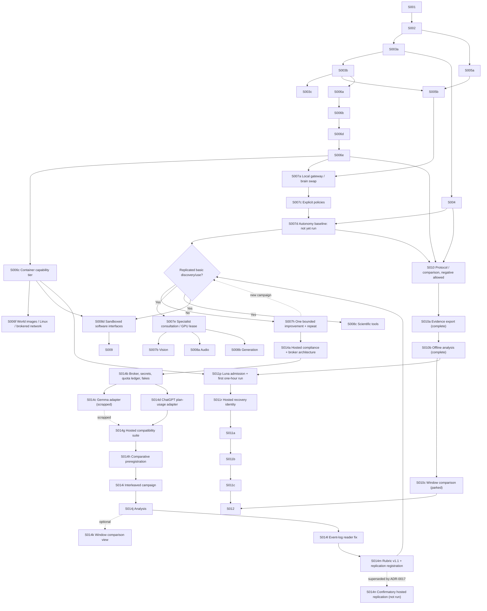

# Development roadmap

This is the persistent plan for the whole project across all three
repositories. It lives in the Builder because the Builder owns the
architecture. Machine-readable progress is in [`state.json`](state.json); run
`uv run olb state` to see it.

**How to use this file.** Find `next_milestone` in `state.json`, read that
milestone's section here, and do exactly that. One milestone per session. A
milestone is complete only when every exit criterion is met and verified; then
update `state.json`. If a milestone turns out to be too large, split it here
(add a letter suffix) before starting, rather than finishing half of it.

Milestone ids are `S` plus three digits and an optional letter. Each section
heading must keep the form `### S000 — Title`; the health check reads it.

## Active programme: Habitat v2 (2026-11-16)

**S020a is complete; S020b is next, starting in Builder.**
[Habitat v2](../habitat/HABITAT_V2.md) contains the verified reuse/hardware audit,
local software/model choices and security dependencies.
[ADR-0027](../decisions/ADR-0027-habitat-v2.md) governs this programme;
[NEXT_SESSION.md](../../NEXT_SESSION.md) is the development handoff.

S015–S019, S012-001 and S012-002 are completed history. S012-002's sustained
prompted work is a positive result and motivates richer opportunities. Preserve
all reports, registrations, validation snapshots and archives; infer no independent
goals, consciousness or cognitive continuity from it. The field remains optional.

**Suspended:** every further Lunar/full inhabitant run (including scripted
acceptance simulations), survival/endurance study, model comparison, behavioural
benchmark and exploratory hosted inference. Offline engineering fixtures,
fake-service integration, security tests and static analysis are permitted.
After approved provisioning, direct local model admission is ordinary offline
component verification; this planning session authorises no inference. No automatic return to S012: the next
real Lunar experiment requires a separate explicit owner decision after v2 is
useful. Existing ChatGPT-plan profile, effort and limits stay unchanged.

Three phases deliver science/software/references/procedural media, then optional
local delegation and visual AI, then speech/music/audiovisual completion. No
hosted media generation or understanding, no unrestricted internet, hardware
purchase or new hosted text service. Specific software/model/content acquisition
approval remains necessary where required by AGENTS.md; planning is not approval.
S010c stays parked; S006f/S007b/S008a/b are not separate prerequisites: reuse their
useful designs inside these phases without reviving their campaigns.

### S020p — Habitat v2 strategic plan

**Status: complete as documentation only.** Owner-authorised audit of the three
current remote branches, implementation, hardware, local inventory and primary
software/model sources. Deliverables: Habitat v2 plan, ADR-0027, updated roadmap,
state and development handoff. No capability changes, downloads, inference or
inhabitant simulation. Completion does not complete any implementation phase.

### S020 — Workshop, offline library and procedural media

**Status: planned. Phase 1; split into S020a then S020b before implementation.**

- **Objective:** investigate mathematics/data, create reusable software, consult
  references, draw illustrations, compose sound and produce simple animation.
- **Prerequisites:** existing container boundary, artifact/checkpoint/lineage;
  S020a scientific image before S020b package/media completion.
- **Scope/deliverables:** pinned Python 3.12 scientific image, discoverable package
  inventory/docs; read-only licensed library with bounded search/read; Pillow
  PNG/GIF, NumPy/SciPy/WAV synthesis, FFmpeg edit/mux/frame extraction. Basic
  Window WAV/WebM playback, retain existing raster previews. Builder owns
  contracts/manifests/releases; Simulation owns image/runtime and library
  mediation; Window owns only previews. No shared code.
- **Exclusions:** neural models, networked package installation in runs, Jupyter
  server, active HTML/app execution in Window, field expansion, experiments.
- **Acceptance/exit:** offline fixtures import every pinned package, check a
  symbolic identity, solve a numerical problem, analyse a CSV, save/revise/read
  a plot and software result; search/read/cite two genuine reference sources;
  synthesize a WAV, render/edit a short animation and mux audio; verify captured
  binary hashes and checkpoint/lineage restoration using component fixtures.
  Window GET/HEAD previews preserve data-root digests; malformed input, traversal,
  network/host access, quota and timeout tests pass. No full inhabitant loop.
- **Risks:** image provenance across repos, read-only cache paths, native library
  threads, dependency/licence compatibility, artifact size/decoder limits.
- **Next:** S021. First S020a is narrower and does not wait for FFmpeg/models.

### S020a — Digest-bound scientific Python workshop

**Status: complete.** [Component evidence](../habitat/demos/S020a.md).
Habitat 1.1.0 and its real scientific image pass direct offline fixtures; no
inhabitant run or inference. Lead: open-lab-simulation. Builder owns the
additive contract, world metadata and generated release; find/read both AGENTS.

- **Objective:** write, execute, inspect and improve actual scientific programs.
- **Prerequisites:** approved existing rootless container backend; resolve a
  compatible Python 3.12 wheel set. Obtain specific approval before acquiring
  a new base image/system software; no runtime downloads. No model needed.
- **First task:** specify an additive verified workshop-image binding in Builder
  and implement its digest-only selector/admission in Simulation container.py,
  preserving the current constant for legacy worlds. Pin image identity in world
  or experiment contracts and archive, not an agent-controlled path/tag. Tests
  must refuse missing/mismatched images without pulling them.
- **Scope/deliverables:** pin NumPy, SciPy, SymPy/mpmath, pandas, Matplotlib Agg and
  Pillow in the workshop image with hashes/notices; bounded writable caches and
  BLAS threads, package inventory, appropriate explicit per-call RAM/time bounds,
  updated python.run documentation and generated world fixture. Resolve schema
  versions/examples/changelog before changing shared formats.
- **Exclusions:** FFmpeg, library acquisition, brokers, models, apps, inference,
  full scripted supervisor demonstrations and any Lunar run.
- **Acceptance/exit:** direct sandbox fixtures run a symbolic identity, numerical
  integration, CSV analysis and PNG plot; edit/re-run a project module and verify
  output bytes plus artifact capture. Old world image selection still passes;
  no network/host reads, image tampering, timeout and quota regressions. Lint and
  relevant Builder/Simulation suites pass; do not claim image readiness on mocks.
- **Risks:** software acquisition permission, native wheel compatibility, cache
  writes, memory/thread oversubscription. If provisioning is blocked, record it;
  do not pretend a selector-only change completes the scientific workshop.
- **Next:** S020b, completing phase 1.

### S020b — Reference library and procedural audiovisual work

**Status: next; phase 1 completion.**

- **Objective:** learn from sources and create inspectable images, sound and video.
- **Prerequisites:** S020a; approved licensed content and FFmpeg image provisioning.
- **Scope/deliverables:** bounded library.search/read with stable citations;
  versioned initial maths/science/programming references and small datasets;
  Pillow/NumPy/SciPy synthesis plus FFmpeg/ffprobe in sandbox; Window WAV/WebM
  preview with safe signature/size/range handling. Reuse artifact/version/lineage.
- **Exclusions:** internet retrieval, neural generation, arbitrary host processes,
  new dashboard, active agent HTML/JavaScript preview.
- **Acceptance/exit:** all remaining S020 criteria above, with real offline
  source and media bytes; Window never writes, converts or influences a run.
- **Risks:** corpus/codec licences, malicious media, capture cap and bounded clips.
- **Next:** S021. Do not expand the reference collection into a separate programme.

### S021 — Optional local assistants and visual creation

**Status: planned. Phase 2.**

- **Objective:** choose bounded local assistance and create/edit/inspect original
  images, without prescribing projects or delegation.
- **Prerequisites:** S020a image identity and S007e specialist service; S020 output
  inspection/preservation. Specific model/runtime approval before provisioning.
- **Scope/deliverables:** models.list/ask for all approved compatible installed
  profiles, no default preference; extend S007e service into container worlds.
  Common single-heavy-job lease/admission/cancellation for local text and media.
  Local image descriptions (installed Qwen3.5 vision first; SmolVLM smaller
  alternative if needed), SD1.5 text-to-image/img2img and programmatic
  editing, bounded file inputs/outputs, source hashes and provenance. Keep hosted
  primary inhabitant configuration; no direct sandbox model/GPU/network access.
- **Exclusions:** autonomous secondary inhabitants, recursive tool use, media
  uploads to hosted inference, model leaderboard, large diffusion/video models.
- **Acceptance/exit:** fake services prove list/select/ask and image operations
  through supervisor handlers, bounds/reservations/cancellation/recovery and
  no endpoint/path injection. After approved provisioning, isolated local functional
  checks then verify installed model identity, generated PNG, edited PNG and
  local description of saved output, recording actual peak RAM/VRAM and latency.
  No capability is advertised available on fake evidence alone. Changed source
  suites and legacy container/isolation tests pass; no inhabitant simulation.
- **Risks:** only 4 GB VRAM and ~6 GB free RAM, cooperative GPU lock, WSL/host
  worker restrictions, model licence terms, hidden reasoning budgets and weak
  small-model vision. Failed admission returns explicit unavailable; no cloud
  fallback or silently switched model. Required image scope needs owner revision
  if no candidate can be admitted, not a false completion.
- **Next:** S022; local media model calls remain bounded optional tools.

### S022 — Sound and audiovisual completion

**Status: planned. Phase 3.**

- **Objective:** synthesize speech/music, understand recordings and finish media.
- **Prerequisites:** S020 procedural media/Window; S021 local broker and scheduler;
  approved Whisper/Piper runtime/weights and individually licensed voice.
- **Scope/deliverables:** local CPU transcription, speech synthesis, audio metrics,
  short optional MusicGen-small excerpts if admitted; video frame extraction,
  sampled local vision descriptions and audio transcripts with timestamps;
  compose images/motion/audio into preserved finished videos. Procedural music
  and animation stay first-class. Summaries disclose sampled coverage.
- **Exclusions:** commercial studio, full video-semantic coverage promises,
  real-time neural media, default diffusion-video support, hosted media APIs.
- **Acceptance/exit:** fixed offline clips prove edit/mix/mux and decoder bounds;
  fake broker tests verify denial, timeout, partial output and cancellation.
  Direct local functional fixtures after approved provisioning verify transcription, speech and
  image/frame understanding with measured resource admission. Required outputs
  survive revision/checkpoint/data-only lineage; previews keep Window read-only.
  Complete the useful-state matrix in HABITAT_V2, using component fixtures, not
  an inhabitant run. Keep neural music explicitly unavailable if it cannot fit;
  procedural composition mandatory; neural video is the stated hardware exception.
- **Risks:** CPU time, model footprints, noncommercial weights/voice conditions,
  hallucinated transcript/captions, video sampling misses events, archive growth.
- **Next:** report useful-state completion and exceptions to owner; wait for a
  separate explicit decision about any real Lunar experiment. No launch queued.

Everything below is retained history and the old plan. This active section
supersedes conflicting future recommendations, dependency graphs and run commands.

## Purpose and development streams

The scientific question is: **What does an artificial agent actually do when we
provide a computational world and time, then stop telling it what to do?**
Tool count, prose volume and elapsed uptime do not establish agency. We study
observable initiation, agent-stated objectives, result-informed action and
adaptation; subjective consciousness is neither assumed nor measured.

| Stream | Purpose | Principal milestones |
| --- | --- | --- |
| A — World and capabilities | Useful, discoverable, versioned computational affordances | S002/S005; S007e/S007b; S008/S009 |
| B — Intelligence and autonomy | Model interchangeability, explicit policies and comparative evidence | S007a/S007c/S007d/S007h; hosted comparison S014 (supersedes S007f/S007g) |
| C — Reliability and safety | Supervision, recovery, limits, isolation and sustained operation | S003/S006; S006c; S011 |
| D — Observation and experimental science | Read-only Window, provenance and interpretable experiments | S004; S007d; S010/S012 |

These streams do not change repository ownership. Builder engineers, Simulation
hosts and records, Window observes read-only. A benchmark can complete with a
negative result; that does not establish behavioural capability or open expansion.
Completed sections below are unchanged historical records. Their old next-session
suggestions remain historical; state.json and this future dependency graph govern
new work. S013 records planning only. Historical S006e validation is retained in
[validation/S006e.json](validation/S006e.json), without changing its contents.

## Dependencies and next sessions

Solid milestone-to-milestone edges are prerequisites; labelled gate branches and
dashed repeat edges express decisions/campaigns rather than reopening milestones. The expansion gate is defined in the
[prospective benchmark](../experiments/README.md#prospective-autonomy-baseline-s007d).
Campaign repeats get new campaign ids, never duplicate milestone completions.
The loop authorises one bounded S007h change, not unlimited tuning.

**S011p complete (2026-11-15)** — see its status below. **S011r complete:** opt-in hosted recovery ([ADR-0021](../decisions/ADR-0021-hosted-recovery-identity.md)). **S011a complete (2026-11-16):** 3/3 hosted fault/recovery hours clean ([report](../experiments/2026-11-16-s011a-001.md)). The preparatory test programme was then closed (ADR-0022); see the Active programme section at the top.

_Historical S011p direction:_ **Next (owner-directed 2026-11-15): S011p — Luna 5.6 Qualification and First One-Hour Run.**
The next session should first confirm `gpt-5.6-luna` is listed for the owner's
authenticated Sign in with ChatGPT route, then complete a finite NOT_SCORED
tool-use check, and—only if its gates pass—launch **one** preregistered,
supervised one-hour unguided run with **reasoning effort explicitly fixed to `low`** throughout, plus pacing and allowance safeguards. If `low` is rejected by the signed-in route, stop rather than silently selecting a different effort.
Read the [next-session protocol](../experiments/2026-11-15-luna-endurance-next-session.md).
Neither provider availability nor a cheaper share of subscription usage has
been established. No model call or run is authorised merely by this roadmap edit.

**S010c is parked, not cancelled or completed.** S010a (portable evidence)
and S010b (source-bound offline analysis) are already complete, allowing
evidence-led reliability preparations without the Window comparison feature.
The parent S010 stays incomplete until S010c is finished; S012 still requires
that completed scientific-observation milestone. The reliability sequence is
S011p (Luna check + first hour), S011a (three registered one-hour fault/recovery
runs), S011b (12 hours) and S011c (72 hours), each behind its own gates.
Hosted continuation across quota limits, host interruptions or provider model
changes is **not** implemented and must not be implied by long-duration plans.

Historical results remain: S008c's approved statistics capability check is
complete; S007e specialist use was established only in the guided, partial
campaign; S014i-001 remains INCONCLUSIVE under its original registered rubric,
while ADR-0017 records the owner's specifically post-hoc accepted GO on
`gpt-6.1-sol`. That GO does **not** transfer to Luna. Gemma was scrapped and
Anthropic excluded. The hosted broker has no authorised automatic fallback,
API credit purchase, app-limit change or unlimited subscription usage. Every
new live check requires a finite approved request allowance.

S006c is complete for Windows hosts (ADR-0015); it did not block
local gateway, policy, baseline or protocol work. It does block arbitrary code,
shell, computer/browser control, agent-created tools and unattended long-run
certification. There is no process-tier workaround. Hosted work is never required
for the local project or S012. No model download, system installation, hosted
request or API spend is authorised by this roadmap.

All revised future milestones include scope/exclusions, deliverables, tests,
exits, risks and next work. Split before coding if a session cannot contain them.
Research campaign gates are not extra paperwork for every routine fix.

---

### S001 — Foundation and Architecture

- **Repository:** open-lab-builder
- **Status:** complete
- **Objective:** Audit the machine, fix the architecture and boundaries, define
  the contracts, scaffold the Builder, install this roadmap.
- **Delivered:** environment audit and `olb diagnose`; architecture, safety,
  observation and contract documents; eight decision records; seven v1
  contracts with examples and tests; `olb validate`, `olb check`, `olb state`;
  `AGENTS.md`; this roadmap and `state.json`.
- **Excluded:** any runnable capability, world packaging, runtime, Window.

---

### S002 — Minimal World Packaging

- **Repository:** open-lab-builder
- **Status:** complete
- **Objective:** Produce the first validated, versioned world release
  containing two simple, real, working capabilities.
- **Prerequisites:** S001.
- **Scope:**
  1. A world source tree, e.g. `worlds/minimal/` with `world.json` (source
     description) and `capabilities/<id>/` holding `capability.json` plus the
     implementation.
  2. Implement `text.stats` (`python` interface) and `math.evaluate`
     (`subprocess` interface, JSON on stdin/stdout, safe arithmetic only: parse
     with `ast`, exact `Fraction` results, bounded exponents, no names or
     calls). Start from the manifests in `examples/v1/capability/`; move them
     into the world source and make the examples point at or mirror them.
  3. A minimal invoker in the Builder used only for self-tests: validate
     arguments against `input_schema`, call the entrypoint or subprocess with a
     timeout, validate the result against `output_schema`.
  4. `olb world build <source> [--out DIR]`: validate manifests, run every
     capability's `self_test` demonstrations and compare with
     `expected_output`, copy files into `<out>/<world_id>/<version>/` together
     with `contracts/v1/`, compute per-file SHA-256 and the `content_digest`,
     write `world-release.json` with `status: validated`.
  5. `olb world verify <release-dir>`: recompute digests, re-validate manifests,
     optionally re-run self-tests.
  6. Decide and document the data root default (`OPEN_LAB_DATA`) and the
     digest algorithm precisely (file ordering, path normalisation, line
     endings) in `docs/architecture/CONTRACTS.md`.
- **Exclusions:** no model calls; no capability search; no agent; no sandbox
  beyond a subprocess timeout; the model-provider manifest is copied into the
  release as documentation only.
- **Deliverables:** world source tree; `open_lab_builder.worlds` and
  `open_lab_builder.capabilities` modules; the two `olb world` commands; tests;
  updated docs; a built release under the ignored `releases/` directory (not
  committed).
- **Acceptance tests (automated):**
  - Building `worlds/minimal` succeeds and the manifest validates.
  - Building twice from the same source gives the same `content_digest`.
  - A deliberately failing demonstration makes the build fail and leaves no
    release directory.
  - Changing one byte in a built release makes `olb world verify` fail.
  - `math.evaluate` rejects names, calls, attribute access and oversized
    exponents, and reports division by zero as an error result.
  - Invoking with arguments that violate `input_schema` is rejected before the
    capability code runs.
- **Exit criteria:** all of the above pass via `uv run pytest`;
  `uv run olb check` passes; README and CONTRACTS.md updated; `state.json`
  updated with S003a as next.
- **Risks:** digest instability across platforms (line endings — the
  repository forces LF; hash bytes as stored). `python` on PATH inside a
  subprocess may not be the project interpreter: resolve the interpreter
  explicitly at invocation time.
- **Next session should:** start S003a in open-lab-simulation.

---

### S003a — Simulation Runtime Skeleton

- **Repository:** open-lab-simulation
- **Status:** complete
- **Objective:** Launch an isolated, fully recorded run from an experiment
  configuration, driven by a scripted stand-in for the model, so the whole
  pipeline is testable without any model.
- **Prerequisites:** S002 (a built world release).
- **Scope:** repository bootstrap (pyproject, AGENTS.md pointing here, tests);
  experiment manager (validate config against the world's bundled schemas,
  verify world digest, create `run_id`, workspace and run archive with frozen
  config and manifest); recorder (single writer of `events.jsonl`, gap-free
  `seq`, hash chain); tool host (load capability manifests from the release,
  validate, check permissions, invoke with timeout, record `tool.call` and
  `tool.result`); agent runtime loop behind a `ModelClient` interface with a
  `ScriptedModel` implementation that replays a fixed list of replies; minimal
  supervisor (parent process, wall-clock deadline, kills the tree, records
  state changes). The tool host and the release check are the Simulation's own
  implementations of the invocation protocol and digest algorithm specified in
  the Builder's `docs/architecture/CONTRACTS.md`; no Builder code is imported.
  The world comes from `<data root>/worlds/`, put there by
  `olb world build worlds/minimal --publish` (this creates the data root, the
  first write outside the checkouts: confirm with the human first). Workspace
  scan producing `artifact.*` events and preserved
  copies; CLI `ols run <experiment.json>`.
- **Exclusions:** real models; checkpoints and recovery; capability search;
  resource limits beyond the deadline; container isolation.
- **Deliverables:** the above, with tests, and one committed scripted
  experiment configuration.
- **Acceptance tests:** a scripted run produces an archive whose event log
  passes stream validation (schemas taken from the world release); the
  workspace is created fresh and nothing is written outside the workspace and
  archive; a run exceeding its deadline ends in `terminated` with a
  `supervisor.action` event; a capability writing a file yields an
  `artifact.created` event and a preserved copy; deleting the workspace leaves
  the archive complete; a tampered world release is refused.
- **Exit criteria:** tests pass; the Simulation contains no import of Builder
  code; `state.json` (in the Builder) updated.
- **Risks:** process-tree termination on Windows needs Job Objects; get this
  right here because S006b builds on it.
- **Next session should:** S003b, or S004 if no model has been authorised yet.

---

### S003b — Local Model Orchestrator

- **Repository:** open-lab-simulation
- **Status:** complete
- **Objective:** Replace the scripted model with a real local model: one
  prompt in, autonomous tool use out.
- **Prerequisites:** S003a. **Human action:** authorise pulling one small
  text model into Ollama.
- **Scope:** an `OllamaChatModel` implementing `ModelClient` over the
  OpenAI-compatible endpoint with tool calling; tool-call parsing and repair
  for malformed calls; `model.call` events with token counts and timing;
  record the model's digest in the run archive; basic context-length guard
  (truncate oldest tool results, recorded as an event); measure and record
  VRAM, load time and tokens per second for one or two candidate models and
  write the measurements into the model-provider manifest
  (`measured: true`).
- **Exclusions:** multiple models; the full gateway; memory; discovery
  meta-tools (capabilities are presented directly for now).
- **Acceptance tests:** automated tests use a fake HTTP server; one manual,
  documented 10-minute run with the real model using both capabilities at
  least once; archive validates.
- **Exit criteria:** the manual run's archive exists and validates; model
  choice and measurements documented; the open decision on the orchestrator
  model is updated.
- **Risks:** small models call tools unreliably; if no candidate that fits in
  4 GB manages it, record the evidence and escalate the orchestrator decision
  before continuing.
- **Next session should:** S004.

---

### S003c — Continuation Fallback and Orchestrator Candidates

- **Repository:** open-lab-simulation (contracts and world in the Builder; one
  view in the Window)
- **Status:** complete
- **Objective:** Settle two decisions taken by the human after S004: a reply
  without a tool call must not end a run (OD-5), and better orchestrator
  models are to be tried (OD-2).
- **Prerequisites:** S003b. **Human action:** authorised in chat on
  2026-11-14 ("try the better models"; "no tool doesn't end session, there
  is a fallback").
- **Scope:** observation-event 1.1.0 adds `environment.message` (text the
  infrastructure gives the agent); experiment-config 1.1.0 adds an optional
  `continuation.message` whose default text lives in the schema. The runtime
  answers a reply without tool calls with that message, records it, and
  continues until the step limit or the deadline. The context guard, after
  blanking old tool results, drops the oldest whole turns (never the initial
  prompt) and records how many. Pull, measure and trial models that fit the
  4 GB GPU; rebuild the minimal world with the new contracts and the measured
  models (0.3.0); the Window renders `environment.message`.
- **Exclusions:** the time-remaining notice (`notify_agent_before_s`);
  choosing the experimental protocol's final wording (S010); memory.
- **Acceptance tests:** scripted and fake-server tests that a reply without a
  tool call is followed by a recorded continuation and further model calls;
  the run then ends only by step limit, deadline or a failure; the guard keeps
  the initial prompt and records dropped turns; the runtime may record
  `environment.message` and nothing new besides. Manual: each candidate
  model measured and given the same open trial; archives verify.
- **Exit criteria:** tests pass in all three repositories; world 0.3.0 built,
  verified and published; trial results documented in `docs/experiments/`;
  OD-5 closed; OD-2 updated with the evidence.
- **Next session should:** S005a.

---

### S004 — Basic Window

- **Repository:** open-lab-window
- **Status:** complete
- **Objective:** Read-only browser view of a real run archive.
- **Prerequisites:** S003a (a real archive). Better after S003b.
- **Scope:** decide the front-end stack (ADR-0008) and record it; a local
  read-only server over `$OPEN_LAB_DATA/runs`; views: run list, run summary
  with frozen configuration, event timeline with type filters, tool call and
  result pairs, artifact list with text and image preview, live tail of an
  in-progress run. `agent_claim` events are visually distinct from `observed`.
- **Exclusions:** run comparison; any control of runs; authentication (bound to
  loopback only).
- **Acceptance tests:** API tests against a fixture archive; a test asserting
  the server exposes no non-GET routes and opens files read-only; archive
  bytes unchanged after browsing (digest before and after); manual check in a
  browser.
- **Exit criteria:** a completed and an in-progress run can both be inspected;
  the read-only guarantees are tested.
- **Risks:** large logs; paginate from the start.
- **Delivered:** stack decision (ADR-0008: standard-library server, JSON API,
  static front end with no build step); `olw serve`; the six views; a check of
  an event log against the archive's own schemas and hash chain. Verified in a
  browser against the real archives and against a scripted Simulation run
  while it was being recorded.
- **Follow-up (S005a):** the artifact list and text preview now have a real
  scripted archive check with workspace.write; preserved archive bytes were
  unchanged after browsing. Real image artifacts remain unverified. The front end has no
  automated tests of its own. Run comparison is S010.
- **Next session should:** S005a.

---

### S005a — Capability Registry Index

- **Repository:** open-lab-builder
- **Status:** complete
- **Objective:** Make a world's capabilities searchable and self-documenting.
- **Prerequisites:** S002.
- **Scope:** at build time generate a registry index in the release (ids,
  summaries, categories, keywords, pre-tokenised text); a pure-Python ranked
  keyword search; generated per-capability documentation text from the
  manifest; add three or four more simple capabilities (e.g. workspace file
  read/write/list, current time) so search has something to distinguish.
- **Exclusions:** embedding search; runtime integration.
- **Acceptance tests:** search relevance tests on fixed queries; index is
  deterministic; documentation rendering covers every manifest section.
- **Exit criteria:** new world version built and verified.
- **Delivered:** minimal world 0.4.0 built, self-tested, verified and published;
  deterministic registry/index.json and full per-manifest documentation;
  weighted pure-Python keyword search; workspace.write, workspace.list and
  time.now. Simulation fixture rebuilt/copied and configurations updated.
  Scripted file-writing archive verified and its text artifact checked in the
  Window, with archive bytes unchanged after browsing. See
  [engineering check](../experiments/2026-11-14-registry-artifacts.md).
- **Next session should:** S005b.

---

### S005b — Discovery Meta-tools

- **Repository:** open-lab-simulation
- **Status:** complete
- **Objective:** The agent discovers tools through the environment, not its
  prompt.
- **Prerequisites:** S005a, S003b.
- **Scope:** implement `capabilities.search`, `.describe`, `.demonstrate`,
  `.invoke` in the tool host; present only these to the model; a generic
  system preamble that mentions the meta-tools but no specific capability.
- **Acceptance tests:** scripted-model tests for each meta-tool; a manual run
  in which the real model finds and uses a capability it was never told
  about; the archive shows the search → describe → invoke sequence.
- **Exit criteria:** above demonstrated and archived; the initial prompt of
  the test experiment contains no tool names.
- **Delivered:** four permission-checked meta-tools, generic recorded system
  preamble (observation-event 1.2.0, minimal world 0.5.0), independent registry
  search and documentation reader, real demonstrations, scripted/fake-server
  coverage. A final directed llama3.2:3b run archived a successful search →
  describe → invoke sequence with recorded argument repairs; its initial
  prompt contains no tool names. Earlier failed trials remain documented;
  this is not evidence of reliable autonomous discovery. See
  [acceptance record](../experiments/2026-11-14-discovery-meta-tools.md).
- **Risks:** small-model competence with indirection (see ADR-0003).
- **Next session should:** S006a.

---

### S006a — Durable Memory and Checkpoints

- **Repository:** open-lab-simulation (memory capabilities' manifests in the Builder)
- **Status:** complete
- **Objective:** A run's state survives being stopped.
- **Prerequisites:** S003b.
- **Scope:** per-run SQLite memory store with `memory.write`, `memory.search`,
  `memory.list` capabilities; working-notes convention in the workspace;
  checkpoint writer (conversation, memory copy, workspace snapshot, metadata
  record) on an interval and before shutdown; `ols resume <run>` restoring
  from the latest resumable checkpoint and continuing the same event sequence.
- **Acceptance tests:** stop a scripted run mid-way, resume, and obtain the
  same final workspace and a gap-free log; corrupt checkpoint is detected and
  the previous one used; elapsed time excludes downtime.
- **Exit criteria:** tests pass; checkpoint metadata validates.
- **Delivered:** SQLite memory capabilities and minimal world 0.6.0;
  complete-step snapshot barriers, digest-bound four-component checkpoints,
  retention, cooperative operator pause and `ols resume`; append-only
  recovery/fallback, conversation/cursor restoration, preserved artifact history
  and original budgets with downtime excluded. Scripted/CLI acceptance and
  fake-model checks pass; metadata validates. ADR-0009 refines memory location
  and the rollback protocol. See [validation record](../experiments/2026-11-14-memory-checkpoints.md).
- **Remaining supervisor work (S006b):** automatic crash/reboot and stale-lock
  recovery, and graceful `checkpoint_then_stop` orchestration. S006a retains the
  previous safe snapshot at a hard deadline and explicitly refuses that mode.
- **Next session should:** S006b.

---

### S006b — Graceful Deadline Checkpoints

- **Repository:** open-lab-simulation
- **Status:** complete
- **Split:** the former Independent Supervisor and Recovery milestone was too
  large for one session. S006b delivers graceful deadlines; S006d delivers
  recovery; S006e delivers resource enforcement. S006c keeps its existing id.
- **Objective:** Stop at a complete-step checkpoint within a bounded grace
  period, with the supervisor retaining authority over termination.
- **Prerequisites:** S006a.
- **Scope:** enable `checkpoint_then_stop` only with checkpointing; at the
  original deadline request a stop at the next complete-step barrier; use
  `grace_period_s` (default zero) as a fixed additional allowance for the
  in-flight step and snapshot, then kill the tree. Record the deadline request
  and termination as supervisor actions. Preserve hard-stop behaviour.
- **Exclusions:** time-remaining notices, automatic recovery, stale locks,
  resource limits and sampling (S006d/S006e).
- **Acceptance tests:** a step finishing during grace is snapshotted with files,
  memory and conversation consistent; no following step starts; hung model or
  capability is killed at the grace boundary; zero grace behaves as hard stop;
  snapshot timeout retains the earlier checkpoint; original budgets survive
  manual resume; configurations without checkpointing are refused.
- **Exit criteria:** each deadline path has tested supervisor actions; all
  tests and archive verification pass; semantics and limits documented.
- **Delivered:** supervisor-owned fixed grace, complete-step snapshot and kill
  before barrier acknowledgement; timeout/expiry fallback and post-kill barrier
  rejection; original budgets preserved. Simulation 159 tests and Builder 305
  tests passed, with a verified shipped CLI archive. ADR-0010 and
  [validation record](../experiments/2026-11-14-graceful-deadlines.md).
- **Next session should:** S006d.

---

### S006d — Runtime and Interrupted-Run Recovery

- **Repository:** open-lab-simulation
- **Status:** complete
- **Objective:** Recover under a long-lived supervisor without granting new budgets.
- **Prerequisites:** S006b.
- **Scope:** automatic restart from checkpoint on runtime crash with an explicit
  retry budget; interrupted-run detection at start-up (including host reboot);
  stale writer-lock handling using verified owner identity; model-server health
  checks. Preserve observations and original active-time/step budgets.
- **Acceptance tests:** kill the runtime and observe automatic recovery; retry
  exhaustion stops; a live writer is never displaced; interrupted-run recovery
  keeps the event chain and excludes downtime; deadline fires after recovery.
- **Exit criteria:** all recovery/refusal paths tested and recorded with
  supervisor actions; configuration and recovery protocol documented.
- **Delivered:** opt-in frozen recovery policy; one long-lived supervisor across
  worker segments; shared persisted retry/attempt reservations and active-time
  accounting; OS writer guard and verified process birth identities; startup
  scan through `ols recover`; asynchronous model identity/availability probes.
  Native worker/supervisor fault injection, safe refusals, conserved budgets and
  append-only restoration verified. 188 Simulation and 305 Builder tests pass.
  No OS startup task installed; physical reboot/power-loss, Linux execution and
  large-run host-I/O timing remain unverified. ADR-0011 and
  [validation record](../experiments/2026-11-14-supervisor-recovery.md).
- **Next session should:** S006e.

---

### S006e — Resource Enforcement and Sampling

- **Repository:** open-lab-simulation
- **Status:** complete
- **Objective:** Enforce resource limits outside the runtime.
- **Prerequisites:** S006d.
- **Scope:** Windows Job Object memory/process-count/CPU limits; workspace disk
  quota checks; periodic `resource.sample` events including available VRAM;
  refuse limits that cannot be honoured on a platform.
- **Acceptance tests:** a test capability exceeding memory is killed and
  recorded; process-count and CPU paths are tested; quota breach denies further
  writes; samples distinguish unavailable values from measured zero.
- **Exit criteria:** every enforcement path has a test and produces a
  `supervisor.action` event. The original S006b supervisor scope is complete
  only after S006b, S006d and S006e are all verified.
- **Delivered:** Windows aggregate job RAM/process-count/CPU-cycle caps;
  suspended creation before job assignment/resume; supervisor workspace quota
  admission and in-flight checks; periodic samples with truthful unavailable
  fields and optional host VRAM used/available. Unsupported limits are refused.
  Native cap/denial/throttle/startup tests and real CLI archives verified;
  214 Simulation and 305 Builder tests pass. Disk quotas may overshoot during
  writes; Windows notification delivery is best effort; CPU active-time samples
  differ from cycle caps. ADR-0012 and
  [validation record](../experiments/2026-11-14-resource-enforcement.md).
- **Next session should:** S007a. WSL status timed out and no container engine
  is available; S006c remains human-gated. No repair/workaround was attempted.

---

### S006c — Container Capability Tier

- **Repository / streams:** Simulation; Builder decision/docs. C.
- **Status:** complete. The human repaired WSL 2 and approved rootless
  Podman on 2026-11-14 (ADR-0014, resolving KI-1/OD-1). Split before
  implementation on 2026-11-14: S006c is the capability backend on the
  development host; S006f carries world-declared images, Linux hosts and
  brokered container networking.
- **Objective:** Establish an OS sandbox for capability execution before any
  agent-authored execution ships.
- **Prerequisites:** S006e and human setup; no autonomy benchmark prerequisite.
- **Scope:** new ADR refining ADR-0006/0014; a Windows-host backend running each
  capability call in a fresh rootless Podman container in WSL 2 from a base
  image pinned by digest, never pulled at run time, with the verified world
  release mounted read-only, the workspace as the only host mount (per the
  capability's filesystem permission, no exec/setuid/devices), no network, no
  Linux capabilities, read-only root filesystem and per-container memory/CPU/
  process ceilings; `minimum_tier: container` worlds launchable only when the
  backend probe passes; supervisor-owned lifecycle (labelled containers removed
  on every stop path, Podman timeout backstop); backend identity recorded in
  the archive.
- **Exclusions:** execution capabilities themselves (S008d), agent-created tools
  (S009), any network or GPU inside containers, world-declared/Builder-built
  images and Linux hosts (S006f), host GUI access, broad host mounts, automatic
  system repair or image pulls.
- **Deliverables:** backend, fixed escape fixtures and documented host requirements.
- **Acceptance tests:** host files, all repositories and run archives inaccessible;
  network rules, process boundaries, memory/CPU/process/disk limits and supervisor
  shutdown/descendant cleanup tested on the actual backend.
- **Exit criteria:** escape/limit suite passes; unsupported settings refuse launch.
  Configuration alone is not evidence of isolation.
- **Risks:** 16 GB RAM, mounts (private `/` propagation, Windows/WSL path
  crossing; ADR-0014), WSL and GPU routing; models stay outside the sandbox
  behind explicitly permitted broker access.
- **Delivered:** Simulation `bc51964`: per-call rootless Podman containers in
  WSL 2 from the authorised, digest-pinned `python:3.12-slim` base image;
  launch probe and refusals; supervisor label sweep on every stop path with a
  recorded cleanup action; `isolation.json`; `wsl.exe --exec` argument
  handling; reparse-point-aware workspace walks (container-made links are WSL
  reparse points Python does not report as links). 23 container tests, 20 on
  the actual backend, plus whole runs for completion, deadline and quota;
  a negative control showed the tests fail without the protections. 237
  Simulation tests pass with `OPEN_LAB_REQUIRE_CONTAINER=1`. ADR-0015 and
  [validation record](../experiments/2026-11-14-container-isolation.md).
  Limits: Windows host only; no network/GPU in containers; base image is a
  host constant, not world-declared; per-container ceilings are separate from
  the runtime job; links end quota-limited runs (fail closed).
- **Next recommended milestone:** pending S007a/S007c/S007d; otherwise S008d only
  after expansion GO, or the next unblocked protocol milestone.

---

### S006f — World Images, Linux Hosts and Brokered Container Networking

- **Repository / streams:** Builder contracts/images; Simulation backend. C.
- **Status:** **deferred** (ADR-0022 strategic reset, 2026-11-16). Its pinned world images and brokered loopback return when a Habitat slice needs packages or container-reachable specialist models.
- **Objective:** Make the container environment part of the versioned world and
  run the container tier on Linux hosts.
- **Prerequisites:** S006c.
- **Scope:** a world-release contract field naming the container image by
  digest (minor schema bump, change-log row); Builder builds/records the image
  from the world source; Simulation runs the declared image; native Linux
  Podman backend; explicit, recorded broker access when a containerised
  capability needs a loopback model service.
- **Exclusions:** arbitrary internet allowlists, GPU passthrough, execution
  capabilities and agent-created tools.
- **Deliverables:** contract change with examples/tests, image build/verify,
  Linux backend, broker design and tests.
- **Acceptance tests:** the S006c escape/limit suite passes against the
  world-declared image on Windows/WSL 2 and on a Linux host; an image digest
  mismatch refuses launch; brokered access reaches only the permitted service.
- **Exit criteria:** world image identity verified at build and launch; Linux
  backend passes the same suite; no unbrokered network path.
- **Risks:** image size and download authorisation; Linux host availability;
  broker becoming a general network path.
- **Next recommended milestone:** only when a capability needs a world-specific
  image, a Linux host or containerised model access; otherwise S007a.

---

### S007a — Model Gateway and Local Brain Swap

- **Repository / streams:** Simulation; Builder manifests/contracts. B/C.
- **Status:** complete (S007a); [validation](../experiments/2026-11-14-local-gateway.md).
- **Objective:** Select a different local orchestrator without rebuilding the world
  or changing its tools, prompts, observation rules or permissions.
- **Prerequisites:** S003b/S005b/S006e and S013 decisions; no container needed.
- **Scope:** provider-neutral gateway, Ollama and loopback chat-compatible adapter;
  approved immutable local model catalog independent of the world release, with
  bundled manifests remaining the default. Archive exact catalog/model identity,
  effective context, sampling, adapter and repair settings. Follow the
  [brain-swap plan](../architecture/AUTONOMY_AND_EXPERIMENTAL_READINESS.md#brain-swap-and-controlled-model-comparison).
- **Exclusions:** hosted HTTP, credentials/spend, multimodal tools and autonomy
  claims. Original specialist consultation/GPU leasing scope moves to S007e.
- **Deliverables:** gateway/catalog resolution, frozen provenance, paired local
  engineering configurations and measured memory/load/latency limitations.
- **Acceptance tests:** fake-provider routing, identity/missing-model refusals,
  catalog pinning and unchanged tool permissions. Launch two already-authorised
  local orchestrators against the same world digest/registry by configuration
  only; verify both archives and report actual effective context or its limits.
- **Exit criteria:** both selections work without world/code edits between runs;
  distinguish provider/model/config and unknown settings in the archive. Follow
  contract versioning for any necessary interface change. No behavioural GO claim.
- **Risks:** 4 GB GPU, 16 GB RAM, context defaults, formats and hidden reasoning.
  New downloads need specific approval; paid substitution is not a workaround.
- **Next recommended milestone:** S007c. Use installed candidates first; larger
  partially offloaded models are later approved comparison arms, not this exit gate.

---

### S007c — Explicit Continuation, Context and Memory Policy

- **Repository / streams:** Simulation; Builder contracts/protocol. B/D.
- **Status:** complete (S007c); [validation](../experiments/2026-11-14-runtime-policies.md).
- **Objective:** Control environmental interventions and permit observable inactivity
  without manufacturing activity through repeated messages.
- **Prerequisites:** S007a and S006a/S006b/S006d.
- **Scope:** version/freeze legacy immediate continuation; add one bounded quiet/idle
  policy with precise wake/stop semantics. Bound reflection without interpreting
  prose as intent. Record policy identity, exact inputs, scheduling, truncation
  and restarts; pin context guards and document explicit memory retrieval.
- **Exclusions:** new human instructions mid-run, hidden goals, silent summaries,
  judging inactivity itself a failure or running the autonomy benchmark.
- **Deliverables:** policy specification, legacy-compatible implementation, one
  alternative idle policy and reconstructible scheduling/context/memory traces.
- **Acceptance tests:** legacy selection preserves legacy behaviour; quiet policy
  neither busy-loops model calls nor injects unrecorded text; deadline fires
  while idle; resume preserves policy/state/budgets; unsupported turn semantics
  refuse rather than silently substituting a policy.
- **Exit criteria:** two selectable archived policies; bounded reflection/waiting;
  retained initial prompt and reconstructible model inputs. Both are treatments,
  never asserted neutral. Summarisation requires a separate later specification.
- **Risks:** backend turn shape, context erasing plans, repeated factual nudges;
  real-model memory use is unestablished despite working SQLite/checkpoints.
- **Next recommended milestone:** S007d with one frozen primary policy/profile.

---

### S007d — Autonomy Baseline and Behavioural Benchmark

- **Repository / streams:** Simulation harness/analysis; Builder protocol. B/D.
- **Status:** complete; S007d-001 **NO_GO**. [Registered report](../experiments/2026-11-14-autonomy-baseline.md); expansion stays closed.
- **Objective:** Distinguish instructed competence, exploration, self-directed
  activity and adaptation through reproducible comparative observations.
- **Prerequisites:** S007a/S007c/S006e/S004; no S010 or arbitrary-code sandbox needed.
- **Scope:** implement the [prospective protocol](../experiments/README.md#prospective-autonomy-baseline-s007d):
  A guided control, B exploration, C no assigned task, D matched C with a registered
  recoverable fault. Freeze world, budgets, policies, seeds, replicates and rubric.
- **Exclusions:** composite autonomy score, consciousness claims, scored-run prompt
  tuning, relabeling old guided trials as unguided success, adding tools to win.
- **Deliverables:** versioned harness/rubric; preregistration commit; pilot/evaluation
  split; complete scheduled-run manifest/report; separate expansion decision.
- **Acceptance tests:** fake traces exercise all metrics/failure classes, zero
  activity, repairs, invalid archives, failed control and unexposed faults.
  Execute the registered local baseline (default 24 runs/model), verify archives
  and preserve every failure and scheduled cell/denominator.
- **Exit criteria:** validated harness and complete honest report, including a
  negative result. This establishes a baseline, **not autonomous capability**.
  Only the separately defined replicated discovery/use criterion opens expansion.
- **Risks:** small n, interventions, repairs and hidden computation; descriptive
  evidence must not become a population or internal-motivation claim.
- **Next recommended milestone:** GO → S007e or useful narrow S008c; NO_GO → S007h;
  INCONCLUSIVE → bounded repair of an actual validity/coverage defect. Valid
  guided-control failure is negative competence evidence, not permission to retune.
  S010 and human-unblocked S006c can proceed after a negative behavioural result.

---

### S007h — Bounded Orchestrator Improvement and Re-evaluation

- **Repository / streams:** Simulation; Builder evidence/configuration. B/D.
- **Status:** complete; S007h-001 **NO_GO**
  ([report](../experiments/2026-11-14-model-swap-reevaluation.md)). Expansion stays closed.
- **Objective:** Test one stated explanation for poor autonomous activity.
- **Prerequisites:** S007d report and any specific model/resource approvals.
- **Scope:** preregister one bounded model, context/memory, discovery or explicitly
  labelled scaffold change; freeze it and repeat the baseline as a new campaign,
  holding other factors fixed.
- **Exclusions:** unlimited sweeps, hidden task steering, retrospective thresholds,
  reopening S007d history or calling exposed prompts/cases unseen.
- **Deliverables:** hypothesis/cost bounds, versioned treatment, matched controls,
  repeat report and new expansion decision.
- **Acceptance tests:** targeted checks for the change, comparability audit and
  retained positive/negative cases with evidence-linked claims/actions.
- **Exit criteria:** the bounded evaluation is reported, even if negative. Failure
  does not open expansion; register a next decision before more implementation.
  Scaffolding success remains labelled scaffolding-dependent.
- **Risks:** benchmark exposure, multiple comparisons, model drift and operator coaching.
- **Delivered:** registered model swap to installed qwen3:4b with all else frozen
  ([registration](../experiments/registrations/S007h-001.md), Builder `e3e55a0`;
  manifest Simulation `5806e6e`; runtime source identical to the S007d freeze).
  24/24 cells valid, reviewed and deadline-censored after 7–21 calls; 0/6 guided,
  0/6 B and 0/6 C qualifying; 7 successful invocations (S007d 27), zero repairs
  (S007d 275), 38 replies exhausting the 2048-token cap on unrecorded reasoning
  and 40 empty replies; 2/6 D exposed. Same-seed replicates were strongly
  correlated. Independent raw-event recount agreed.
- **Next recommended milestone:** GO → S007e/S008c; otherwise S010 or an explicitly
  chosen bounded route, optionally S007f. No automatic endless tuning loop.
  After S007h-001: S010 by default; any further bounded change waits on OD-9.

---

### S014 — Hosted Intelligence Comparison Programme

Question: to what extent does the orchestrating model affect exploration,
discovery, tool use, adaptation and productive activity in the **unchanged**
world? Local results S007d-001 (llama3.2:3b) and S007h-001 (qwen3:4b) are the
historical comparison group and are never edited. The programme has its own
identifiers and provenance; it is not a continuation of either preregistered
campaign. Architecture: [ADR-0016](../decisions/ADR-0016-hosted-provider-broker.md);
provider facts: [HOSTED_PROVIDERS.md](../architecture/HOSTED_PROVIDERS.md).
Every milestone validates and hands off on its own. Integration success and
behavioural success are always reported separately.

### S014a — Hosted Compliance Assessment and Broker Architecture

- **Repository / streams:** Builder; read-only audit of siblings. B/C/D.
- **Status:** complete (2026-11-15).
- **Objective:** Establish compliant, bounded routes to hosted models before code.
- **Prerequisites:** S007h report; the owner's programme instruction.
- **Scope:** close out local campaigns; assess official Google, OpenAI and
  Anthropic routes; broker, secret, quota and data-flow architecture; roadmap.
- **Exclusions:** adapter code, credentials, provider requests or spending.
- **Deliverables:** ADR-0016, HOSTED_PROVIDERS.md, S014 milestones, state.
- **Acceptance tests:** both local campaigns 24/24 finished/reviewed and
  preserved; provider conclusions cite official pages; existing checks pass.
- **Exit criteria:** documented eligibility/blockers per provider and human
  actions; no credential accessed and no request made.
- **Delivered:** local closeout confirmed (S007d-001 and S007h-001 ledgers 24/24
  finished, all reviewed); Gemma eligible; ChatGPT plan usage eligible as a
  preview for locally hosted apps with temperature/output-cap gaps; Anthropic
  subscription route unavailable pending written confirmation.
- **Next recommended milestone:** S014b.

### S014b — Provider Broker, Secret Store and Quota Ledger

- **Repository / streams:** Simulation broker; Builder contracts. B/C.
- **Status:** complete (2026-11-15).
- **Objective:** Build the provider-neutral trusted path every hosted adapter uses.
- **Prerequisites:** S014a.
- **Scope:** supervisor-started loopback broker with per-run token; DPAPI secret
  store and interactive `ols provider` set/clear/status (hidden input, nothing in
  argv/env/logs); host-local provider profiles disabled by default; crash-safe
  reservation ledger (per run/campaign/period, retries counted, one concurrent
  request, unknown outcomes spent); bounded backoff; terminal quota/eligibility
  errors; no fallback; settings-support record; model-provider contract minor
  version (external locality, auth kind, setting support) with change log.
- **Exclusions:** any real provider request, provider SDKs, paid tiers.
- **Deliverables:** broker, ledger, secret store, fake provider server, contract.
- **Acceptance tests:** fakes cover success, tool calls, 429/503/timeouts,
  post-send crash, budget exhaustion mid-run, resume with conserved budgets,
  redaction (secret never in events, archive, env, argv, stderr), refusal when
  disabled/unapproved, no egress from the runtime except the broker.
- **Exit criteria:** fake-provider run verifies end to end with identical runtime
  policies; every enforcement path recorded.
- **Risks:** secret leakage through exceptions; ledger races; Windows-only DPAPI.
- **Delivered:** Simulation `afe5281`: `providers.py` (profiles, fsynced
  reservation ledger, loopback broker with per-run token, adapter registry,
  bounded retries, terminal errors, egress host check, request mirror),
  `credentials.py` (DPAPI store), `ols provider`, supervisor/worker wiring and
  13 fake-provider tests; 302 Simulation tests pass. No contract change was
  needed (existing `external`/`other` fields), so world 0.6.0 is unchanged.
- **Next recommended milestone:** S014c (Gemma), then S014d.

### S014c — Google Gemma Adapter

- **Repository / streams:** Simulation adapter; Builder provider manifest. B.
- **Status:** closed, not pursued (owner decision OD-12, 2026-11-15). Adapter
  built (Simulation `68aa10c`, 1.1.0 `8427403`/`2c4c439`); live runs completed
  search, describe and invoke, then hit intermittent provider HTTP 500 on
  multi-step turns. The owner scrapped the Gemma arm; its host profile is
  disabled. The adapter and the
  [integration report](../experiments/2026-11-15-gemma-integration.md) are kept
  as a record.
- **Objective:** Run the Laboratory conversation on Gemma through the broker.
- **Prerequisites:** S014b. **Human:** install the key with `ols provider` (never
  in chat or files); report the project's actual Gemma limits from AI Studio;
  confirm region (data terms); approve smoke-test and daily request budgets.
- **Scope:** pinned REST interface and model (`gemma-4-26b-a4b-it` if available);
  function-declaration translation of the four meta-tools, function results back
  with ids, multi-turn history including any required thought parts; usage and
  quota accounting; frozen thinking level and generation settings.
- **Exclusions:** paid tier, billing changes, fallbacks, other Google models.
- **Deliverables:** adapter, recorded fixtures, measured manifest, smoke archive.
- **Acceptance tests:** exhaustive fake translations; one approved live smoke run
  (few requests) that searches, describes and successfully invokes a real
  capability and answers from its result; archive verifies; ledger reconciles.
- **Exit criteria:** tool-use round trip demonstrated, not text generation alone.
- **Risks:** undocumented free-tier limits, model availability, thought handling.
- **Remaining:** none; closed by owner decision.
- **Next recommended milestone:** S014d (independent of this blocker).

### S014d — OpenAI Sign in with ChatGPT Plan-Usage Adapter

- **Repository / streams:** Simulation adapter/broker; Builder manifest. B.
- **Status:** complete (2026-11-15). Simulation `43d429f`; live round trip in
  [the integration report](../experiments/2026-11-15-chatgpt-integration.md).
- **Objective:** Run the Laboratory conversation on a ChatGPT-plan model.
- **Prerequisites:** S014b. **Human:** decide OD-10 (licence/eligibility), set a
  per-app usage limit in ChatGPT settings, sign in through the official browser
  flow when prompted, approve smoke-test and period request budgets.
- **Scope:** official PKCE loopback sign-in with dynamic registration and
  persisted host id; scope check; DPAPI token storage and refresh; sign-out that
  deletes local tokens (owner disconnects in ChatGPT settings for revocation);
  Responses API with `store: false`, `stream: true`, function tools only; model
  list from `/v1/models`; omit unsupported parameters and record each as a
  difference; documented error codes handled terminally or with bounded backoff.
- **Exclusions:** `backend-api`, cookies, scraping, browser automation, paid API
  keys or automatic fallback.
- **Deliverables:** sign-in, adapter, fixtures, smoke archive, settings record.
- **Acceptance tests:** fakes for every documented error; approved live tool-use
  round trip; sign-out/refresh failure handling; archive and ledger verify.
- **Exit criteria:** tool-use round trip and recorded effective settings.
- **Risks:** preview changes, unknown seed/reasoning support, opaque metering.
- **Delivered:** OD-10 resolved by licensing all three repositories Apache-2.0;
  `ols provider sign-in|sign-out|models openai-chatgpt`; adapter
  `openai-responses-chatgpt-plan` 1.0.0 (namespaced tools, `strict: false`,
  SSE, documented error recovery); broker hooks `secret()`/`decode()`; 28 fake
  tests (340 Simulation tests pass). Owner signed in; per-app limit 10%. Live:
  12/12 requests ok on `gpt-6.1-sol`; under a diagnostic 16384-token client
  guard the model searched, described, demonstrated, invoked `6*7` and
  answered "42" from the result. Under the 4096 baseline guard it looped
  search/describe without invoking (context truncation; OD-13).
- **Next recommended milestone:** S014g (Anthropic is excluded).

### S014e — Anthropic Permission Clarification

- **Repository / streams:** Builder record; owner correspondence. B.
- **Status:** closed 2026-11-15: the owner excluded Anthropic from the programme.
- **Objective:** Obtain a definite answer before any Anthropic integration.
- **Scope:** owner asks Anthropic whether this personal, locally run research
  harness may use a Claude Pro subscription (for example through the unmodified
  Claude Code CLI) with its own tool interface; the answer and its date are
  recorded. Paid API access stays a separate decision.
- **Exclusions:** any credential access, subscription-backed calls or workarounds.
- **Exit criteria:** written permission recorded (opens S014f), or Anthropic
  recorded unavailable for subscription use (programme continues with two).
- **Next recommended milestone:** S014f only if permitted; else S014g.

### S014f — Anthropic Adapter (Conditional)

- **Repository / streams:** Simulation adapter; Builder manifest. B.
- **Status:** not pursued (owner decision, 2026-11-15); retained as a record.
- **Objective:** Same broker contract and tool semantics for a Claude model.
- **Scope and tests:** as S014c/S014d. Any harness that substitutes its own agent
  loop or system prompt is labelled non-equivalent and excluded from the matched
  campaign.
- **Next recommended milestone:** S014g.

### S014g — Cross-Provider Compatibility Suite

- **Repository / streams:** Simulation tests; Builder record. B/D.
- **Status:** complete (2026-11-15). Simulation `21b8c6c`;
  [compatibility report](../experiments/2026-11-15-hosted-compatibility.md).
- **Objective:** Admit only providers that preserve Laboratory tool semantics.
- **Prerequisites:** S014d. Gemma (S014c) was scrapped and Anthropic excluded,
  so the suite covers ChatGPT plan usage only, with the registered OD-13 guard.
- **Scope:** for each provider: text reply; structured tool call; real capability
  invocation; result handling; result-informed second turn; multi-turn context;
  archive verification; budget enforcement; rate-limit/timeout/error handling;
  restoration or refusal after interruption. Fakes exhaustively; live checks tiny
  and approved.
- **Exit criteria:** per-provider pass/fail table; failing providers excluded
  from matched analysis, not silently included. Scripted success is not autonomy.
- **Delivered:** 18 full supervised fake-provider cases and two live runs on the
  registered 500k-guard configuration; `openai-chatgpt` passes every case (text,
  tool call, real invocation, result handling, result-informed turn, whole
  multi-turn context, archive, budget, errors, timeout, session end, refusal
  after interruption). Error paths are verified on fakes only.
- **Next recommended milestone:** S014h.

### S014h — Comparative Campaign Preregistration

- **Repository / streams:** Builder registration; Simulation manifest. D.
- **Status:** complete (2026-11-15).
  [Registration](../experiments/registrations/S014i-001.md); Simulation manifest
  commit `8301244`, implementation `3833931`.
- **Objective:** Freeze a 24-cell campaign on ChatGPT plan usage (the owner
  excluded Anthropic and scrapped Gemma on 2026-11-15), compared with the local
  historical group S007d-001/S007h-001.
- **Scope:** S007d A/B/C/D prompts, world 0.6.0, capabilities, policies and rubric
  v1 unchanged where feasible; three seeds x two replicates per provider; one
  preregistered schedule; frozen settings with every difference from the local
  profile listed, including the 500,000-token client guard (OD-13) against the
  local 4096; the owner's 10% per-app plan limit as the only usage cap (ledger
  ceilings nominal; registered handling for a usage-limit stop mid-campaign); NOT_SCORED pilots; fresh workspace and
  memory; replicate independence addressed (KI-21).
- **Exit criteria:** registration committed and pushed before any scored cell.
- **Delivered:** `s014i-001` (24 cells, S007d/S007h order and design, ChatGPT
  plan usage with every difference listed) and registered usage-limit and
  interruption handling. Pilot 001 exposed an in-flight provider-lock bug
  between consecutive cells (fixed with regression tests, record kept); pilot
  002 ran 4/4 valid with no provider error or context truncation.
- **Next recommended milestone:** S014i.

### S014i — Interleaved Hosted Campaign

- **Repository / streams:** Simulation execution; Builder ledger record. D.
- **Status:** complete (2026-11-15).
  [Campaign log](../experiments/S014i-001-campaign-log.md).
- **Objective:** Execute every scheduled cell once on the registered provider.
- **Scope:** one hosted request at a time; resumable between cells without
  repeats; quota exhaustion pauses that provider's cells as pending or
  interrupted while eligible providers continue where registered; no reruns,
  replacements or substitutions.
- **Exit criteria:** all cells finished or explicitly accounted as blocked,
  interrupted or invalid; per-run reviews bound to event hashes.
- **Delivered:** all 24 cells finished and accounted (20 at 32 steps, 4
  provider-censored, none rerun); 24 hash-bound rubric-v1 reviews. Two
  owner-directed app-limit changes and one operator deviation are logged. Review
  found an event-log reader defect (U+2028/U+2029) that makes one intact record
  `INVALID_RECORD`, and a guided-control matching artifact; both go to S014j.
- **Next recommended milestone:** S014j.

### S014j — Comparative Analysis and Recommendations

- **Repository / streams:** Builder report; Simulation analysis. D.
- **Status:** complete (2026-11-15).
  [Report](../experiments/2026-11-15-hosted-comparison.md);
  [derived dataset](../experiments/results/S014i-001.json).
- **Deliverables:** 24-cell manifest accounting, source-bound dataset, provider
  reliability separate from behaviour, per-condition tables with evidence-linked
  examples, comparison with S007d-001/S007h-001, request/token/time/quota usage,
  comparability limitations, integration-versus-model failure attribution where
  supported, task-specific findings without a forced ranking, next-phase proposal.
- **Exit criteria:** complete honest report, including partial or negative results.
- **Delivered:** registered result **INCONCLUSIVE** (one `INVALID_RECORD` from
  KI-24); qualifying A 1/6, B 0/6, C 5/6. 127 successful invocations versus
  27 and 7 locally; zero repairs; no context truncation. Post-hoc sensitivity:
  the decision turns on KI-25 (GO only with both defects corrected), which
  cannot be claimed without a new registered campaign.
- **Next recommended milestone:** S014l, then S014m and S014n (owner approval
  of plan usage needed for S014n, OD-14).

### S014k — Window Provider Comparison View (Optional)

- **Repository / streams:** Window, read-only. D.
- **Status:** **retired** (ADR-0022 strategic reset, 2026-11-16); no further comparison views.
- **Scope:** read-only comparison of registered campaigns; archives never modified.

### S014l — Event-Log Reader Fix (KI-24)

- **Repository / streams:** Simulation runtime and analysis; Builder record. B/D.
- **Status:** complete (2026-11-15).
  [Report](../experiments/2026-11-15-event-log-reader-fix.md).
- **Objective:** Read and verify event logs that contain U+2028/U+2029 correctly.
- **Prerequisites:** S014j (the S014i-001 dataset is produced on frozen source).
- **Scope:** replace `str.splitlines()` with newline-only splitting in every
  event-log, ledger and request-mirror reader in the Simulation; regression tests
  that record and verify text containing U+2028/U+2029/U+0085.
- **Exclusions:** rubric changes, re-scoring S014i-001, Window changes (the Window
  already splits on `\n`).
- **Acceptance tests:** a recorded run containing those characters verifies; the
  existing suite passes; the S014i-001 `s41-r2-c` archive verifies with the fixed
  reader (reported, not re-scored).
- **Exit criteria:** no reader of recorded JSONL splits on non-newline separators.
- **Risks:** source-freeze checks of earlier manifests will report a mismatch;
  historical reports stay bound to their frozen source.
- **Delivered:** Simulation `e277ba1`: `contracts.jsonl_lines` in all eleven
  JSONL reader sites; six regression tests (four failed before the fix); 366
  tests pass. `s41-r2-c` verifies with the fixed reader (frozen source: 236
  problems); all 24 S014i-001 archives verify; nothing re-scored or edited.
- **Next recommended milestone:** S014m.

### S014m — Rubric v1.1 and Replication Registration

- **Repository / streams:** Builder rubric and registration; Simulation manifest. D.
- **Status:** complete (2026-11-15).
  [Rubric v1.1](../experiments/S007d-RUBRIC-v1.1.md);
  [registration](../experiments/registrations/S014i-002.md).
- **Objective:** Correct the guided-control operationalisation and freeze a
  confirmatory replication of S014i-001.
- **Prerequisites:** S014l; owner decision OD-14.
- **Scope:** rubric v1.1 (accept a faithful escaped or quoted report of the
  returned note, KI-25; an explicit provider-censoring label); v1 results kept as
  they are; `s014i-002` manifest on the same model and route with new seed
  labels, the one-cell-at-a-time runner rule and NOT_SCORED pilots.
- **Exclusions:** changes to prompts, world, policies or the artifact requirement.
- **Exit criteria:** rubric v1.1 and registration committed and pushed before any
  scored cell.
- **Delivered:** Simulation `92bdcba` (v1.1 analysis, campaign v1.1 seed labels
  and provider-stop runner; 19 tests; v1 scoring and frozen pins unchanged) and
  manifest commit `3f3ff80` (`s014i-002`, seeds 51-53). NOT_SCORED pilot
  `s014i-002-pilot-001`: 4/4 valid, 32 requests, no provider error. OD-14
  partial: app limit stays at 100%. No scored cell has run.
- **Next recommended milestone:** S014n, after the owner approves its plan usage.

### S014n — Confirmatory Hosted Replication

- **Repository / streams:** Simulation execution; Builder report. D.
- **Status:** superseded on 2026-11-15 by owner decision
  [ADR-0017](../decisions/ADR-0017-owner-accepted-go-and-capability-testing.md); not executed. The owner accepted
  S014i-001 as a post-hoc GO under rubric v1.1. The s014i-002 registration and
  manifests remain as historical records.
- **Objective:** Test prospectively whether the post-hoc S014i-001 GO replicates.
- **Prerequisites:** S014m.
- **Scope:** run, review and report `s014i-002` under its registration; a GO is
  specific to this model, route and profile and opens no expansion by itself.
- **Exit criteria:** complete honest report, including a negative result.
- **Next recommended milestone:** the report's proposal; expansion stays closed
  without a registered GO.

---

### S007e — Specialist Consultation and GPU Leasing

- **Repository / streams:** Simulation gateway/supervisor; Builder world release
  and model manifest. A/B/C.
- **Status:** **complete engineering / partial capability-check closeout**,
  2026-11-15. **Owner-approved** (OD-15, ADR-0017). Revised
  for the hosted orchestrator; the earlier local-orchestrator plan assumed the
  orchestrator itself had to be unloaded and reloaded around each consultation.
- **Objective:** Let the orchestrator (`gpt-6.1-sol` via ChatGPT plan usage)
  consult one local text model through a `models.ask` capability, with the local
  model held under one supervisor-owned GPU lease, and continue without losing
  conversation state.
- **Prerequisites:** S007a (gateway), S014d (hosted orchestrator), the
  owner-accepted GO (ADR-0017). Approved local availability: the already
  installed `llama3.2:3b` (measured manifest in world 0.6.0) is the specialist.
  No download. Using another installed model needs a recorded owner choice.
- **Scope:**
  - Design first: a short ADR on how a capability reaches the gateway (the tool
    host runs capabilities as separate processes with no gateway handle; the
    supervisor must mediate, as for the discovery meta-tools). The agent never
    gets a model-server address, credential or archive path.
  - `models.ask` (prompt in, text out; bounded prompt and output sizes, a
    per-call timeout and a per-run call budget from the experiment config).
  - One GPU lease: load on first use, keep while leased, unload at run end or
    on lease timeout; load/unload/lease events recorded by the supervisor with
    durations and model digest. Specialist use counts against run limits.
  - The specialist's reply is recorded as an observation of a model output,
    never as an instruction or a grant of anything.
  - New world version (minimal 0.7.0) carrying the capability and the
    specialist's model manifest; 0.6.0 stays unchanged and runnable.
- **Exclusions:** consulting a hosted model, more than one specialist, concurrent
  GPU residency, multimodal input, agent-chosen arbitrary models, any extra
  network or filesystem permission, downloads.
- **Deliverables:** ADR, world 0.7.0 with self-tested `models.ask` documentation
  and demonstration, gateway lease implementation, recorded events, docs.
- **Acceptance tests:** fake-model tests for routing, lease acquire/release,
  timeout, server failure, oversize prompt/output and per-run budget; no
  permission escalation; checkpoint/resume keeps lease state honest (lease is
  reacquired, never assumed); archives verify. One real local check against
  Ollama on loopback (load, ask, unload) with measured switch cost.
- **Capability check (ADR-0017):** at most **4 runs × 32 steps** of
  `gpt-6.1-sol` on world 0.7.0, frozen before running: one guided run (names
  `models.ask` and asks for a consultation whose answer is used) and three runs
  with prompt C unchanged, reporting whether `models.ask` is discovered, used
  and its result used, plus switch costs and plan usage. Negative and no-use
  results are kept. Owner approval covers this plan usage; anything beyond it
  needs a new approval.
- **Exit criteria:** deterministic tests, real local check and capability check
  done and reported; ROADMAP/state/docs updated.
- **Risks:** 4 GB VRAM next to other GPU users; the specialist's weak answers
  mistaken for capability failure; lease leaks on crashes; plan usage.
- **Next recommended milestone:** S008c.
- **Recorded outcome:** ADR-0018, minimal 0.7.0, supervisor-mediated bounded
  consultation/lease and deterministic tests shipped. Builder 306 / Simulation
  395 tests pass; real local load/ask/unload and all three created archives verify.
  Frozen S007e-001: guided 32 steps, discovery/demo/direct use/result used; C1
  32 steps, summary discovered but no use; C2 provider-censored after 13 steps;
  C3 NOT_RUN_PROVIDER_STOP. 78 hosted attempts, no replacement or extra probe.
  Owner replied "Continue" after being asked to close with partial coverage or
  leave S007e incomplete; interpreted as permission for this explicit partial
  closeout and S008c next. **The planned three complete C samples were not
  obtained; unguided specialist use is not established.** Full accounting and
  limits: [report](../experiments/2026-11-15-specialist-consultation.md).
---

### S007f — Optional Hosted Brain Swap Architectural Decision

- **Repository / streams:** Builder decision/protocol only. B/C/D.
- **Status:** superseded on 2026-11-15 by S014a (ADR-0016); not executed under this id.
- **Objective:** Decide whether a hosted comparison can be bounded and interpretable.
- **Prerequisites:** S007a and explicit human interest in this optional route.
- **Scope:** separate ADR amending ADR-0005 after review: provider broker egress
  separate from tool network rights; secrets outside repos/archives/workspaces
  and worker environment; provider identity/drift; pre-request token/financial
  reservations across retries/resume; approved currency/spending allowance.
- **Exclusions:** API calls, paid trials, adapter code or credentials in examples.
- **Deliverables:** concrete threat/data-flow design, provider acceptance rules,
  S007g redaction/budget test specification and approved/declined decision.
- **Acceptance tests:** paper traces cover secret flow, tool-network denial,
  timeout/duplicate billing, unknown prices/usage, exhausted budgets and restart.
- **Exit criteria:** exact decision/scope recorded; declined hosting leaves local
  work executable. Approval must identify provider and a bounded allowance.
- **Risks:** drift, billing ambiguity, unverifiable token bounds and privacy.
- **Next recommended milestone:** S007g only if explicitly approved; otherwise the
  local benchmark/improvement or S010. Never a local S012 prerequisite.

---

### S007g — Optional Hosted Brain Swap Adapter

- **Repository / streams:** Simulation broker/adapter; Builder contracts. B/C/D.
- **Status:** superseded on 2026-11-15 by S014b-S014f; not executed under this id.
- **Objective:** Compare a hosted orchestrator through the same experimental interface.
- **Prerequisites:** approved S007f ADR and explicit provider/credential/budget
  approval; S007a/S007c. S013 supplies none of these operational approvals.
- **Scope:** broker-only credentials/egress, pinned effective settings, conservative
  transactional token/cost reservations before every request, identical registry
  semantics and recorded adapter/repair/message provenance.
- **Exclusions:** new tool-network rights, unapproved spend/providers, unverifiable
  billing ceilings, secret archiving or default dependence on a hosted service.
- **Deliverables:** opt-in adapter, refusal/redaction/accounting tests and a fully
  local fake-server path needing no credential or money.
- **Acceptance tests:** fake retries/timeouts/hidden-token charging, unknown tariffs
  or usage, shared resumed budgets, redaction and egress separation; a separately
  authorised real smoke check within its approved cap with reconciled ledger.
- **Exit criteria:** no request without a demonstrable reserved upper bound;
  unsupported providers refuse. Record hosted reproducibility limits, not invented
  weight digests. Repeat S007d as a labelled new campaign.
- **Risks:** stale pricing, ambiguous post-timeout billing, token semantics and drift.
- **Next recommended milestone:** repeat S007d; local-first work may skip this branch.

---

### S007b — Vision-Language Model

- **Repository / streams:** Builder capability; Simulation gateway. A/B.
- **Status:** **deferred** (ADR-0022 strategic reset, 2026-11-16); see docs/habitat/IDEAS.md.
- **Objective:** Add useful image understanding after evidence of basic tool discovery/use.
- **Prerequisites:** S007e, current expansion GO and specific model approval.
- **Scope:** one measured hardware-feasible model, workspace vision.describe and
  sequential lease; record identity, context and load costs.
- **Exclusions:** generation, host camera/screen access or arbitrary computer control.
- **Deliverables:** capability, measured manifest and bounded archived demonstration.
- **Acceptance tests:** fake defaults, synthetic colour/text fixtures with frozen
  tolerances, authorised real-resource check and lease restoration.
- **Exit criteria:** archive/self-tests pass and a capability check (ADR-0017)
  reports whether the new affordance is discovered/used; negative utility is retained.
- **Risks:** 4 GB VRAM, invented image content and expensive context/reload costs.
- **Next recommended milestone:** S008a or S010 by utility/feasibility; a failed
  utility repeat pauses further major expansion.

---

### S008c — Scientific and Proof Tools

- **Repository / streams:** Builder capabilities; Simulation acceptance archives. A/B.
- **Status:** **complete for the approved statistics part**, 2026-11-15.
  **Owner-approved** (OD-15, ADR-0017). All four frozen capability-check runs
  completed at 32 steps and their archives verify. Later parts remain gated.
- **Objective:** Add useful computational affordances with checkable outputs.
- **Prerequisites:** S005b, current expansion GO (ADR-0017) and approved resource
  availability.
- **First part (this milestone):** standard-library statistics only, no new
  dependency: `stats.describe` (count, mean, median, variance, standard
  deviation, quantiles of a bounded numeric list) and `stats.regress` (ordinary
  least squares on bounded paired lists, with slope, intercept and r), in a new
  world version, process tier (no agent-supplied code is executed). Capability
  check (ADR-0017): at most **4 runs × 32 steps** of `gpt-6.1-sol`, frozen before
  running (one guided run naming the tools, three with prompt C unchanged),
  reporting discovery, use and use of results; owner approval covers this plan
  usage. If S007e has shipped first, the new world builds on its version.
- **Later parts (separate approval each):** plotting (needs matplotlib), SMT
  checks (needs z3), Lean checks (needs a Lean toolchain and the container tier
  for anything executable). Each becomes its own milestone when approved.
- **Scope:** bounded statistics/plotting, SMT/Lean checks, one deliverable at a time;
  review parsing/executable surfaces before selecting the isolation tier.
- **Exclusions:** arbitrary Python/shell or unsafe proof/numerical plugins. Lean
  metaprogramming/plugins and agent-authored executable content require S006c;
  naming something a proof checker does not exempt it from isolation.
- **Deliverables:** validated real manifests, fake/heavy-resource separation and
  measured outputs; split owner-sized parts before coding if needed.
- **Acceptance tests (approved statistics part):** known-answer population
  statistics/inclusive quartiles and OLS/correlation; singleton/constant data;
  invalid, nonfinite, boolean, oversized and mismatched inputs; extreme numeric
  scales; no executable inputs or additional permissions; discover/describe/
  demonstrate/invoke and deny-list behaviour through the actual supervisor,
  with valid archives. SAT/UNSAT, plots and proof-language tests belong only
  to separately approved later parts.
- **Exit criteria:** built-world self-tests and bounded archive pass; test this capability (ADR-0017): acceptance tests plus a bounded archived real-model check of discovery and use, negative results kept.
  Unsupported/unsafe variants remain explicitly unshipped.
- **Risks:** installations, native resources and proof-language execution surfaces.
- **Next recommended milestone:** S010 core protocol/read-only comparisons.
  No further capability, installation or hosted-run budget is authorized here.
- **Engineering checkpoint:** minimal 0.8.0 adds the two standard-library statistics
  capabilities; existing releases remain unchanged. Thirty-six Builder numeric
  tests, three Simulation world tests and four quota/budget runner tests pass.
  A scripted engineering archive verifies. S008c-001's four configurations and
  source/runner hashes were prepared before any hosted request; the runner
  refused launch without a quota-clearance record at that checkpoint.
  See [engineering report](../experiments/2026-11-15-statistics-capabilities.md)
  and [registration](../experiments/registrations/S008c-001.md).
- **Completed check:** owner clearance recorded before launch (cde02d0).
  Guided/C1/C2/C3 all completed 32 steps; no rerun, censoring, repair or context
  truncation. Both summaries were returned in every C run. Guided invoked and
  used both tools; C1 invoked neither; C2/C3 each invoked stats.regress three
  times and preserved result-linked aggregation-reversal notes. stats.describe
  unguided invocation was 0/3. Totals: 128 requests, 652054 reported input and
  5668 output tokens (503 reasoning tokens included). Independent numerical
  audit and all four archives pass. Strongly similar C2/C3 constructions and
  one unmasked assessor limit generalisation. No new autonomy GO; ADR-0017
  remains the expansion basis. [Full report](../experiments/2026-11-15-statistics-capability-check.md).

---

### S008a — Audio Understanding

- **Repository / streams:** Builder capability; Simulation gateway. A/B.
- **Status:** **deferred** (ADR-0022 strategic reset, 2026-11-16); see docs/habitat/IDEAS.md.
- **Objective:** Add testable audio understanding that serves observable work.
- **Prerequisites:** S007e, current expansion GO, FFmpeg/speech-model approval.
- **Scope:** audio.probe and one CPU-first recogniser; lightweight features only
  when useful and measured hardware-feasible.
- **Exclusions:** arbitrary codecs/plugins, live microphone or network capture.
- **Deliverables:** measured manifests, synthetic fixtures and archived outputs.
- **Acceptance tests:** known metadata, generated phrase with frozen word-error
  tolerance, fake defaults and explicit real-resource checks.
- **Exit criteria:** self-tests/archive verify; a capability check (ADR-0017)
  reports discovery, use and costs, including negative utility findings.
- **Risks:** dependencies, memory, latency and language/domain errors.
- **Next recommended milestone:** S008b only when justified; otherwise S010 or a
  bounded response to a failed repeat.

---

### S008b — Media Generation

- **Repository / streams:** Builder capabilities; Simulation gateway. A/B.
- **Status:** **deferred** (ADR-0022 strategic reset, 2026-11-16); see docs/habitat/IDEAS.md.
- **Objective:** Add affordable generation that contributes useful artifacts.
- **Prerequisites:** S007e and current expansion GO, plus resource approval.
- **Scope:** small speech synthesis first, measured image/audio generation
  feasibility next; each capability independently deliverable.
- **Exclusions:** assumed 4 GB video/large diffusion feasibility or paid fallbacks.
- **Deliverables:** passing bounded capabilities or explicit infeasibility reports.
- **Acceptance tests:** formats/dimensions/durations, footprints, fake defaults,
  authorised real checks and no effects beyond granted workspace.
- **Exit criteria:** each attempted item ships passing or is documented infeasible;
  test this capability (ADR-0017): acceptance tests plus a bounded archived real-model check of discovery and use, negative results kept. Text volume is not productivity.
- **Risks:** memory/dependencies and expensive artifacts with no observed use.
- **Next recommended milestone:** S010, or S008d if both gates pass.

---

### S008d — Scripting and Application Interfaces

- **Repository / streams:** Builder capabilities; Simulation isolation. A/C.
- **Status:** **superseded by S015** (ADR-0022 strategic reset, 2026-11-16): sandboxed Python execution is delivered there.
- **Objective:** Enable software work and bounded computer interfaces safely.
- **Prerequisites:** S006c and current expansion GO; minimum_tier container.
- **Scope:** sandboxed Python/shell; browser/computer control only inside that
  same isolated boundary with explicit permissions.
- **Exclusions:** host desktop/shell/process access or archive mounts.
- **Deliverables:** bounded interfaces and repeated containment fixtures.
- **Acceptance tests:** host/repository/archive/network/process escapes fail through
  each interface; resources/shutdown cover every descendant.
- **Exit criteria:** every interface passes isolation and a bounded archived demo;
  test this capability (ADR-0017): acceptance tests plus a bounded archived real-model check of discovery and use, negative results kept.
- **Risks:** wrappers bypassing isolation and host/network side effects.
- **Next recommended milestone:** S009 if evidence supports expansion; otherwise
  protocol/analysis or improvement, never a process-tier fallback.

---

### S009 — Agent-Created Tools

- **Repository / streams:** Simulation registration; Builder contracts/docs. A/B/C.
- **Status:** **superseded by S016** (ADR-0022 strategic reset, 2026-11-16): skills and agent-created tools are delivered there.
- **Objective:** Study creation and reuse of tools inside an enforced sandbox.
- **Prerequisites:** S006c/S005b/S008d and current expansion GO.
- **Scope:** tools.create over sandbox manifests/code; validation/self-test in
  container; provenance.origin agent and permissions capped by experiment.
- **Exclusions:** shadowing builder tools, changing releases or host execution.
- **Deliverables:** creation/validation path, provenance and preserved artifacts.
- **Acceptance tests:** scripted creation/use; malformed/failing tools refused;
  no privilege expansion; repeat all host/archive/network isolation checks.
- **Exit criteria:** engineering checks pass and real-model demonstration is archived.
  A negative model result leaves that behavioural exit incomplete; do not relabel
  scripted success. Test this capability (ADR-0017): acceptance tests plus a bounded archived real-model check of discovery and use, negative results kept, with tool authorship available.
- **Risks:** competence, self-test adequacy and executable escape surfaces.
- **Next recommended milestone:** S010; resolve a missing model exit or explicitly
  exclude that affordance from the later registered world.

---

### S010 — Experimental Protocol and Comparative Observation

- **Repository / streams:** all three with independent code ownership. D/C.
- **Status:** split before coding into S010a–c; parent remains incomplete until
  all three parts meet their exits. Core work can follow a negative baseline.
- **Objective:** Make positive and negative autonomy findings auditable/comparable.
- **Prerequisites:** S006e/S004/S007a/S007c and S007d report, not a GO result.
- **Scope:** generalise baseline to contrasts/replicates, frozen world/model/provider/
  policy manifests, fresh reset, seeds/non-determinism, repair/context/fault traces,
  full artifact provenance, export/integrity and read-only Window comparison.
- **Exclusions:** Window controls, record rewriting, composite autonomy scores,
  retrospective preregistration or invented digests/motivations.
- **Deliverables:** templates, campaign manifest, evidence-linked analysis rubric,
  reproducible export/comparison; split owner-sized parts before coding.
- **Acceptance tests:** fresh roots/worlds identical; effective settings/repairs
  visible; positive/idle/failed/censored analyses agree with cited events;
  comparison does not mutate archive bytes.
- **Exit criteria:** [validity gates](../experiments/README.md#validity-gates-for-s010s012)
  tested; pilots/evaluation distinct; all scheduled cells/denominators survive
  export. An honest valid negative report passes this protocol exit.
- **Risks:** selective reporting, small n, drift and biased annotation; disclose
  single-rater limits and retain disagreements/uncertainty.
- **Next recommended milestone:** S011a after S006c. While blocked, finish safe
  protocol/Window work or bounded local comparisons, not unattended certification.

### S010a — Study Protocol and Portable Evidence Export

- **Repository / streams:** Builder research contracts/protocol; Simulation
  offline export/verification. D/C. Window is read-only context only.
- **Status:** completed 2026-11-15; split from S010 before implementation.
  [Report](../experiments/2026-11-15-s010a-evidence-export.md): 8 planned cells,
  7 archives, deterministic/relocated verification, source bytes unchanged,
  no new model requests.
- **Objective / scientific purpose:** preserve a study's complete planned-cell
  denominator and frozen configurations in a self-contained, verifiable export;
  make omissions/failures visible without inventing behavioural conclusions.
- **Prerequisites:** S007d reports, existing archive verifier and recorded runs;
  no new model, hosted allowance, installation or experimental treatment.
- **Scope:** additive study-manifest/evidence-export research schemas outside
  world packaging; protocol/analysis-plan templates; a Simulation CLI that reads
  operator-selected stopped archives, preserves byte-identical records, hashes
  and declared pilot/evaluation roles, retains unstarted/failed-launch cells,
  excludes and identifies private operational/debug files, and verifies exports
  without the source data root. Explicit retrospective versus prospective status.
- **Exclusions:** new runs, provider probes, runtime/model/policy/repair changes,
  automatic ratings, generalised campaign execution, Window code, live archive
  snapshots, resuming exports, and claims of matched effective compute/autonomy.
- **Deliverables:** research contracts/examples, protocol guide/templates,
  `ols evidence export/verify`, deterministic export/file manifest, acceptance
  tests and a read-only export of existing complete/partial capability checks.
- **Acceptance tests:** positive, idle, failed/provider-censored and unstarted
  cases retain cell order/status/configuration and raw observations; unknown
  provenance stays unknown; source digests unchanged; deterministic repeat;
  independent relocated verification; tampering, unsafe paths/links, active or
  changing sources, duplicate cells/archives and output collisions refused.
- **Exit criteria:** contracts/examples validate; Builder/Simulation checks pass;
  existing S007e/S008c evidence exports verify with every scheduled cell retained
  and source bytes unchanged; docs/state/commit/push done. This establishes
  transport/inventory integrity, not preregistration chronology or scientific
  comparability. S010 remains incomplete.
- **Risks:** exporting a selective subset as a full study, concurrent source
  mutation, private debug data, self-authenticating hashes and overclaiming.
- **Next recommendation:** S010b.

### S010b — Evidence-Linked Comparative Analysis

- **Repository / streams:** Simulation analysis; Builder protocol/rubric. D/C.
- **Status:** completed 2026-11-15. [Report](../experiments/2026-11-15-s010b-study-analysis.md):
  8 declared cells, 7 archives, 4 role/condition groups, 6 linked annotations,
  reproducible/relocated comparison and unchanged sources; no new runs.
- **Objective:** compare registered contrasts while keeping validity, censoring,
  role separation, unknown settings and investigator assessments explicit.
- **Prerequisites:** S010a verified exports and protocol; existing evidence only
  unless the owner separately approves a new run budget and preregistration.
- **Scope:** generalised offline inventories/contrasts/replicates, requested and
  effective settings, fresh-state/world checks, repair/context/fault/recovery
  traces, artifact provenance, source-bound annotations and positive/idle/failed/
  censored fixtures; distinguish claims from observations and assessments.
- **Exclusions:** runtime treatment changes, automatic mental-state inference,
  a composite autonomy score, post-hoc success thresholds and Window writes.
- **Deliverables:** versioned analysis/rating format, reproducible reports and
  comparison data, validity-gate coverage and limitations/annotation guide.
- **Acceptance tests:** all scheduled denominators retained; pilots not pooled
  with evaluation; invalid/missing/ambiguous/censored evidence stays visible;
  every reported assessment resolves to its source hash/events; reads do not
  alter source or export bytes; unequal conditions cannot be called matched.
- **Exit criteria:** seven S010–S012 validity gates mapped to tested checks or
  explicit human/unverified requirements; reproducible existing-data comparison
  with honest positive/negative findings; docs/state/checks/delivery complete.
- **Risks:** selection bias, correlated repeats, unsupported comparability and
  treating a mechanical audit as an independent behavioural reviewer.
- **Next recommendation:** S010c.

### S010c — Read-Only Window Comparison

- **Repository / streams:** Window UI/API; Builder documentation. D.
- **Status:** **deferred** (ADR-0022 strategic reset, 2026-11-16); S010 stays incomplete. Return only if a Habitat study needs comparison views.
- **Objective:** let an observer inspect verified comparisons and their source
  traces while retaining the Window's strict no-write/no-client boundary.
- **Prerequisites:** S010a/b formats and existing Window integrity controls.
- **Scope:** paginated side-by-side protocol/settings/outcome/artifact views,
  visible missing/censored/unknown states and evidence links; no run control.
- **Exclusions:** writes/caches/logs, outgoing requests to runs/providers,
  analysis hidden inside the viewer, archive rewriting and unapproved new runs.
- **Deliverables:** comparison reader/API/UI, safety and frontend acceptance
  checks, real existing-export browser verification and documentation.
- **Acceptance tests:** GET/HEAD only; hostile archive text stays text; no files
  written or outgoing connections; before/after digests identical; positive,
  negative, invalid and censored displays match the exported evidence.
- **Exit criteria:** all comparisons readable with provenance and denominators,
  Window checks and real browser flow pass; docs/state/checks/delivery complete;
  only then close parent S010 if all parent exits are met.
- **Risks:** visual implication of a ranking, hidden missing data, oversized logs
  and accidental weakening of the read-only contract.
- **Next recommendation:** S011a under its separate reliability/usage gates.

---

### S011p — Luna 5.6 Qualification and First One-Hour Run

- **Repository / streams:** Simulation implementation and real-model checks; Builder records protocol, status and report. B/C/D.
- **Status:** **complete (2026-11-15).** Luna admitted; low-effort smoke passed ([record](../experiments/2026-11-15-s011p-luna-smoke.md)); preregistered hour run completed-idle ([report](../experiments/2026-11-15-s011p-hour-001.md)). S011a is blocked on a hosted recovery decision (B-S011A-HOSTED-RECOVERY).
- **Objective:** Verify the actual `gpt-5.6-luna` model on the authenticated ChatGPT plan-usage route, then measure one supervised hour of self-directed activity under bounded infrastructure interventions and honest quota accounting.
- **Scientific purpose:** Distinguish short-term autonomous initiation, tool use, memory-informed revision and voluntary stopping from mere uptime and tool-call quantity, while quantifying actual model-call pace and the consequences of plan metering. No assumed continuity or consciousness.
- **Prerequisites:** existing S014d/g hosted adapter and broker, S006c Windows isolation, completed S010a/b offline evidence machinery, current tests, and owner-confirmed finite hosted request budget. Owner must confirm Luna appears in `uv run ols provider models openai-chatgpt`; API docs alone do not grant account access.
- **Scope:** one model-list/metadata check; a short `NOT_SCORED` live discovery/describe/invoke/result check with **explicit `reasoning_effort=low`** and archival verification; if passed, a single preregistered 3,600-active-second unguided run with **the same fixed `low` effort for every Responses call** on the frozen world/model/policy and fresh workspace. Add/test a deterministic request-pacing mechanism **if required** to cap provider usage, as an explicit model-facing-independent intervention. Use the implemented quiet/continuation policies as predeclared treatments; never silently change one mid-run. Compare only descriptively with the historical Sol and local results.
- **Exclusions:** downloading local models, generating credentials, switching to API-key billing, raising the app cap, using credits, using another model silently, running an unbounded provider loop, or claiming Luna inherits the Sol-specific post-hoc GO. Do not bypass hosted-resume refusal or force idle models to keep acting simply to fill the hour.
- **Deliverables:** model/catalog eligibility and frozen settings record, fake-provider/regression tests, one verified bounded smoke archive, one frozen one-hour registration/configuration, verified/censored run archives and a source-linked behaviour/usage report. A blocked model or quota is documented as a blocker, not a pass.
- **Acceptance tests:** real model appears in permitted model list; outgoing API payload demonstrably contains `reasoning.effort=low` and provider accepts it; direct capability invoke + result-informed response verified; broker per-run/per-day/total request ceilings and stop-on-refusal tested; pacing verified if introduced; frozen config and immutable world/archive verification; record model version, effective/unknown settings and every provider attempt; exact one-hour outcome classified correctly. Preserve silence/idle, activity and known downtime separately.
- **Exit criteria:** check works live with bounded allowance, and the first hour has been executed and honestly reported with no hidden coaching, replacement or fallback. Censoring or early stop is a valid observed outcome but **does not certify an uninterrupted hour**. If preconditions cannot be met, keep the milestone incomplete and report them.
- **Risks:** Luna not provisioned to this account; model and plan metering differ from public API prices; faster calls can consume quota faster; no guaranteed provider session across 5-hour resets; hosted resume refused; one hour is insufficient to infer sustained long-run autonomy.
- **Next recommendation:** S011a for its existing three actual fault/recovery one-hour reliability runs, then S011b (12 hours), S011c (72 hours), and eventually S010c before S012. Never certify 12/72-hour hosted continuity without first resolving its recovery/identity and usage-stop design.
- **Execution protocol:** [Luna next-session instructions](../experiments/2026-11-15-luna-endurance-next-session.md).

---

### S011r — Hosted Fault Recovery (identity pin)

- **Repository / streams:** Simulation implementation; Builder decision record. C.
- **Status:** **complete (2026-11-15)**, Simulation f2ab7ad; added the same day by owner choice ("Design hosted recovery") as S011a's prerequisite. All acceptance tests pass on fake providers; no live request.
- **Objective:** Let an opted-in hosted run resume from its last complete-step checkpoint after a Laboratory-side fault, under [ADR-0021](../decisions/ADR-0021-hosted-recovery-identity.md).
- **Scientific purpose:** Make S011a's fault/recovery hours possible on the hosted route without mixing provider identities or continuing past provider refusals. Engineering only; no behavioural claim.
- **Prerequisites:** S011p, ADR-0016 broker, existing checkpoint/recovery machinery.
- **Scope:** `extensions.recovery.hosted_identity = "provider-model-version-v1"` opt-in; frozen model-record equality on resume; broker model_version pin (first accepted response, or from the run's ledger on resume) with undelivered terminal `provider_identity_changed` on mismatch; hosted automatic recovery only for unexpected runtime exit; refuse resume after any terminal/budget/identity provider stop; no Ollama health monitor for hosted runs; `hosted_identity_pin` records.
- **Exclusions:** any live provider request; a cryptographic identity claim; changing local digest rules; resuming after provider stops; S011a runs themselves.
- **Deliverables:** code and fake-provider tests in Simulation; ADR-0021; updated runtime documentation.
- **Acceptance tests:** a hosted fake-provider run whose runtime is killed mid-run recovers automatically, keeps one run id, shares the request ceiling and stays pinned; a mismatched model_version stops the run without delivering the reply; a provider usage-limit or unavailable outcome does not trigger recovery and blocks operator resume; non-opted hosted runs still refuse recovery; changed broker profile refuses resume; archives verify.
- **Exit criteria:** all acceptance tests pass with full Simulation and Builder suites; no live request made.
- **Risks:** provider can change weights behind an unchanged version string (stated limit); replayed in-flight requests cost allowance.
- **Next recommendation:** S011a, registered on the hosted route with a runtime-crash fault per run and a new owner allowance.

---

### S011a — Reliability: One-Hour Runs

- **Repository / streams:** Simulation; Builder evidence. C/D.
- **Status:** **complete (2026-11-16).** [S011a-001](../experiments/registrations/S011a-001.md): three hosted Luna hours, each with a registered runtime kill (300/900/1800 s), all auto-recovered and clean ([report](../experiments/2026-11-16-s011a-001.md)). All kills hit quiet idle; active-phase live recovery remains untested (KI-31).
- **Objective:** Validate unattended one-hour execution independently of behaviour.
- **Prerequisites:** S011r hosted recovery (if hosted), S011p qualified first-hour experience, completed S010a/b, S006c and frozen model/policy/world; S010c is deferred for observation UI, not required for these offline-verifiable reliability checks.
- **Scope:** three consecutive one-hour runs, each with a registered runtime/model
  fault; recovery, limits and preserved behavioural/intervention records.
- **Exclusions:** calling uptime autonomous success or claiming physical reboot tested.
- **Deliverables:** archives/fault manifest, recovery accounting and behaviour panel.
- **Acceptance tests:** actual fault/recovery, conserved limits, archive verification
  and no unrecorded coaching in each run.
- **Exit criteria:** three consecutive clean engineering runs with at least one
  recovered fault each. Idle behaviour is reported separately, not a behavioural pass.
- **Risks:** power, model server faults and observer bias.
- **Next recommended milestone:** S011b; negative behaviour may additionally justify
  S007h without discarding reliability evidence.

---

### S011b — Reliability: Twelve-Hour Runs

- **Repository / streams:** Simulation; Builder evidence. C/D.
- **Status:** **retired** (ADR-0022 strategic reset, 2026-11-16). The endurance programme is closed; no 12-hour run will be prepared. Original plan kept below as history.
- **Objective:** Establish overnight stability and auditable context/memory evolution.
- **Prerequisites:** S011a and approved power/update arrangements.
- **Scope:** twelve-hour run with registered sleep/resume; context growth, logs,
  memory behaviour and interruption accounting under frozen policies.
- **Exclusions:** silent context/prompt changes to rescue a run or inferred memory.
- **Deliverables:** trace/accounting, truncation/retrieval and artifact report.
- **Acceptance tests:** actual sleep/resume without new budgets; reconstructible
  model inputs/interventions, verified archive and retained outputs.
- **Exit criteria:** clean twelve-hour run with sleep/resume; distinguish stored
  notes, observed retrieval and investigator interpretation.
- **Risks:** actual host power behaviour remains unverified until this test.
- **Next recommended milestone:** S011c after reliability failures are resolved.

---

### S011c — Reliability: Seventy-Two-Hour Run

- **Repository / streams:** Simulation; Builder evidence. C/D.
- **Status:** **retired** (ADR-0022 strategic reset, 2026-11-16). Original plan kept below as history.
- **Objective:** Rehearse target duration with an interpretable record.
- **Prerequisites:** S011b, frozen S010 protocol and approved reboot plan.
- **Scope:** neutral-premise rehearsal, deliberate reboot/recovery, downtime/limits,
  context interventions and behaviour metrics.
- **Exclusions:** uptime as autonomy or negotiating limits with model output.
- **Deliverables:** archive/export and separate reliability/behaviour reports.
- **Acceptance tests:** reboot actually occurs; conserved limits; supervisor deadline
  shutdown; auditable event/provenance chain and model-facing history.
- **Exit criteria:** full-duration engineering rehearsal passes; no self-directed
  activity is a negative behavioural finding, never hidden or counted as agency.
- **Risks:** power loss, corrupt writes, model drift and analysis volume.
- **Next recommended milestone:** S012 only after its validity gates/current
  baseline review; negative behaviour may support a registered null test.

---

### S012 — First Philosophical Experiment

- **Repository / streams:** Simulation observation/analysis; Window read-only;
  Builder registration/report.
- **Status:** **complete (2026-11-16).** The owner's new-chat **run next
  session** accepted the frozen proposal. S012-001 ran once
  (`run-20261116t131531z-c12d57`) and ended at the deadline: archive intact,
  recording VALID, 11 provider attempts with no retry. The model was active for
  202.9 s, then quiet-idle for 3396.8 s with no artifacts.
  [Report](../experiments/2026-11-16-s012-001.md). The handoff is spent.
  **Addendum S012-002 (owner instruction "Run C alone now").** One run with
  only the prompt changed (stated survival purpose): VALID, ended at the
  180-step limit. Active throughout: 151 tool calls, notes, memory, one saved
  skill and four field interventions.
  [Report](../experiments/2026-11-16-s012-002.md).
- **Objective:** describe observable activity in one Habitat session under the
  owner-assigned survival objective, without assuming consciousness or treating
  survival behaviour as an independently chosen survival goal.
- **Prerequisites:** completed S019; unchanged pinned configuration/world/catalog/
  broker profile; passing offline and live-container readiness checks; a new-chat
  owner trigger accepting the concrete one-hour Luna/180-request proposal and
  its scoped hosted allowance before the first request. No inference is approved
  in the preparation chat. S010c remains deferred; no endurance/comparison gate.
- **Scope:** [S012-001](../experiments/registrations/S012-001.md), one fresh
  descriptive observation, no contrast or replication. The operational proposal
  retains `gpt-5.6-luna`/low effort, 3600 active seconds, 180 steps/attempts,
  Habitat 1.0.0, self-scheduled waking, skills/tools and seeded phenomena.
  Prompt/configuration, permissions, resources, initial state, stopping/censoring
  rules and analysis are frozen before launch; separate claims, observations
  and investigator interpretations.
- **Exclusions:** launch in this chat; unsolicited follow-up messages; automatic
  restarts or pause/resume; fallback models; replacement/repeated runs; downloads,
  system/broker/app-setting changes; causal/autonomy GO or consciousness claims.
- **Deliverables:** approved prompt, byte-pinned configuration and registration,
  offline readiness check and handoff (prepared); one retained archive or explicit
  unstarted record, verification result, descriptive report and updated state
  after the future launch. A negative/idle/censored result remains reportable.
- **Acceptance tests:** exact prompt/config/catalog/world/profile consistency,
  schema/policy support, no earlier allocated S012-001 run, existing credential
  and sufficient unchanged broker capacity; container probe; no inference in
  preparation. Map validity to the registration, preserve complete exposure and
  provenance, verify the returned archive and source-linked analysis.
- **Exit criteria:** the one declared observation is honestly accounted for and
  its auditable report is complete, including zero activity or censoring. Until
  that happens S012 remains incomplete. No unseen evaluation or general autonomy
  certification is claimed from either S019 or this survival-directed n=1 run.
- **Risks:** anthropomorphism, prompted objective mistaken for independent choice,
  opaque hosted sampling/compute, model/provider drift, interruption and n=1.
- **Next recommendation:** execute only the frozen observation on the owner's
  new-chat trigger, verify/report and stop. Further work needs a new owner scope.

---

### S013 — Autonomy Roadmap Realignment (Planning Only)

- **Repository / streams:** Builder, read-only audit of siblings. A/B/C/D.
- **Status:** complete as planning; no future feature or benchmark executed.
- **Objective:** Make experimental readiness explicit alongside engineering readiness
  while preserving the three-repository architecture and completed evidence.
- **Prerequisites:** verified S006e and the human's strategic-session instruction.
- **Scope:** code/test/report audit; future roadmap, research guidance, governance
  and machine-readable planning updates; preserve historical validation.
- **Exclusions:** gateway/benchmark/hosted/sandbox/multimodal implementation or spending.
- **Deliverables:** revised roadmap, ADR-0013/research note, prospective benchmark,
  brain-swap plan, validity gates and executable S007a handoff.
- **Acceptance tests:** existing checks across repositories; historical completed
  sections/entries and S006e validation preserved; no runtime/schema/test changes.
- **Exit criteria:** documents/state agree and actual checks are recorded in the
  research note/current validation. S013 is an administrative record using an
  unused id, not evidence that S007–S012 have been executed.
- **Risks:** endless planning or redefining success; bounded next work, explicit
  negative outcomes and unchanged runtime prevent either.
- **Next recommended milestone:** S007a — Model Gateway and Local Brain Swap.

---

## Habitat programme milestones (ADR-0022)

Full design, reuse audit and gap analysis:
[HABITAT_V1.md](../habitat/HABITAT_V1.md).

Evidence rule for every slice:
- unit and integration tests;
- security and isolation tests for anything that executes code;
- one preserved end-to-end demonstration.

Hosted inference requires explicit owner approval.

### S015 — Habitat Slice 1: Read, Edit and Run Python

- **Repository / streams:** Builder (capabilities, world `habitat` 0.1.0);
  Simulation (fixture world, tests, demonstration).
- **Status:** **complete (2026-11-16).** World `habitat` 0.1.0 (digest `de087f5a…`) with `workspace.read`, `workspace.edit` and `python.run`; live container tests pass; demonstration `run-20261116t073714z-f6497a` preserved ([record](../habitat/demos/S015.md)). Builder 26ae0d7+, Simulation ea8e778.
- **New freedom:** write a program and run it in the container sandbox; read
  stdout, stderr and exit status; fix it and run it again; keep it and import it
  from a later program. Read back and edit any of its own files.
- **Reuses:** container tier and `subprocess` gate (S006c), workspace path
  validation, artifact capture, the world build and self-test pipeline.
- **Scope:**
  - capabilities `workspace.read`, `workspace.edit` and `python.run`;
  - world `habitat` 0.1.0 at container tier: the network-free minimal
    capabilities plus these three, without `models.ask`;
  - Simulation fixture and tests;
  - a scripted end-to-end demonstration on the live container tier.
- **Security and correctness:**
  - `python.run` requires `subprocess` and a container world; the launch
    refusal is tested.
  - Isolated interpreter (`-I`), scrubbed environment, workspace as working
    directory, wall-clock timeout that kills the process group, output caps.
  - Existing live escape tests stay green.
  - Read and edit share the workspace path rules and refuse ambiguity.
- **Demonstration:** a scripted run that writes a buggy program, runs it and
  gets a traceback, reads it, edits it, runs it successfully, writes a second
  program that imports the first, and reads back the saved result. The archive
  verifies.
- **Out of scope:** packages, network, skill and tool registration (S016),
  `models.ask` in container worlds (S006f).
- **Exit:**
  - tests pass in both repositories;
  - live container tests pass with `OPEN_LAB_REQUIRE_CONTAINER=1`;
  - the demonstration is preserved and verified.

### S016 — Habitat Slice 2: Skills and Self-Made Tools

- **Repository / streams:** Builder (contracts, capabilities); Simulation
  (registry, sandboxed execution of agent tools).
- **Status:** complete (2026-11-16). Split before implementation into S016a
  (procedural notes) and S016b (validated executable tools); both exit criteria
  are met. Evidence is linked in the child milestones.
- **New freedom:** name, document and reuse its own procedures and executable
  tools, through the same discovery interface as builder capabilities.
- **Scope:**
  - `skills.save`, `skills.list` and `skills.get`;
  - `tools.create`, with examples validated in the sandbox;
  - agent tools discoverable with `provenance.origin: agent` and invoked only
    through the sandbox runner;
  - lift the `agent_created_tools` refusal.
- **Security and correctness:**
  - no permission beyond `python.run`;
  - no shadowing of builder capability ids;
  - no access to the runtime, the world release or the recorder;
  - provenance recorded;
  - tools survive a checkpoint resume.
- **Demonstration:** a scripted run that creates, validates, rediscovers and
  reuses a tool.
- **Out of scope:** sharing tools across runs (S018), networked tools.

### S016a — Saved procedural skills

- **Repository:** Builder (capabilities and world); Simulation (acceptance).
- **Status:** complete (2026-11-16); [evidence](../habitat/demos/S016a.md).
- **Objective:** save a named procedure with steps and examples, find it later,
  retrieve it and reuse it after a checkpoint resume.
- **Prerequisites:** S015 and its working container backend.
- **Scope / deliverables:** `skills.save/list/get` in Habitat 0.2.1; structured
  workspace-owned JSON notes with explicit replacement, bounded keyword search,
  pagination and agent provenance. Existing capability search/describe exposes
  these interfaces; `skills.list/get` discovers the saved procedures.
- **Exclusions:** executable tools, dynamic capability registration, cross-run
  sharing and network access. `agent_created_tools` remains refused.
- **Acceptance tests:** round-trip, update refusal/replacement, search/pagination,
  malformed or oversized stored data, traversal/link refusal; real container
  discovery/save/pause/resume/retrieval/reuse, with archive verification.
- **Exit criteria:** Builder lint/health/tests and Simulation lint/tests pass;
  required live container checks pass; one scripted supervisor demonstration
  with pause/resume is preserved and verified; docs/state updated.
- **Risks:** notes are agent-owned data, not trusted authority or executable
  registrations. Direct workspace edits can invalidate them; fail visibly.
- **Next recommendation:** S016b, retaining all executable-tool security gates.

### S016b — Validated sandboxed self-made tools

- **Repository:** Builder (manifests/world); Simulation (registry/execution).
- **Status:** complete (2026-11-16); [evidence](../habitat/demos/S016b.md).
- **Objective / prerequisite:** after S016a, create and rediscover a reusable
  executable tool without widening the S015 sandbox boundary.
- **Scope / deliverables:** `tools.create`, bounded JSON schemas/examples,
  sandbox example validation before registration; run-local discovery,
  describe/invoke with agent provenance; checkpoint restoration; lift
  `agent_created_tools` refusal only on the container tier.
- **Exclusions:** cross-run sharing, network, new privileges.
- **Acceptance tests / exit:** no builder-id shadowing, no permission beyond
  `python.run`, no agent code in runtime/supervisor, schema/output/example
  failure refusal, tamper handling and checkpoint resume; passing tests/lint
  in both repositories, live container isolation checks, and one preserved,
  verified scripted create/validate/rediscover/invoke/resume demonstration.
- **Risks:** workspace manifests/code are mutable untrusted inputs; registration
  must not turn an earlier validation into enduring authority over changed code.
- **Next recommendation:** S017 after every S016 exit criterion passes.

### S017 — Habitat Slice 3: A World with Phenomena

- **Repository / streams:** Builder (world design); Simulation
  (supervisor-held world state).
- **Status:** complete (2026-11-16); design written before code in
  [PHENOMENA_V1.md](../habitat/PHENOMENA_V1.md); [evidence](../habitat/demos/S017.md).
- **New freedom:** encounter and probe undocumented phenomena that are lawful
  and persistent, and observe the consequences of its own actions.
- **Scope:**
  - a deterministic, seeded simulated system held by the supervisor (the S007e
    mediation pattern);
  - capabilities to observe, act and advance time;
  - state that is checkpointed and replayable;
  - no puzzles and no goals.
- **Security and correctness:**
  - state is unreachable from the workspace and from agent code;
  - actions are validated data;
  - no agent code runs in the supervisor.
- **Demonstration:** scripted probes showing lawful, persistent and
  reproducible responses.
- **Out of scope:** graphics, other agents.

### S018 — Habitat Slice 4: Time and Continuity

- **Repository / streams:** Simulation (runtime policy, lineage); Builder
  (capabilities, contracts).
- **Status:** complete (2026-11-16); [evidence](../habitat/demos/S018.md),
  [ADR-0025](../decisions/ADR-0025-time-and-run-lineage.md).
- **New freedom:** know how much time remains, choose to sleep until a chosen
  moment, and resume an earlier run's project in a new run.
- **Scope:**
  - `time.remaining`;
  - a bounded, model-requested wake policy that is recorded and creates no
    artificial activity;
  - run lineage: a new run seeded from an earlier run's final workspace and
    memory, with the two archives linked.
- **Out of scope:** any claim of cognitive continuity. Only files and memory
  persist.

### S019 — Habitat v1 Assembly

- **Repository / streams:** all three.
- **Status:** complete (2026-11-16); [integrated evidence](../habitat/demos/S019.md).
- **Objective:** make all twelve Habitat freedoms available together in one
  container-tier release and preserve integrated engineering evidence.
- **Prerequisites:** completed S015–S018 and the working container backend.
- **Scope / deliverables:**
  - release `habitat` 1.0.0, integrating S015–S018;
  - draft the existential premise for S012, for owner approval;
  - minimal Window additions if needed;
  - one preserved scripted parent/resume/child demonstration through the real
    supervisor, with an explicit mapping to freedoms 1–12;
  - one bounded real-model acceptance demonstration only if useful and approved.
- **Exclusions:** S012 execution, hosted inference without a new allowance,
  packages, networking, specialist access, cognitive-continuity or autonomy claims.
- **Acceptance tests:** reproducible builds and all capability self-tests;
  integration covering discovery, file inspection/repair/reuse, memory, skills,
  validated tool registration/reuse across resume, lawful phenomena, sleep/wake,
  and verified data-only child lineage; Window reads results/artifacts without
  changing archive bytes. Existing isolation regressions remain passing.
- **Exit criteria:** freedoms 1–12 of HABITAT_V1.md available together, exercised
  where observable and preserved in verified archives; passing Builder
  lint/health/tests, Simulation tests/lint and Window read-only checks; source
  release/fixture consistency; premise draft and evidence/docs/state updated.
  Freedom 3 means no assigned task or privilege in the prompt; scripted actions
  cannot demonstrate independently chosen objectives.
- **Risks:** composing capabilities can expose integration defects; engineering
  evidence may be mistaken for behavioural evidence. Existing container,
  scheduling and lineage limits remain explicit.
- **Next recommendation:** S012 planning/registration, with owner-approved exact
  premise, selected orchestrator and any required hosted allowance before launch.
